


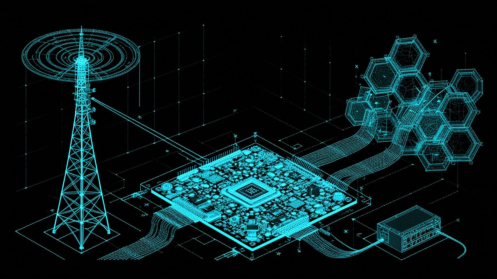

# IMSI Catchers: Government, Enterprise, and Adversary-Platforms

<!-- patch:status -->
> **Release status.** 34 pages · 3 verification block(s) outstanding · 0 hotlink(s) · images injected where anchored.
> `--check` is green only at zero outstanding and zero hotlinks.
<!-- /patch:status -->


**Reference, Field Guide, Build Manual, Category Study and Technical Annexes**

---

## About this edition

This is the complete edition. It consolidates five previously separate volumes into one numbered whole and extends them to the point where the three actor categories — **government and nation state**, **enterprise**, and **adversary** — are each treated as a subject in their own right: how they operate, what they buy, what it costs, what it is worth, how they fail, and how they are countered.

Nothing here is a product. It is a reference, and a build manual for the parts of the stack that can be built.

> **Structure.** Parts I–V correspond to the original volumes in order. Part VI is a visual reference. Part VII studies the three categories. Part VIII closes technical gaps. Part IX covers programme and operations. Part X is reference annexes. Part XI is forms and templates. Section numbering is continuous and stable; every cross-reference has been renumbered to match. Each part opens with its own subsection index.
>
> **What 2.0 adds over 1.1.** Badges, a banner, eighteen identification plates, eleven new parts' worth of material: category studies (Part VII), technical supplements covering 3G, ePDG and IMS, SS7 and Diameter, the SIM credential layer, SUCI profiles, baseband exploitation, cell broadcast abuse, timing-advance ranging, small-cell confusion, rogue Wi-Fi, NTN and 6G (Part VIII), programme and operations including RF safety incidents, environmental ratings, supply chain, reproducible builds, KPIs, governance, training, jurisdiction, data protection, retention, insurance and postmortems (Part IX), reference annexes with band tables, calculators, frame structures, link budgets, antenna fundamentals and sampling theory (Part X), and eight forms with a disclosure pack, expert-witness checklist and cross-examination bank (Part XI).
>
> **What it still is not.** Not a certification. Not type-approved. Not a substitute for a spectrum licence or legal advice. §105 states plainly what remains impossible.
>
> **Link caveat.** Vendor storefronts move, merge and go end-of-life. Where a product has moved to a parent company that is noted inline. Prices are indicative bands, not quotes. Every commercial catcher is quote-only. Links in Parts III, V, VII and VIII were compiled without web search and are marked where drift is likely — verify before relying on any of them in a procurement document.
>
> **Image caveat.** Part VI images are hotlinked from vendor, project and stock sites and are reproduced for identification and commentary. Provenance per plate, licensing consolidated in §138.3. Re-host anything you intend to redistribute.
>
> **Reading order.** Part I is the reference and defensive guide. Part VII is the category study — read §83 first if you want the map. Parts II–V are the build and engineering annexes; Part IV §49 is a complete one-day bootstrap, and you should read Part IV §35 before keying a transmitter anywhere public. Parts VIII–XI are read as needed, never end to end.

**Citation grading.** Every claim in this document carries a grade in the sense of §14.3. Vendor capability claims are **D** until reproduced. Widely repeated assertions with no primary source are **E** and are flagged as such. Anything you put in a procurement record should be re-verified to at least **B**.

---

*Version 2.4 · Page 1 of 34. Next page: Table of Contents.*

---
---

## Table of Contents
<style>
details.toc>summary{cursor:pointer;font-weight:600;padding:.2rem 0}details.toc details>summary{font-weight:400;padding-left:1rem}details.toc[open]>summary{margin-bottom:.35rem}</style>
<details class="toc">
<summary>Part I — Reference and Field Guide</summary>
1. [Executive Summary](#1-executive-summary)
2. [How IMSI Catchers Operate](#2-how-imsi-catchers-operate)
3. [Exhaustive Feature and Capability Catalogue](#3-exhaustive-feature-and-capability-catalogue)
4. [Vulnerable and Affected Devices](#4-vulnerable-and-affected-devices)
5. [Known Limitations and Constraints](#5-known-limitations-and-constraints)
6. [Common Myths and Misconceptions](#6-common-myths-and-misconceptions)
7. [Enterprise Defensive Field Guide](#7-enterprise-defensive-field-guide)
8. [4G and 5G Security Comparison](#8-4g-and-5g-security-comparison)
9. [Android Hardening Guide](#9-android-hardening-guide)
10. [iPhone Hardening Guide](#10-iphone-hardening-guide)
11. [Risk-Scoring Worksheet Template](#11-risk-scoring-worksheet-template)
12. [Anomaly Log Sheets](#12-anomaly-log-sheets)
13. [Privacy Travel Checklist](#13-privacy-travel-checklist)
14. [Glossary and Appendix](#14-glossary-and-appendix)
15. [References and Citations](#15-references-and-citations)

</details>
<details class="toc">
<summary>Part II — Hardware, Software and Build Guides</summary>
16. [How to Use This Volume](#16-how-to-use-this-volume)
17. [Shared Hardware Substrate](#17-shared-hardware-substrate)
18. [Hardware by Category](#18-hardware-by-category)
19. [Software by Category](#19-software-by-category)
20. [Repositories With Working Code](#20-repositories-with-working-code)
21. [Build Guide B — Bad Actor and DIY](#21-build-guide-b--bad-actor-and-diy)
22. [Build Guide E — Enterprise Passive Monitoring](#22-build-guide-e--enterprise-passive-monitoring)
23. [Build Guide G — Government and Nation State](#23-build-guide-g--government-and-nation-state)
24. [Capability and Budget Ladder](#24-capability-and-budget-ladder)
25. [Failure Modes and Calibration](#25-failure-modes-and-calibration)
26. [References](#26-references)

</details>
<details class="toc">
<summary>Part III — Site Survey, Core Handoff, Evidence Chain and Signalling Control</summary>
27. [Scope and the Gap Being Addressed](#27-scope-and-the-gap-being-addressed)
28. [Site Survey, Comprehensively](#28-site-survey-comprehensively)
29. [Handing a Session to a Real Core](#29-handing-a-session-to-a-real-core)
30. [CDR Generation and the Evidence Chain](#30-cdr-generation-and-the-evidence-chain)
31. [Signalling Parameters That Force Downgrade or Plaintext](#31-signalling-parameters-that-force-downgrade-or-plaintext)
32. [Gap Analysis: Commercial, FOSS, Internal](#32-gap-analysis-commercial-foss-internal)
33. [Internal Build Order](#33-internal-build-order)
34. [References](#34-references)

</details>
<details class="toc">
<summary>Part IV — Build Specification, With Numbers</summary>
35. [RF Exposure and Exclusion Zones](#35-rf-exposure-and-exclusion-zones)
36. [TX/RX Isolation and Desense](#36-txrx-isolation-and-desense)
37. [Power Architecture](#37-power-architecture)
38. [Thermal Design](#38-thermal-design)
39. [GNSS and Timing Integrity](#39-gnss-and-timing-integrity)
40. [Calibration and Measurement](#40-calibration-and-measurement)
41. [Host Hardening and Watchdog](#41-host-hardening-and-watchdog)
42. [Rig Security](#42-rig-security)
43. [Configuration Management and Version Pinning](#43-configuration-management-and-version-pinning)
44. [Acceptance Testing](#44-acceptance-testing)
45. [Ground Truth](#45-ground-truth)
46. [UE Fleet and SIM Tooling](#46-ue-fleet-and-sim-tooling)
47. [Documentation Deliverables](#47-documentation-deliverables)
48. [Licensing Checklist](#48-licensing-checklist)
49. [The One-Day Bootstrap Build](#49-the-one-day-bootstrap-build)

</details>
<details class="toc">
<summary>Part V — 4G/5G Observation Platform: Full Build Guide</summary>
50. [Design Goals and Non-Goals](#50-design-goals-and-non-goals)
51. [Architecture](#51-architecture)
52. [Hardware Selection](#52-hardware-selection)
53. [Software Base Selection](#53-software-base-selection)
54. [Base Build](#54-base-build)
55. [Radio Configuration](#55-radio-configuration)
56. [Stealth Layer](#56-stealth-layer)
57. [Decoding Pipeline](#57-decoding-pipeline)
58. [Data Model and Storage](#58-data-model-and-storage)
59. [API and GUI](#59-api-and-gui)
60. [Telemetry and Charts](#60-telemetry-and-charts)
61. [Carrier Profile System](#61-carrier-profile-system)
62. [Update and Plugin System](#62-update-and-plugin-system)
63. [Deployment Form Factors](#63-deployment-form-factors)
64. [Test and Validation](#64-test-and-validation)
65. [Cost Summary](#65-cost-summary)
66. [Honest Limits](#66-honest-limits)

</details>
<details class="toc">
<summary>Part VI — Visual Reference</summary>

</details>
<details class="toc">
<summary>Part VII — Category Deep Dives</summary>
83. [The Three Categories Compared](#83-the-three-categories-compared)
84. [Government and Nation-State Operations](#84-government-and-nation-state-operations)
85. [Government Procurement and Programme Shape](#85-government-procurement-and-programme-shape)
86. [Enterprise Business Case and Justification](#86-enterprise-business-case-and-justification)
87. [Enterprise Operating Model and SOC Integration](#87-enterprise-operating-model-and-soc-integration)
88. [Adversary Economics](#88-adversary-economics)
89. [Criminal Use Cases in Detail](#89-criminal-use-cases-in-detail)
90. [Adversary Counter-Forensics](#90-adversary-counter-forensics)
91. [Commercial Market Map and Pricing](#91-commercial-market-map-and-pricing)
92. [Public Programmes and Known Deployments](#92-public-programmes-and-known-deployments)

</details>
<details class="toc">
<summary>Part VIII — Technical Supplements</summary>
93. [3G and UMTS Specifics](#93-3g-and-umts-specifics)
94. [Wi-Fi Calling, ePDG and IMS](#94-wi-fi-calling-epdg-and-ims)
95. [SS7, Diameter and Core-Side Attacks](#95-ss7-diameter-and-core-side-attacks)
96. [The SIM, eSIM and Credential Layer](#96-the-sim-esim-and-credential-layer)
97. [SUCI Scheme Profiles in Detail](#97-suci-scheme-profiles-in-detail)
98. [Baseband Exploitation](#98-baseband-exploitation)
99. [Cell Broadcast and Public Warning Abuse](#99-cell-broadcast-and-public-warning-abuse)
100. [Timing Advance, Measurement Reports and Ranging](#100-timing-advance-measurement-reports-and-ranging)
101. [Small Cells, Femtocells and Repeaters: the Confusion](#101-small-cells-femtocells-and-repeaters-the-confusion)
102. [Rogue Wi-Fi and Captive Portal Interworking](#102-rogue-wi-fi-and-captive-portal-interworking)
103. [Non-Terrestrial Networks and Direct-to-Device](#103-non-terrestrial-networks-and-direct-to-device)
104. [6G and the Trajectory](#104-6g-and-the-trajectory)
105. [What Still Cannot Be Done](#105-what-still-cannot-be-done)

</details>
<details class="toc">
<summary>Part IX — Programme and Operations</summary>
106. [RF Safety Incidents and Emergency Procedures](#106-rf-safety-incidents-and-emergency-procedures)
107. [Environmental Ratings and Installation](#107-environmental-ratings-and-installation)
108. [Supply Chain and Component Provenance](#108-supply-chain-and-component-provenance)
109. [Reproducible Builds](#109-reproducible-builds)
110. [Programme KPIs and Metrics](#110-programme-kpis-and-metrics)
111. [Governance, RACI and Decision Rights](#111-governance-raci-and-decision-rights)
112. [Training Curriculum](#112-training-curriculum)
113. [Competence Assessment](#113-competence-assessment)
114. [Jurisdiction and Authority Matrix](#114-jurisdiction-and-authority-matrix)
115. [Data Protection and Minimisation](#115-data-protection-and-minimisation)
116. [Retention Matrix](#116-retention-matrix)
117. [Insurance, Liability and Complaints](#117-insurance-liability-and-complaints)
118. [Postmortems and Lessons Learned](#118-postmortems-and-lessons-learned)

</details>
<details class="toc">
<summary>Part X — Reference Annexes</summary>
119. [Band and Frequency Reference](#119-band-and-frequency-reference)
120. [ARFCN and EARFCN Calculators](#120-arfcn-and-earfcn-calculators)
121. [PLMN and MCC/MNC Reference](#121-plmn-and-mccmnc-reference)
122. [GSM Frame and Channel Structure](#122-gsm-frame-and-channel-structure)
123. [LTE and NR Frame Structure](#123-lte-and-nr-frame-structure)
124. [Link Budget and Range Estimation](#124-link-budget-and-range-estimation)
125. [Antenna Fundamentals](#125-antenna-fundamentals)
126. [Sampling, Nyquist and Filtering](#126-sampling-nyquist-and-filtering)
127. [Expanded Glossary](#127-expanded-glossary)
128. [FAQ and Troubleshooting Index](#128-faq-and-troubleshooting-index)

</details>
<details class="toc">
<summary>Part XI — Forms and Templates</summary>
129. [Site Survey Form](#129-site-survey-form)
130. [Key-Up Authorisation Form](#130-key-up-authorisation-form)
131. [Acceptance Certificate](#131-acceptance-certificate)
132. [Custody Transfer Form](#132-custody-transfer-form)
133. [RFQ and Evaluation Matrix](#133-rfq-and-evaluation-matrix)
134. [Redaction Procedure](#134-redaction-procedure)
135. [Disclosure Pack Contents](#135-disclosure-pack-contents)
136. [Expert Witness Checklist](#136-expert-witness-checklist)
137. [Cross-Examination Question Bank](#137-cross-examination-question-bank)
138. [Licence, Reuse and Credits](#138-licence-reuse-and-credits)

</details>

*Version 2.4 · Page 2 of 34. Next page: Document Map.*

---
---

## Document Map

| Part | Title | Function | Origin |
|---|---|---|---|
| **I** | Reference and Field Guide | Threat model, capability catalogue, hardening, logging, checklists | *IMSI Catchers: Government, Enterprise and Adversary Platforms* v1.1 |
| **II** | Hardware, Software and Build Guides | Component pools, vendor landscape, three build guides by actor tier | *Volume II* |
| **III** | Survey, Handoff, Evidence, Signalling | Survey method, core handoff architecture, chain of custody, signalling levers | *Volume III* |
| **IV** | Build Specification, With Numbers | Exposure, isolation, power, thermal, timing, hardening, acceptance | *Volume IV* |
| **V** | 4G/5G Observation Platform | Full platform build: hardware, software, stealth, decode, UI | *Volume V* |
| **VI** | Visual Reference | Eighteen identification plates with provenance | New in 1.1 |
| **VII** | Category Deep Dives | Government, enterprise and adversary as subjects: operations, procurement, economics, countermeasures | New in 2.0 |
| **VIII** | Technical Supplements | 3G, IMS, core signalling, SIM layer, SUCI, baseband, PWS, ranging, small cells, Wi-Fi, NTN, 6G | New in 2.0 |
| **IX** | Programme and Operations | Safety, environment, supply chain, reproducible builds, KPIs, governance, training, law, data protection, insurance, postmortems | New in 2.0 |
| **X** | Reference Annexes | Bands, calculators, frame structures, link budgets, antennas, sampling, glossary, FAQ | New in 2.0 |
| **XI** | Forms and Templates | Eight forms, RFQ, disclosure pack, expert witness, cross-examination | New in 2.0 |

**Which part do you need?**

| If you are… | Start at |
|---|---|
| A defender, traveller or security lead | Part I |
| Buying hardware or building a first rig | Part II §16, then §24, then Part VI |
| Running a deployment that must survive an evidential test | Part III §27–§30, then Part IV |
| Building the 4G/5G platform | Part V, with Part IV §35–§41 first |
| Answering "how much does this cost" | §24, then §65, then §91 |
| Understanding who does this and why | Part VII §83 |
| Closing a known gap in the stack | Part VIII |
| Standing up a programme | Part IX §110–§113 |
| Writing a spec, a form or a court bundle | Part XI |
| Looking for a number, a formula or a band | Part X |

---

## How to read the grading and confidence marks

Three separate marks appear throughout and are often confused.

| Mark | Meaning | Where defined |
|---|---|---|
| **A–E evidence grade** | How well supported a claim is | §14.3 |
| **T0–T3 travel tier** | Defender exposure banding | §7.2 |
| **Rung 0–6 capability ladder** | Build sophistication and cost | §24 |

An **A** claim with a **T3** tier and a **rung 2** rig is the ordinary shape of a competent small programme. An **E** claim dressed as a **T3** requirement is how programmes over-buy.

---
---

# Part I — Reference and Field Guide

**A technical reference, defensive field guide and assessment toolkit**

Part version 1.1 · Compiled 2026-11-13 · Scope: GSM through 5G SA

**Part I index**

<details class="toc">
<summary>Show sections</summary>

1. [Executive Summary](#1-executive-summary)
2. [How IMSI Catchers Operate](#2-how-imsi-catchers-operate)
3. [Exhaustive Feature and Capability Catalogue](#3-exhaustive-feature-and-capability-catalogue)
4. [Vulnerable and Affected Devices](#4-vulnerable-and-affected-devices)
5. [Known Limitations and Constraints](#5-known-limitations-and-constraints)
6. [Common Myths and Misconceptions](#6-common-myths-and-misconceptions)
7. [Enterprise Defensive Field Guide](#7-enterprise-defensive-field-guide)
8. [4G and 5G Security Comparison](#8-4g-and-5g-security-comparison)
9. [Android Hardening Guide](#9-android-hardening-guide)
10. [iPhone Hardening Guide](#10-iphone-hardening-guide)
11. [Risk-Scoring Worksheet Template](#11-risk-scoring-worksheet-template)
12. [Anomaly Log Sheets](#12-anomaly-log-sheets)
13. [Privacy Travel Checklist](#13-privacy-travel-checklist)
14. [Glossary and Appendix](#14-glossary-and-appendix)
15. [References and Citations](#15-references-and-citations)

</details>

---

## 1. Executive Summary

An IMSI catcher is a radio device that impersonates a mobile network base station in order to learn the permanent identities of nearby handsets, and in some configurations to intercept their traffic. The core weakness it exploits is architectural and decades old: in GSM, the network authenticates the subscriber but the subscriber never authenticates the network. That asymmetry means any transmitter speaking GSM convincingly enough can make a phone surrender its IMSI, IMEI and location, and can then carry its traffic in a cipher it already knows how to break.

Three things have changed the picture since 2020, and they cut in opposite directions.

First, capability has commoditised. What was a six-figure law-enforcement appliance in 2010 is now a software-defined radio stack, an open-source core and a laptop, for roughly the price of a mid-range phone. The barrier to a competent adversary is now skill, not capital.

Second, 5G introduced the Subscription Concealed Identifier (SUCI), which encrypts the permanent identity on the air interface. Where 5G Standalone is properly deployed with a real ECIES home-network key, passive identity harvesting largely stops working. This is genuine, structural progress.

Third, that progress is easily undone. SUCI is optional in configuration. Operators may run the null scheme, sending the SUPI in plaintext. Devices can be bidded down to LTE, 3G or 2G, none of which understand SUCI. Published work has demonstrated SUCI-catcher attacks that recover identity from the concealed value itself, and measurement studies have found the concealment simply not deployed on many live networks.

The practical conclusion for a defender is uncomfortable but clear. **You cannot make a phone immune. You can raise the cost, shrink the exposure window, and make the residue detectable.** Everything in the hardening sections is in service of those three things. 2G suppression removes the largest attack surface. Lockdown Mode on iOS and Advanced Protection on Android do it for you. Manual carrier selection and disciplined radio hygiene close the rest. Detection is heuristic and should be treated as corroboration, never proof.

For an enterprise, the deliverable is not a product. It is a baseline, a travel tier system, a set of SOC rules and an incident process that survives contact with a real event.

### 1.1 A short history, because the shape of the thing is historical

| Year | Event |
|---|---|
| 1990s | GSM deployed; no network authentication from the start |
| 1998 | A5/2 broken outright; A5/1 weakened by design |
| 2001–2005 | Academic catcher work; first commercial law-enforcement sales |
| 2008 | First sustained public reporting of US federal Stingray use |
| 2010–2012 | Harris Stingray fleet expands; NDAs become routine |
| 2012 | Osmocom, OpenBTS and cheap SDRs put a catcher under $2,000 |
| 2013 | Snowden disclosures reveal airborne and fixed-site programmes |
| 2014–2016 | A5/1 rainbow tables make 2G intercept trivial; first Android detection apps |
| 2017–2019 | LTE catchers appear; "downgrade forcing" documented |
| 2020 | 5G NSA arrives with no SUCI benefit; SUCI defined for SA |
| 2021–2023 | SUCI-catcher research; measurement studies find null scheme in the wild |
| 2024–2025 | Android adds network notifications and identifier-disclosure alerts; Apple ships Lockdown Mode 2G/3G suppression |
| 2026 | Android 16 AOSP controls; 2G sunsets accelerate in several markets |

The trajectory is not "solved." It is "the same problem at a higher layer, with a shrinking set of excuses for not configuring the mitigations."

### 1.2 The three categories, in one paragraph each

**Government and nation state.** Purpose-built appliances, spectrum authority, core integration, fusion with other collection. Operated by agencies and increasingly by local police, often under an NDA that limits what can be said in court. Budgets in the hundreds of thousands, procurement cycles in years, capability in the "everything at once, multi-RAT, amplified, airborne" range. Studied in §84–§85.

**Enterprise.** Passive-first, calibrated, rack or vehicle mounted, feeding a SIEM. Bought for continuous monitoring of a campus or a travelling executive pool, not for intercept. Budgets in the tens of thousands, procurement in weeks, capability in the "metadata and anomaly detection" range. Studied in §86–§87.

**Adversary.** Commodity SDR, open-source core, laptop, no licence. Bought or built for burglary reconnaissance, 2FA interception and mass harvesting. Budgets from $600, procurement in days, capability in the "harvest and hold" range. Studied in §88–§90.

The three share one substrate and diverge on power, timing, calibration and paperwork. That is the whole of the difference, and it is worth understanding before buying anything.

---

## 2. How IMSI Catchers Operate

### 2.1 The fundamental asymmetry

GSM (3GPP TS 43.020) authenticates the subscriber to the network using a challenge derived from the SIM's Ki. The handset is never given anything that proves the base station is genuine. A phone that hears a stronger, plausibly configured cell will attach to it and, in the process, disclose identity.

Later generations add network authentication — mutual authentication in UMTS and LTE, 5G-AKA in NR — but the identity disclosure problem survives in modified form, because the network must still resolve who the handset is before it can authenticate anyone.

### 2.2 Passive versus active

| Mode | Transmits? | Detectable by handset? | Typical use |
|---|---|---|---|
| **Passive monitor** | No | No | Baseline collection, calibration, corroboration |
| **Active catcher** | Yes | Yes, indirectly | Identity harvesting, interception, denial |
| **Hybrid** | Selectively | Partly | Silent harvesting with periodic active bursts |

Passive devices (Rohde & Schwarz TSMA/TSME class) are receive-only scanners. They see what the real network already broadcasts and what handsets emit, and they are essentially invisible. Active devices are the classic "Stingray" and are what most of this document addresses.

### 2.3 The GSM attach hijack, step by step

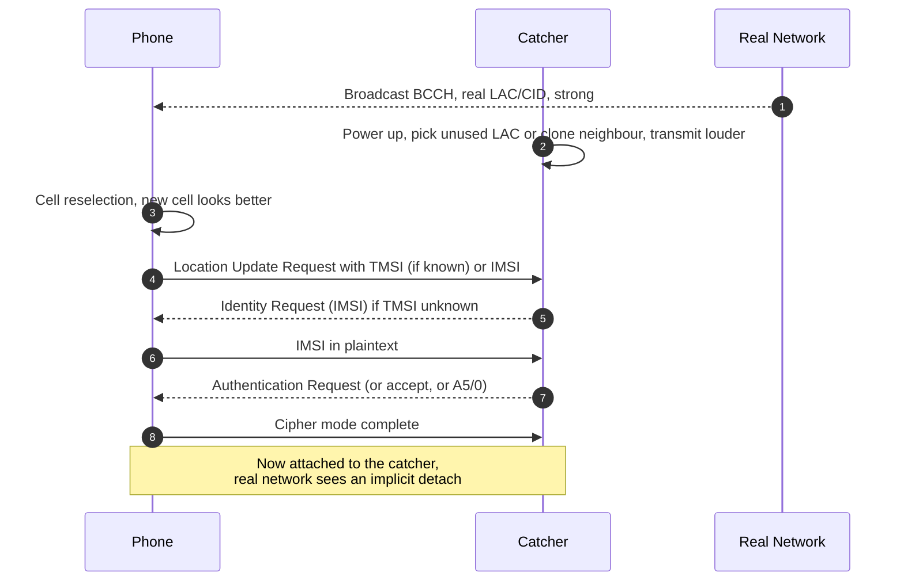

The critical steps are 3 through 7. Step 4 is where identity leaks. Step 7 is where the catcher chooses a cipher — frequently A5/0 (none) or A5/1, both of which it can handle.

### 2.4 Why the phone moves

A handset reselects when a candidate cell outranks the serving cell on the C1/C2 (GSM) or S-criteria (LTE/NR) ranking. Catchers manipulate this by transmitting at higher power, advertising a different Location Area Code so a Location Update is forced, and cloning a legitimate neighbour's parameters so the transition looks routine. Some implementations hold the handset by repeatedly forcing updates rather than letting it drift back.

C1 in GSM is `C1 = (A − P_max)` where A is the received level and `P_max` the maximum permitted transmit power; C2 adds the cell reselection offset and penalty time. A catcher sets the offset and zeroes the penalty so it wins the ranking immediately and keeps winning.

### 2.5 Identity acquisition techniques

| Technique | Mechanism | Counter |
|---|---|---|
| **Forced Location Update** | New LAC triggers update, IMSI disclosed | GUTI reuse, 5G SUCI |
| **Identity Request** | Direct IMSI/SUPI solicitation post-attach | None at 2G/3G/4G |
| **TMSI paging sweep** | Page all TMSIs, note who answers | Nothing practical |
| **Silent SMS (Type 0)** | Message with no user alert, delivery report confirms presence | None; monitor billing |
| **IMEI/IMEISV request** | Device fingerprint alongside identity | None |
| **KARMA-style response** | Answer any probe as if known | Manual network selection |
| **Downgrade forcing** | Advertise only 2G, or reject 4G attach | 2G suppression, Lockdown Mode |
| **Null-cipher forcing** | Negotiate A5/0 or LTE EEA0 | Android 14+ null-cipher block |
| **Measurement-report capture** | Serving cell reads neighbour RSRP/RSRQ, giving a position fix | Nothing practical |

### 2.6 Interception

Full interception is a 2G phenomenon. Once a handset is camped on a catcher with A5/0 or A5/1, voice and SMS are recoverable. A5/1 falls to precomputed rainbow tables in minutes; A5/2 is broken outright.

On LTE and 5G, a catcher generally gets metadata and identity, not plaintext, because it cannot complete mutual authentication convincingly without either relaying to the real network or accepting that the handset will notice. Where the catcher does hold a session, it can still observe which services are used, when, and how much.

### 2.7 The 5G twist

5G Standalone conceals the SUPI as a SUCI, ECIES-encrypted to the home network's public key. A catcher cannot read it. It therefore has three options: rely on null-scheme misconfiguration, mount a SUCI-catcher attack that correlates a captured SUCI against a known subscriber through repeated AKA, or bid the device down to a generation that does not conceal anything. All three are documented and field-demonstrated. §97 covers the scheme profiles in detail.

### 2.8 What a catcher is not

- **Not a TLS break.** It never touches your transport encryption.
- **Not a general wiretap.** On modern generations it is identity and metadata.
- **Not a jammer**, though it can deny service as a side effect.
- **Not a direction finder**, though DF is often paired with it.
- **Not invisible.** Every active catcher is a detectable anomaly by definition.

---

*Version 2.4 · Page 4 of 34. Next page: 3. Exhaustive Feature and Capability Catalogue.*

---
---

## 3. Exhaustive Feature and Capability Catalogue

<!-- patch:img:## 3. Exhaustive Feature and Capability Catalogue -->
<p class="plates">
<figure>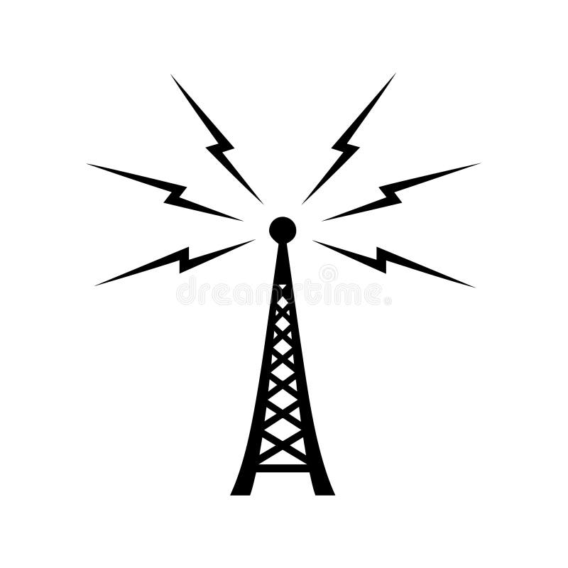<figcaption>Lattice tower — stock (stock)</figcaption></figure>
</p>
<!-- /patch:img -->


Organised by tier of actor. Real deployments mix tiers; a nation-state suite may include commodity components.

### 3.1 Radio and physical layer

| Capability | Notes |
|---|---|
| Multi-RAT transmit | GSM, UMTS, LTE, NR NSA/SA in one unit |
| Band coverage | 700 MHz through 3.5 GHz; low band gives range, mid band gives capacity |
| Software-defined radio core | USRP, LimeSDR, proprietary; retunable |
| Transmit power | 100 mW handheld to 20–50 W vehicle, plus amplifier |
| Antenna options | Omni, sectoral, directional, MIMO |
| GPS/GNSS disciplined clock | Required for timing alignment on LTE/NR |
| Channel and PCI/ARFCN control | Manual or automatic |
| Duplex modes | TDD and FDD |
| Simultaneous real-network monitoring | Second radio for relay and comparison |

### 3.2 Identity and collection

| Capability | Tier |
|---|---|
| IMSI capture | All |
| IMEI / IMEISV capture | All |
| TMSI / GUTI capture | All |
| SUPI / SUCI capture | Government and above |
| MSISDN correlation via HLR/SS7 lookup | Government, enterprise |
| Silent SMS confirmation | Government, enterprise |
| Bulk passive collection with no transmit | Government |
| Per-IMSI targeting lists (allow/deny) | Enterprise and above |
| "Camp on demand" for a named subscriber | Government |
| Long-dwell presence tracking | Government |
| Handover-graph construction | Nation state |
| Cell-ID-to-geography mapping | All |

### 3.3 Interception and service manipulation

| Capability | Tier |
|---|---|
| 2G voice intercept | Government and above |
| 2G SMS intercept | Government and above |
| Metadata and CDR generation | All |
| Forced downgrade to 2G | All |
| Forced downgrade to LTE from NR | Government |
| Null-cipher negotiation | All |
| Denial of service / jamming adjunct | Government |
| Deny-attach to selected IMSIs | Enterprise and above |
| Call/SMS redirection to attacker media | Government |
| VoLTE relay or break-out | Advanced government |
| 5G SUCI capture with null-scheme fallback | Nation state |
| SUCI-cracker correlation | Nation state, research |
| Baseband exploit delivery | Nation state |
| Rogue Wi-Fi interworking (ePDG) | Nation state |

### 3.4 Deployment form factors

| Form | Typical operator |
|---|---|
| Handheld / briefcase | Field surveillance, entry teams |
| Manpack | Dismounted military |
| Vehicle covert (mag-mount) | Mobile tracking |
| Aircraft ("dirtbox") | Nation state, wide-area |
| Fixed indoor | Embassy, office, conference centre |
| Maritime | Coastal, port |
| Drone | Short dwell, high angle |
| Deployable mast | Event security |
| Permanently installed | Critical infrastructure, border |

### 3.5 Management and integration

| Capability | Notes |
|---|---|
| Local GUI on ruggedised laptop | Baseline |
| Remote/cloud C2 | Enterprise and above |
| Multi-unit mesh coordination | Nation state |
| Fusion with SIGINT/OSINT platforms | Nation state |
| Lawful-intercept handoff to core | Nation state, carrier-grade |
| Automatic report generation | Enterprise and above |
| IMSI-to-name resolution | Via HLR/HSS or commercial broker |
| Retention and pattern-of-life analytics | Nation state |

### 3.6 Nation-state programmes (publicly reported)

| Programme / actor | Reported shape |
|---|---|
| **US, NSA** | Airborne GSM collection; "Tactical Edge" and "SEA MAVEN" lineage; fixed sites at diplomatic premises |
| **US, DOJ/FBI** | Dirtbox airborne deployment; Stingray fleet with Harris |
| **US, CBP** | Border-zone fixed and mobile collection |
| **UK, GCHQ** | Fixed and mobile, integrated with passive SIGINT |
| **Israel, Unit 8200 lineage** | Vendor ecosystem origin; KingFish and Hailstorm families |
| **China, MSS** | Dense fixed deployment, border and urban |
| **Russia** | Fixed urban, mobile, aggressive 2G retention |
| **France, DGSE** | Fixed diplomatic and mobile |
| **Germany, BND/BfV** | Domestic mobile, IMSI use in investigations |

### 3.7 Bad-actor tier

| Capability | Cost band |
|---|---|
| SDR + OpenBTS/YateBTS/srsRAN + laptop | ~$1,000–3,000 |
| srsRAN + USRP B210, 2G/4G lab stack | ~$2,000 |
| Osmocom GSM stack, LimeSDR | ~$600 |
| Commercial low-end (Septier LightRay class) | ~$20,000–60,000 |
| Commodity IMSI-only catcher, grey market | ~$5,000–30,000 |

Criminal use cases concentrate on: identifying which phones are present in a building before a burglary, correlating a target's IMSI to intercept 2FA by SMS, and mass harvesting for later SS7 query. The 2G-only, short-dwell, low-effort deployment is the realistic criminal baseline.

### 3.8 Representative vendor landscape

L3Harris (Stingray II, KingFish, Hailstorm, Crossbow) · Parsons/DRT · Septier (IBS, Interceptor) · Rohde & Schwarz (TSMA/TSME, QualiPoc) · Keysight · Anritsu · CommScope · CellXion · PKI · Airspan · BLiNQ · Sunwave · Klas Telecom · Nokia · Cisco.

Full commercial map, price bands and procurement behaviour in §91.

---

## 4. Vulnerable and Affected Devices

<!-- patch:img:## 4. Vulnerable and Affected Devices -->
<p class="plates">
<figure>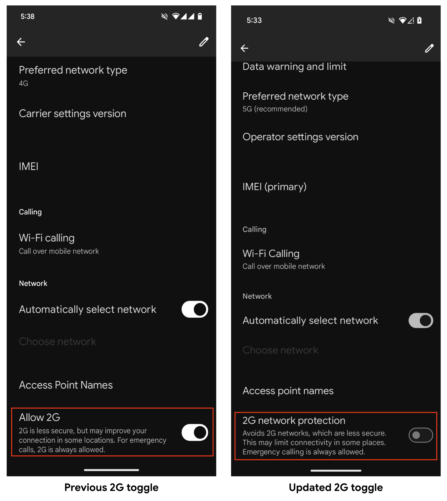<figcaption>Android 2G toggle — AOSP (project)</figcaption></figure>
</p>
<!-- /patch:img -->


The honest answer is: every device with a cellular radio. What varies is exposure.

### 4.1 Highest exposure

| Class | Why |
|---|---|
| 2G-only handsets and feature phones | No mutual auth, no SUCI, plaintext identity |
| Devices with 2G fallback enabled | Downgrade path always open |
| Android below 12 | No modem-level 2G suppression |
| Android 12–15 without OEM implementation | Toggle absent or non-functional |
| iPhones without Lockdown Mode | 2G/3G fallback active |
| IoT, telematics, smart meters, PoS terminals | Often 2G/3G Cat-M, no toggles, years behind on patching |
| Medical and industrial cellular modems | Long lifecycle, no hardening surface |
| eSIM-only devices | Still vulnerable; eSIM changes nothing at the air interface |
| Devices with stale baseband firmware | Known baseband CVEs |
| Devices with VoLTE disabled | Forces circuit-switched fallback to 2G/3G |
| Dual-SIM handsets | Two identities, two attack surfaces |

### 4.2 Reduced exposure

| Class | Why |
|---|---|
| Android 16+ devices with IRadio HAL 3.0 | Network notifications, identifier-disclosure alerts, Mobile network security page |
| Pixel 10 and later | Ships with the full feature set |
| iOS 16+ with Lockdown Mode enabled | 2G and 3G off at the OS level |
| 5G SA-only with SUCI and a real home key | Identity concealed on the air interface |
| Devices with 2G network protection on | Largest surface closed |

### 4.3 Device properties that change the picture

- **Baseband vendor.** Qualcomm modems expose diagnostic interfaces that SnoopSnitch can read; Exynos and MediaTek largely do not. Detection capability is Qualcomm-plus-root, effectively.
- **Android Requirements Freeze.** Devices launched under GRF keep their launch HAL version, so a 2024 handset will not gain Android 16 network notifications by updating.
- **Carrier configuration.** The same handset may expose or hide the 2G toggle depending on the carrier profile pushed to it.
- **eSIM provisioning windows.** The bootstrap profile install is a distinct, brief exposure point.
- **Firmware age.** Baseband CVEs are patched in monthly builds; a deferred update is an open door (§98).
- **Charging and accessory ports.** Wired accessory access is a baseband-adjacent path, which is why Lockdown Mode restricts it.

### 4.4 The classes nobody hardens

| Class | Problem | Realistic mitigation |
|---|---|---|
| Vehicle telematics | Hard-wired, always on, 2G/3G, no UI | Ask the fleet provider; replace units at end of contract |
| Smart meters and AMI | Decade lifecycle, no toggles | Carrier-side 2G barring on the SIM estate |
| PoS and payment terminals | PCI scope, 2G fallback, shared SIMs | Carrier barring, PIN pad physical control |
| Medical implants and monitors | Cannot be reconfigured | Nothing; accept and document |
| Industrial RTUs | Often 2G/3G, exposed management | VPN behind the modem, 2G barring |
| Alarm signalling paths | 2G/3G primary, easy to deny | Dual-path with IP, test monthly |

### 4.5 Device register fields

Whatever the class, the register carries: asset tag, model, baseband vendor, OS build, patch level, carrier profile version, 2G state, VoLTE state, Lockdown/Advanced Protection state, baseline cells, and last review date. Without the register, none of §7.5 is implementable.

---
---

## 5. Known Limitations and Constraints

Stated plainly, because overestimating a catcher is as damaging as underestimating one.

### 5.1 Technical

| Limitation | Detail |
|---|---|
| **Range** | Handheld tens to low hundreds of metres; vehicle up to 1–2 km in rural low band; airborne much wider but weaker per-user |
| **Capacity** | A 2G catcher saturates quickly; hundreds of handsets in a dense area cause rejects and churn |
| **Throughput** | 2G user plane is a trickle; large transfers stall or fail |
| **4G/5G plaintext** | Generally metadata only; user plane needs relay or core access |
| **Mutual authentication** | LTE/NR handsets can notice a catcher that cannot authenticate |
| **Timing** | LTE/NR require GPS-disciplined sync; a sloppy clock makes the cell look wrong |
| **Interference** | A catcher degrades the real network in its footprint; users notice |
| **Spectrum** | Transmit authority varies by jurisdiction; band choice constrained |
| **Power** | Vehicle and manpack installs need substantial battery or generator |
| **No persistence** | Passive collection cannot follow a moving target beyond range |
| **Detection of the detector** | Active units are themselves findable by drive-test and by handsets |
| **SUCI** | Defeats naive 5G identity harvesting outright |
| **Null scheme** | Operators may disable concealment, handing identity back |
| **Downgrade dependency** | Most useful attacks require the target to accept a lower generation |

### 5.2 Operational and legal

- Deployment requires spectrum authorisation or a cooperative carrier in most jurisdictions.
- Evidence admissibility varies; US practice frequently involves NDAs with the vendor that complicate disclosure in court.
- Metadata without content is often enough for a warrant application but not for a prosecution.
- A catcher in a busy area collects thousands of non-targets, which raises retention and minimisation questions.
- Vendor lock-in and closed firmware mean an operator may not know what their own box does.
- Power and antenna work at height introduces its own safety and access regime.

### 5.3 Defender-side limitations

- Detection apps are heuristic. A clean report is not proof of absence.
- Qualcomm baseband plus root is a hard prerequisite for the best tools.
- Android's own notifications fire on legitimate behaviour too; every post-airplane-mode reattach requests identity.
- No consumer phone reports "this tower is fake" as a definitive verdict, because it cannot know.
- Lockdown Mode and 2G suppression cost coverage in rural areas and can break roaming.
- The mitigations protect identity and metadata, not a compromised app or a served exploit.

### 5.4 What the limitations mean together

Add them up and the honest position is: a catcher is a **short-range, capacity-limited, timing-sensitive, detectable identity harvester** with a narrow content capability confined to 2G. That is enough to be very useful to a surveillance operator and not enough to be a wiretap. Plan against the useful part.

---

## 6. Common Myths and Misconceptions

| Myth | Reality |
|---|---|
| "A catcher reads all your texts and calls" | On 2G, yes. On LTE/5G, mostly metadata. WhatsApp, Signal and iMessage content stays encrypted end to end regardless |
| "Airplane mode protects you" | Only while it is on. The moment you disable it you attach, and if a catcher is present it is first in the queue |
| "A VPN protects against IMSI catchers" | No. A VPN sits above the radio and hides payload destination, not identity or tower association |
| "5G is immune" | No. Null-scheme misconfiguration, SUCI-cracker correlation and downgrade all work |
| "They are only used by spies and the FBI" | Commodity SDR stacks put a working catcher under $2,000 |
| "SS7 attacks and IMSI catchers are the same thing" | Different layers. SS7 is core signalling abuse from a distance; a catcher is a local radio impersonation |
| "You can reliably detect one with an app" | Detection is anomaly heuristics with meaningful false positive and negative rates |
| "Turning off 2G makes you safe" | It removes the biggest hole. It does nothing about 4G/5G identity requests |
| "A catcher decrypts TLS" | No. It never touches your TLS session |
| "IMSI catcher means full wiretap" | Identity and metadata, and on 2G content. Not a general intercept of encrypted app traffic |
| "Detection apps work on any phone" | Qualcomm baseband and root, in practice |
| "Every silent SMS is an attack" | Carriers use Type 0 SMS legitimately for provisioning and voicemail indication |
| "eSIM protects you" | The air interface is unchanged |
| "Changing your IMEI helps" | Marginally. The IMSI is the identifier that matters |
| "The catcher has to be within a few metres" | Up to a couple of kilometres in low band, rural, vehicle-mounted |
| "A warning triangle or 'G' icon means a catcher" | It means 2G. That is a hint, not a verdict |
| "Vendors publish what their boxes do" | Frequently not. Capability claims outrun documentation |
| "You can sue your way out of it" | In the US, vendor NDAs have repeatedly been used to limit disclosure |
| "A small cell on a lamppost is a catcher" | Usually not. §101 covers how to tell them apart |
| "Cell ID changes mean you are being tracked" | Cells change constantly. Only the pattern matters |
| "Turning the phone off protects you" | Only while off. Power-on attach is the exposure point, and the IMEI is fixed |
| "A Faraday bag makes you invisible" | It makes you unreachable. The moment you open it you attach again |
| "Catchers need a warrant everywhere" | Jurisdiction-dependent, and the answer is frequently no for metadata |
| "Removing the SIM stops it" | The IMEI still attaches on emergency calls, and eSIM has no removable card |
| "The carrier can tell you if one is active" | Rarely in real time. Carriers can confirm cell IDs after the fact |
| "Newer phone, newer generation, safer" | Only if 2G is off and the baseband is patched |

### 6.1 Why these myths persist

Each one contains a fragment of truth from a specific generation or configuration, generalised until it is wrong. "Airplane mode protects you" was near-true for a phone left in airplane mode. "A catcher reads your texts" was true on 2G. The generalisation is what fails.

The correction habit is mechanical: ask **which generation**, **which configuration**, and **whether the mitigation is applied**. Almost every myth collapses on one of those three.

---
---

## 7. Enterprise Defensive Field Guide

### 7.1 Governance

| Control | Owner | Cadence |
|---|---|---|
| Cellular threat model in the security architecture doc | CISO | Annual |
| Travel risk tiers mapped to device configurations | Security ops | Quarterly |
| Device baseline in MDM compliance policy | Endpoint | Continuous |
| Vendor due diligence for any cellular hardware | Procurement | Per acquisition |
| Legal review of collection and retention | Legal | Annual |
| Incident playbook with a named commander | IR lead | Annual test |

### 7.2 Device baseline (enforced via MDM)

```text
[ ] OS within two minor versions, auto-update forced
[ ] 2G network protection ON (Android 12+, where exposed)
[ ] Advanced Protection ON (Android 16+)
[ ] Network notifications ON (Android 16+, IRadio HAL 3.0)
[ ] Lockdown Mode ON for tier-1 and tier-2 travellers (iOS 16+)
[ ] Wi-Fi auto-join OFF, "ask to join" OFF
[ ] Manual carrier selection for tier-1 travel
[ ] Private DNS / DNS-over-TLS forced
[ ] Screen lock 6+ digits, biometrics allowed, USB accessory restriction ON
[ ] Baseband patch level tracked as a separate compliance item
[ ] Non-approved catcher-detection apps blocked
```

### 7.3 Travel tiers

| Tier | Profile | Configuration |
|---|---|---|
| **T0 Home** | Domestic, known carrier | Baseline only |
| **T1 Elevated** | Conference, protest, court, competitor-adjacent | Lockdown/Advanced Protection, 2G off, manual carrier |
| **T2 Hostile** | Known-state-surveillance country, border crossing | T1 plus burner handset, no corporate SIM in primary device, comms plan |
| **T3 Contested** | Active conflict, detention risk | T2 plus minimal-data device, pre-agreed silence schedule, remote wipe armed |

### 7.4 SOC detection rules

Treat all of these as corroboration, not alerts.

| Rule | Signal | Weight |
|---|---|---|
| R-01 | Cipher drops from encrypted to null mid-session | High |
| R-02 | RAT downgrade NR→LTE→2G with no coverage justification | High |
| R-03 | Repeated identity requests inside one session | Medium |
| R-04 | LAC/TAC change with no geographic movement | High |
| R-05 | Cell ID present in one location, absent twenty minutes later | Medium |
| R-06 | Signal strength jumps >20 dB with no movement | Medium |
| R-07 | Attach storms across a fleet in one geofence | High |
| R-08 | Silent SMS cluster in billing records | Low |
| R-09 | Emergency-only service while neighbours have full bars | Medium |
| R-10 | Roaming onto a network not in the approved list | High |

### 7.5 Incident response

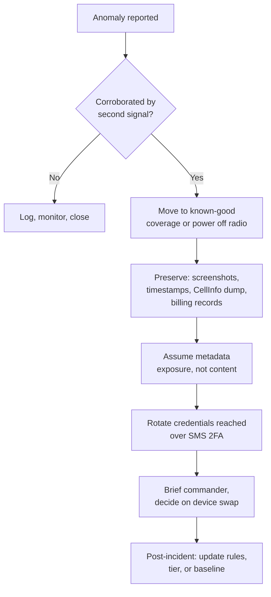

### 7.6 What to tell staff, in one paragraph

Your phone shouts its identity to whatever tower is loudest. A fake tower is just a louder tower. We turn off the oldest, weakest radio standard, we keep the OS current, and on high-risk trips we use a configuration that refuses the old standard entirely. If the phone ever drops to 2G in a city, that is worth a message to the SOC. Nothing you send over Signal or WhatsApp gets read. Your location and who you called does.

### 7.7 Metrics that matter

Percentage of fleet compliant with baseline · median days to baseband patch · tier-1 travellers with Lockdown Mode · anomalies per 100 device-days by country · false-positive rate per rule · mean time to corroboration.

---

## 8. 4G and 5G Security Comparison

| Property | GSM | UMTS | LTE | 5G SA |
|---|---|---|---|---|
| Network authentication | **None** | Yes (AUTN) | Yes (AUTN) | Yes (5G-AKA) |
| Subscriber authentication | A3/A8 | Milenage | Milenage | 5G-AKA |
| Identity on air | **IMSI plaintext** | IMSI/TMSI, plaintext IMSI on request | IMSI plaintext on request | **SUCI, ECIES-concealed** |
| Identity concealment mandatory | No | No | No | Optional in config, **null scheme possible** |
| Cipher | A5/0, A5/1, A5/2, A5/3 | UEA1/UEA2 | EEA0/1/2/3 | NEA0/1/2/3 |
| Null cipher available | Yes (A5/0) | Yes (UEA0) | Yes (EEA0) | Yes (NEA0) |
| Integrity protection | No | Yes (UIA) | Yes (EIA) | Yes (NIA) |
| User-plane integrity | No | No | No | **Yes (optional, NIA)** |
| Known cipher break | A5/1 rainbow tables, A5/2 broken | KASUMI weakened | Sound | Sound |
| Downgrade resistance | N/A (bottom) | Low | Low | **Low** |
| Typical catcher outcome | Full identity + voice + SMS | Identity + metadata | Identity + metadata | Identity only via misconfig or crack |
| Handset can notice a fake | No | Partly | Partly | Partly |
| Practical defender control | Disable 2G | Disable 3G | Null-cipher block | SUCI assurance, 2G/3G off |

### Reading the table

The generational story is real: identity concealment, mutual authentication, integrity protection and, in 5G, user-plane integrity are all genuine gains. The story is also incomplete in three specific ways.

**Null ciphers remain legal in every generation.** A catcher that negotiates EEA0 gets a plaintext LTE session. Android 14 added the ability to refuse null ciphers; iOS does not expose an equivalent.

**Downgrade is not defended by any generation.** Nothing in the standard stops an attacker from advertising only 2G. The defence is policy, not protocol — turn the old generations off.

**SUCI is optional and often absent.** Chlosta et al. showed the attack works; later measurement work found concealment frequently not deployed. A network running null-scheme 5G is barely better than LTE for identity.

**NSA is not SA.** In 5G Non-Standalone the control plane anchors on LTE, so SUCI may not apply at all on the anchor leg.

---
---

## 9. Android Hardening Guide

<!-- patch:img:## 9. Android Hardening Guide -->
<p class="plates">
<figure><figcaption>Android 2G toggle — AOSP (project)</figcaption></figure>
<figure>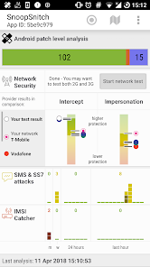<figcaption>SnoopSnitch — Google Play (vendor)</figcaption></figure>
</p>
<!-- /patch:img -->


Ordered by effect, highest first. The first two items do most of the work.

### 9.1 Android 16+: Advanced Protection and the 2G toggle

Settings → Security & privacy → Advanced Protection. Enabling it turns on network notifications, identifier-disclosure alerts and the Mobile network security page, and it is the intended home for the 2G toggle.

Settings → Network & internet → SIMs → (SIM) → **Allow 2G** → off.

**Verify.** Airplane mode off in a known 4G area, watch the status bar. If "G" or "E" appears, the toggle did not take — check the carrier profile and the OEM build.

The Mobile network security page reports the serving cell, cipher state and alert history. Screenshot it during any incident; it is the closest thing Android has to an evidence view.

### 9.2 Android 12–15: OEM toggles

The toggle exists on most OEM builds from 12 onward at varying paths, and is absent or cosmetic on some carrier profiles.

| OEM | Path |
|---|---|
| Pixel | Settings → Network & internet → SIMs → Allow 2G |
| Samsung | Settings → Connections → Mobile networks → Network mode |
| Xiaomi | Settings → SIM → Mobile networks → Prefer 2G |
| Others | Search settings for "2G" |

### 9.3 Below Android 12

No native control. Options, in order:

1. **Carrier-side 2G barring.** Ask the operator to bar 2G on the line. Persistent, survives everything, but breaks rural fallback.
2. **Network mode lock** to LTE/WCDMA only where the OEM exposes it.
3. **Detection app** — SnoopSnitch (§9.6) for awareness, not prevention.

### 9.4 Modem and baseband

- **Null cipher blocking.** Android 14+ can refuse A5/0 and EEA0. Enabled by default from 14; verify it has not been disabled.
- **Baseband updates.** Monthly. Deferred updates are the commonest real-world exposure.
- **Diagnostic mode.** `*#*#717717#*#*` on some OEMs exposes baseband logs; full use needs root.
- **Do not flash third-party basebands** on a device used for evidence.

### 9.5 App hygiene

- Signal: enable **registration lock**.
- **TOTP or passkey over SMS 2FA**, everywhere.
- **Verify safety numbers** out of band for high-value contacts.
- **Restrict background network access** for apps that do not need it.
- **Disable "scan for nearby devices"** when not in use; it is another radio.
- **Play Integrity** where the app supports it.

### 9.6 Detection tooling

| Tool | Needs | Strength | Weakness |
|---|---|---|---|
| SnoopSnitch | Qualcomm, root | Baseband-level scoring, silent SMS detection | False positives on legitimate reattach |
| NetMonster | Nothing | Cell logging, baseline building | No verdicts |
| Cell Spy Catcher | Nothing | RAT transition log | Dated |
| Tower Collector / GNetTrack | Nothing | Crowd map of what should be there | Not real time |

Treat output as corroboration. The reliable pattern is: tool flags → you walk out of the footprint → the flag clears → you log it.

### 9.7 New-device baseline procedure

1. Patch to current, then verify patch date.
2. Advanced Protection on (16+) or 2G off (12–15).
3. Confirm the toggle held.
4. Install NetMonster, record home and office cells.
5. If rooted Qualcomm, install SnoopSnitch, run 24 h passive.
6. Enter in the register (§4.5).
7. Re-baseline after any T1+ travel.

---

## 10. iPhone Hardening Guide

<!-- patch:img:## 10. iPhone Hardening Guide -->
<p class="plates">
<figure><figcaption>Signal — Google Play (vendor)</figcaption></figure>
</p>
<!-- /patch:img -->


iOS has fewer controls and a stronger single one. Lockdown Mode is the whole of it.

### 10.1 Lockdown Mode

Settings → Privacy & Security → Lockdown Mode → Turn On → restart.

What it does that matters:

- **Disables 2G and 3G** at the OS level. This is the largest single reduction available on any consumer device.
- **Blocks unknown FaceTime callers** and most message attachment types.
- **Restricts wired accessories**, closing cable-based paths.
- **Reduces Safari and WebKit attack surface**, which is the usual baseband-adjacent entry.

What it does not do: stop LTE/5G identity requests, prevent LTE downgrade, or provide any detection.

### 10.2 Coverage cost

Lockdown Mode makes the phone a paperweight in 2G/3G-only areas. Policy it by tier: mandatory T2–T3, recommended T1, optional T0, and warn about the coverage trade explicitly.

### 10.3 Other controls

- **Manual carrier selection:** Settings → Cellular → Network Selection → Automatic off.
- **VoLTE on:** Settings → Cellular → Cellular Data Options → Voice & Data.
- **Wi-Fi Calling off** on untrusted networks.
- **Wi-Fi Assist off** to reduce churn.
- **SMS 2FA reduced** in favour of passkeys or TOTP.
- **iOS current**, baseband fixes included in point releases.

### 10.4 Detection on iOS

There is no SnoopSnitch equivalent, because there is no diagnostic baseband access.

- **Field Test Mode** (`*3001#12345#*`): serving cell, RAT, band, neighbours. Awkward but real.
- **Third-party cell loggers** can record what the OS exposes, nothing more.
- **Carrier settings version** changes indicate a profile push; log them.

The workflow is manual: watch the RAT indicator, record Field Test values, walk out, re-check.

### 10.5 Register fields for iOS

Model, iOS build, Lockdown Mode state, carrier settings version, baseline cells, last review. Same cadence as Android.

---

## 11. Risk-Scoring Worksheet Template

Score 0–3, multiply by weight, sum. Per trip or per site.

| # | Factor | Weight | 0 | 1 | 2 | 3 |
|---|---|---|---|---|---|---|
| 1 | Jurisdiction hostility | 3 | Allied, stable | Allied, mixed | Contested | Adversarial |
| 2 | Border crossing | 3 | None | Air, low traffic | Air, high scrutiny | Land, hostile |
| 3 | Known catcher deployment | 3 | None reported | Occasional | Regular | Documented programme |
| 4 | Device generation | 2 | 5G SA, Android 16+ | 5G NSA, modern | LTE, modern | 2G fallback only |
| 5 | OS currency | 2 | Current | One cycle behind | Two cycles | Unpatched |
| 6 | Carrier SUCI/SA status | 2 | SA, SUCI, real key | SA, partial | NSA only | 2G-heavy |
| 7 | Data sensitivity | 3 | Public | Internal | Confidential | Regulated / source-protecting |
| 8 | Personnel profile | 2 | Anonymous | Named, low profile | Named, public role | High-profile target |
| 9 | Dwell time | 1 | <1 day | Days | Weeks | Permanent |
| 10 | Prior incidents | 2 | None | Isolated | Recurring | Confirmed targeting |
| 11 | Coverage need | 1 | Wi-Fi only | Urban only | Mixed | Rural / remote |
| 12 | Counter-surveillance skill | 2 | None | Basic | Trained | Dedicated team |

**Bands.** 0–20 low (T0). 21–40 moderate (T1). 41–60 elevated (T2). 61+ high (T3).

**Overrides.** Any 3 on items 1, 3, 7 or 10 raises the band one level. Item 8 at 3 with item 3 at 2 or more sets T3 outright.

**Notes.** Score before booking, re-score on itinerary change, record on the authorisation. A low score with a confirmed incident still escalates.

---
---

## 12. Anomaly Log Sheets

### 12.1 Daily log

| Time | Location | RAT | Cell ID / TAC | LAC change | Signal | Cipher | Identity req | Silent SMS | Note | Code |
|---|---|---|---|---|---|---|---|---|---|---|
| | | | | | | | | | | |
| | | | | | | | | | | |
| | | | | | | | | | | |
| | | | | | | | | | | |

**Field definitions**

- **RAT** — 5G NR, LTE, 3G, 2G, or No Service
- **Cell ID / TAC** — from Field Test or `*#*#4636#*#*`; screenshot if lengthy
- **Cipher** — Encrypted / Null / Unknown
- **Identity req** — Y if the OS notified an identifier request
- **Signal** — bars, or dBm if available
- **Code** — see 12.2

### 12.2 Anomaly codes

| Code | Meaning | Weight |
|---|---|---|
| A1 | Cipher dropped to null | High |
| A2 | Downgrade with no coverage cause | High |
| A3 | LAC/TAC change without movement | High |
| A4 | Repeated identity requests, same session | Medium |
| A5 | Signal jump >20 dB stationary | Medium |
| A6 | Cell ID vanished, then returned elsewhere | Medium |
| A7 | Silent SMS received | Low |
| A8 | Emergency-only service, neighbours fine | Medium |
| A9 | Roamed onto unapproved network | High |
| A10 | Carrier selection reset itself | Low |

### 12.3 Escalation matrix

| Codes in one hour | Interpretation | Action |
|---|---|---|
| One Low | Normal variance | Log only |
| Two Medium | Possible | Corroborate, screenshot |
| One High | Probable | Move or power off, preserve evidence, notify SOC |
| Any High + any Medium | Likely | Full incident procedure |
| Three High | Strongly indicated | Assume collection, rotate SMS-2FA credentials |

### 12.4 Evidence capture

Photograph the screen with a visible clock. Dump CellInfo if you have adb:

```bash
adb shell dumpsys telephony.registry > cellinfo.txt
adb shell dumpsys wifi >> cellinfo.txt
```

Record in UTC. Note whether the device was stationary. Preserve the billing record export — the carrier's own log is independent corroboration and is often the only artefact that survives.

---

## 13. Privacy Travel Checklist

### Before departure

```text
[ ] Risk score completed, band recorded
[ ] OS fully updated, baseband patch confirmed
[ ] Lockdown Mode / Advanced Protection ON if band >= High
[ ] 2G network protection ON
[ ] Network notifications ON where available
[ ] Wi-Fi auto-join OFF
[ ] Manual carrier selection enabled
[ ] Private DNS set
[ ] SMS 2FA migrated to TOTP or hardware key
[ ] Backup verified, remote wipe armed and tested
[ ] Burner handset prepared if band >= Severe
[ ] Comms plan and silence schedule agreed
[ ] Local SIM / eSIM decision made
[ ] Sensitive files moved off primary device
```

### In country

```text
[ ] Manual carrier re-selected after landing
[ ] Anomaly log started, UTC
[ ] Public Wi-Fi joined only deliberately, VPN on
[ ] Bluetooth off when not in use
[ ] Phone face-down and screen-locked in meetings
[ ] USB data blocker used at charging kiosks
[ ] Charged above 50% before any movement
[ ] Border crossings: expect and log a forced downgrade
[ ] Detention scenario: know the wipe gesture cold
```

### On return

```text
[ ] Full anomaly log exported and filed
[ ] Billing records pulled and attached
[ ] Any High code reviewed with SOC
[ ] SMS-2FA credentials rotated if indicated
[ ] Device considered for re-image if band was Critical
[ ] Burner wiped and retired
[ ] Debrief note written
[ ] Rules or tier updated from what was learned
```

### Border-specific notes

Expect a period of no service or 2G while the handset re-registers. A catcher at a border is unremarkable; that is precisely why it is used there. Do not unlock for an official who asks — hand over an unlocked secondary if you have one. Assume anything on the primary device is readable during a physical inspection.

---

## 14. Glossary and Appendix

| Term | Definition |
|---|---|
| **A5/0, A5/1, A5/2, A5/3** | GSM cipher suite; A5/0 is none, A5/1 falls to rainbow tables, A5/2 broken outright, A5/3 sound |
| **AKA** | Authentication and Key Agreement; mutual auth protocol in UMTS/LTE/5G |
| **AMF** | 5G Access and Mobility Management Function |
| **ARFCN** | Absolute radio frequency channel number |
| **BCCH** | Broadcast Control Channel, carries cell identity and parameters |
| **Bidding down** | Advertising only a lower generation to force fallback |
| **Catcher** | Colloquial for active IMSI catcher |
| **CDR** | Call Detail Record |
| **C1/C2, S-criteria** | Cell reselection ranking metrics |
| **Dirtbox** | Airborne GSM collection platform |
| **ECIES** | Elliptic Curve Integrated Encryption Scheme, used for SUCI |
| **EEA0 / NEA0 / UEA0** | Null cipher in LTE / 5G / UMTS |
| **eNB / gNB** | LTE / 5G base station |
| **ePDG** | Evolved Packet Data Gateway, untrusted Wi-Fi entry |
| **EIR** | Equipment Identity Register |
| **GRF** | Google Requirements Freeze; locks launch HAL versions |
| **GUTI** | Globally Unique Temporary Identifier (LTE/5G) |
| **HLR / HSS / UDM** | Subscriber databases across generations |
| **IMEI / IMEISV** | Device identity and software version |
| **IMSI** | International Mobile Subscriber Identity, permanent |
| **IRadio HAL** | Android radio hardware abstraction layer |
| **KARMA** | Attack responding to any probe as if known |
| **Ki** | Long-term SIM secret |
| **LAC / TAC** | Location / Tracking Area Code |
| **Milenage** | UMTS/LTE auth algorithm family |
| **MME** | LTE Mobility Management Entity |
| **MSISDN** | Phone number |
| **NEA / NIA** | 5G ciphering / integrity algorithms |
| **Null scheme** | SUCI configuration sending SUPI unencrypted |
| **PCI** | Physical Cell Identity |
| **RAT** | Radio Access Technology |
| **SDR** | Software-Defined Radio |
| **Silent SMS** | Type 0 SMS, no user alert, delivery report confirms presence |
| **SS7** | Signalling System 7, core network protocol suite |
| **SUCI** | Subscription Concealed Identifier |
| **SUPI** | Subscription Permanent Identifier, the 5G name for IMSI |
| **TMSI** | Temporary Mobile Subscriber Identity (2G/3G) |
| **Type 0 SMS** | See silent SMS |
| **VoLTE / VoNR** | Voice over LTE / NR |

### Appendix A — Relevant 3GPP specifications

| Spec | Subject |
|---|---|
| TS 43.020 | GSM security architecture |
| TS 33.102 | UMTS security |
| TS 33.401 | EPS (LTE) security |
| TS 33.501 | 5G System security; SUCI in clause 6.12 |
| TS 23.003 | Numbering, addressing and identifiers |

### Appendix B — Confidence grading for findings

| Grade | Basis |
|---|---|
| **A** | Direct observation plus independent corroboration |
| **B** | Direct observation, single source |
| **C** | Anomaly pattern consistent with, no corroboration |
| **D** | Reported by user, unverified |

Record a grade against every anomaly. Most logs will be C. That is correct and honest.

---

## 15. References and Citations

### Official Android

- AOSP, *Mobile network security* (Android 16, IRadio 3.0 gating, identifier notifications) — <https://source.android.com/docs/security/features/cellular-security/mobile-network-security>
- AOSP, *2G connectivity toggle* — <https://source.android.com/docs/security/features/cellular-security/toggle-2g>
- AOSP, *Security* — <https://source.android.com/docs/security>
- AOSP, *Security features* — <https://source.android.com/docs/security/features>
- Google, *Improve device security with Advanced Protection for Android* — <https://support.google.com/android/answer/16339980>
- Android Developers, *Connectivity* — <https://developer.android.com/develop/connectivity>
- Android Enterprise, *Networking and telephony for DPCs* — <https://developer.android.com/work/dpc/network-telephony>
- Android Developers, *android.telephony reference* — <https://developer.android.com/reference/android/telephony/package-summary>

### Official Apple

- Apple, *About Lockdown Mode* (2G and 3G disabled) — <https://support.apple.com/en-us/105120>
- Apple, *Lockdown Mode security*, Platform Security Guide — <https://support.apple.com/guide/security/lockdown-mode-security-sec2437264f0/web>
- Apple, *Apple Platform Security* — <https://support.apple.com/guide/security/welcome/web>
- Apple, *Apple Platform Security* PDF — <https://help.apple.com/pdf/security/en_US/apple-platform-security-guide.pdf>
- Apple, *How to turn on Advanced Data Protection for iCloud* — <https://support.apple.com/en-us/108756>
- Apple, *Advanced Data Protection for iCloud*, Platform Security Guide — <https://support.apple.com/guide/security/advanced-data-protection-for-icloud-sec973254c5f/web>

### Academic

- Chlosta, M. et al., *5G SUCI-Catchers: Still catching them all?* ACM WiSec 2021 — <https://dl.acm.org/doi/10.1145/3448300.3467826>
- Holtmanns, S. et al., *Defeating the Downgrade Attack on Identity Privacy in 5G* — <https://arxiv.org/pdf/1811.02293>
- *Detecting IMSI-Catchers by Characterizing Identity Exposing Messages*, NDSS 2025 — <https://www.ndss-symposium.org/wp-content/uploads/2025-1115-paper.pdf>
- Braunschmied, M., *Countering SUCI-catcher: Practical Implementation, Evaluation and Mitigation Against SUCI Replay Attacks in 5G Networks*, TU Wien diploma thesis, 2025 — <https://repositum.tuwien.at/handle/20.500.12708/216285>
- *5G SUCI Probing in the Wild* — <https://www.researchgate.net/publication/381853402_5G_SUCI_Probing_in_the_Wild>

### Industry and press

- EFF, *Victory: Google Releases "disable 2G" Feature for New Android Smartphones* — <https://www.eff.org/deeplinks/2022/01/victory-google-releases-disable-2g-feature-new-android-smartphones>
- Android Authority, *Android 16 can warn you that you might be connected to a fake cell tower* — <https://www.androidauthority.com/android-16-mobile-network-security-3571497/>
- TelcoSec, *5G SUCI Null-Scheme: IMSI Catcher Evolution* — <https://telcosec.net/5g-suci-null-scheme-supi-exposure/>
- Wikipedia, *IMSI-catcher* — <https://en.wikipedia.org/wiki/IMSI-catcher>

### Tools

- SnoopSnitch — <https://play.google.com/store/apps/details?id=de.srlabs.snoopsnitch>
- AIMSICD — <https://github.com/CellularPrivacy/Android-IMSI-Catcher-Detector>
- Osmocom — <https://osmocom.org/>
- srsRAN — <https://github.com/srsran/srsRAN_Project>

---

*Corrections welcome. Field observations with a device model, OS build, baseband version and timestamp are worth more than opinion.*

---
---

# Part II — Hardware, Software and Build Guides

**Companion to Part I**

Part version 1.0 · Compiled 2026-11-13

**Part II index**

<details class="toc">
<summary>Show sections</summary>

16. [How to Use This Volume](#16-how-to-use-this-volume)
17. [Shared Hardware Substrate](#17-shared-hardware-substrate)
18. [Hardware by Category](#18-hardware-by-category)
19. [Software by Category](#19-software-by-category)
20. [Repositories With Working Code](#20-repositories-with-working-code)
21. [Build Guide B — Bad Actor and DIY](#21-build-guide-b--bad-actor-and-diy)
22. [Build Guide E — Enterprise Passive Monitoring](#22-build-guide-e--enterprise-passive-monitoring)
23. [Build Guide G — Government and Nation State](#23-build-guide-g--government-and-nation-state)
24. [Capability and Budget Ladder](#24-capability-and-budget-ladder)
25. [Failure Modes and Calibration](#25-failure-modes-and-calibration)
26. [References](#26-references)

</details>

> **Link caveat.** Vendor storefronts move, merge and go end-of-life. Where a product has moved to a parent company that is noted inline. Prices are indicative bands, not quotes. Every commercial catcher is quote-only.

---

## 16. How to Use This Volume

The three actor categories are not three different technologies. They are three points on a budget and integration curve over the **same** substrate: a software-defined radio, a disciplined clock, an amplifier, an antenna and a host. What separates a $900 laptop-and-SDR rig from a $250,000 vehicle installation is power, calibration, integration and support — not physics.

That is useful, because it means a defender can build the bottom of the curve to understand the top of it.

| Category | Label | Substrate | Integration |
|---|---|---|---|
| **B** | Bad actor / DIY | Commodity SDR, laptop | None, hand-assembled |
| **E** | Enterprise | Commercial passive scanner, rack or vehicle | Software-only, API-driven |
| **G** | Government / nation state | Purpose-built COTS appliance, amplified, GNSS-disciplined | Full, with core handoff and fusion |

Sections 17 to 20 are reference material. Sections 21 to 23 are build guides. Read §24 before buying anything.

---

## 17. Shared Hardware Substrate

<!-- patch:img:## 17. Shared Hardware Substrate -->
<p class="plates">
<figure>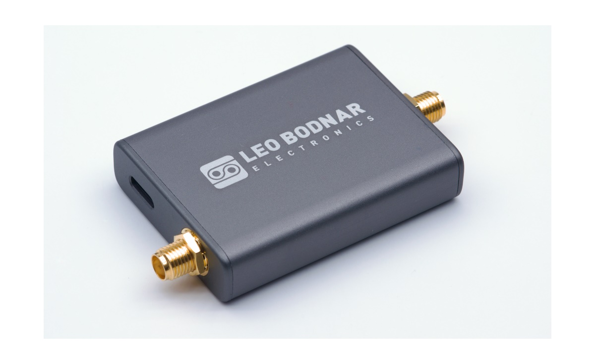<figcaption>GNSSDO — Leo Bodnar via Batronix (retail)</figcaption></figure>
<figure>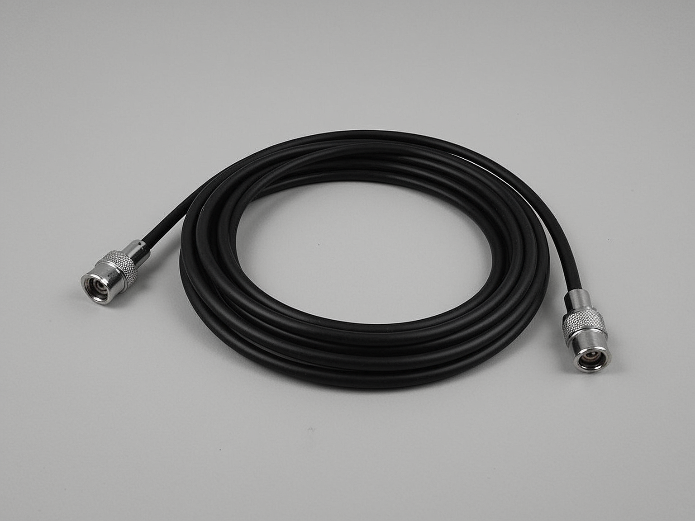<figcaption>LMR-400 jumper — generated (Pasternack for reference) (CC BY-SA 4.0)</figcaption></figure>
</p>
<!-- /patch:img -->


Every category draws from these pools. Specific part numbers differ; the function does not.

### 17.1 Radio front ends

| Function | Why every tier needs it | Notes |
|---|---|---|
| Transceiver with TX | Attach hijack requires transmitting | Half-duplex parts are unsuitable for GSM BTS work |
| Wide tuning range | 700 MHz to 3.5 GHz covers all target bands | Narrow-band parts constrain you to one operator |
| Sufficient sample rate | GSM needs ≥ 1.6 MS/s, LTE 10–20 MHz | Low sample rate limits you to 2G |
| External clock input | Timing alignment on LTE/NR | Without it, 4G cells look malformed |

### 17.2 Timing and frequency reference

A GPS-disciplined oscillator is the single most-skipped item and the most common cause of "it transmits but nothing attaches."

| Function | Tier that needs it |
|---|---|
| GNSS-disciplined 10 MHz + 1PPS | G always, E for timing analysis, B for any 4G/5G work |
| Holdover oscillator | G, for indoor and vehicle use under bridges |

### 17.3 RF chain

| Function | Notes |
|---|---|
| LNA (receive) | Low-noise figure, mast-mounted where possible |
| Power amplifier (transmit) | 10–50 W; must be linear and band-filtered |
| Band-pass filter | Prevents out-of-band emissions; legally required in most jurisdictions |
| Directional and omni antennas | Directional for targeting, omni for harvesting |
| Mast, mag-mount, tripod | Elevation is worth more than power |

### 17.4 Host and compute

| Function | Options across tiers |
|---|---|
| Control host | Ruggedised laptop (G), rack server (E), any laptop (B) |
| Headless sensor node | ODROID, Raspberry Pi, mini-PC |
| Storage | SSD, plus remote offload for E and G |

### 17.5 Ancillary

| Item | Use |
|---|---|
| Faraday bag | Transport, isolation, evidence handling |
| USB data blocker | Charging in hostile locations |
| Labelled cable set, spare everything | Field reliability |
| Spectrum analyser or second SDR | Verify your own emissions |
| Power: LiFePO4 pack, inverter | Vehicle and manpack |

### 17.6 Physical topology (common shape)

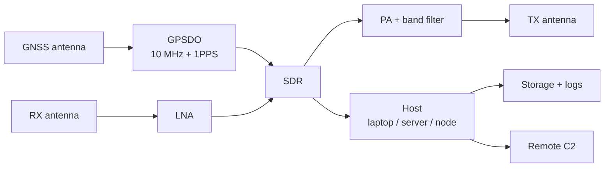

Every build guide below is a variation on this diagram. The differences are power, calibration and what runs on the host.

---

## 18. Hardware by Category

<!-- patch:img:## 18. Hardware by Category -->
<p class="plates">
<figure>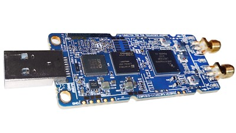<figcaption>LimeSDR Mini 2.0 — eBay listing (seller)</figcaption></figure>
<figure>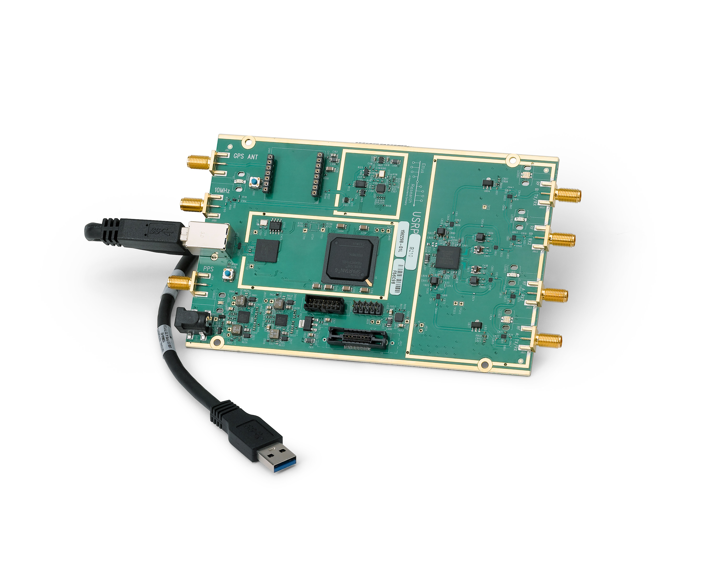<figcaption>USRP B210 — Ettus Research (vendor)</figcaption></figure>
<figure>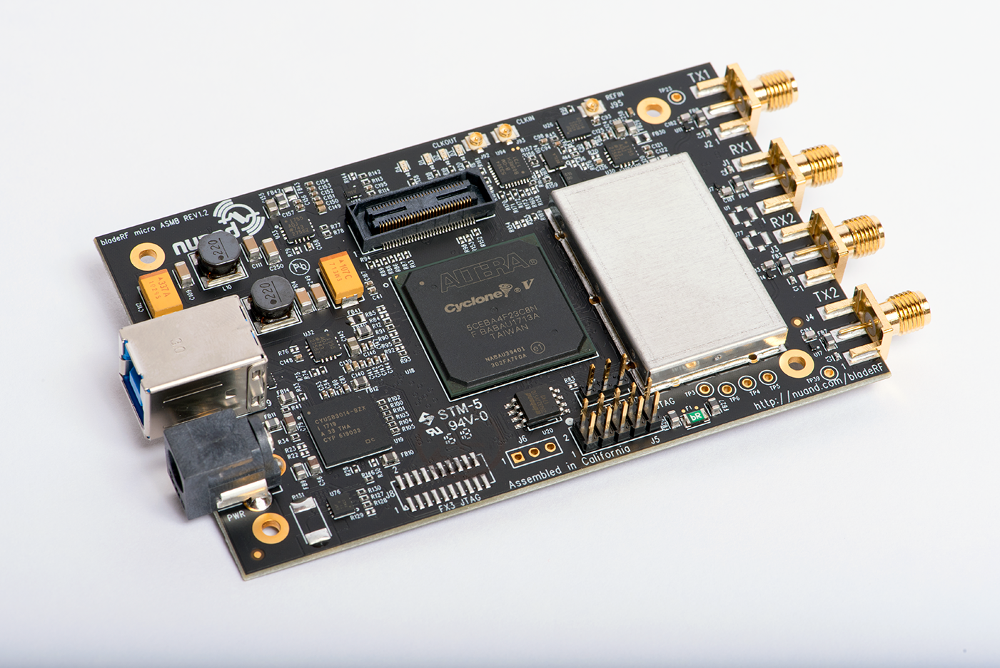<figcaption>bladeRF 2.0 micro — Nuand (vendor)</figcaption></figure>
<figure>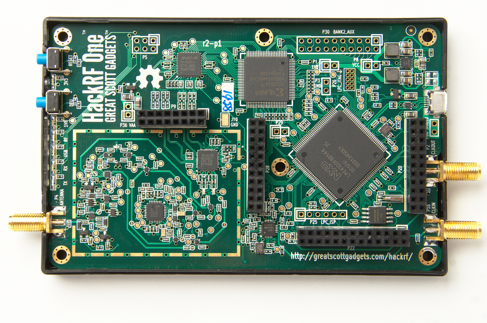<figcaption>HackRF One — HackRF docs (project)</figcaption></figure>
<figure>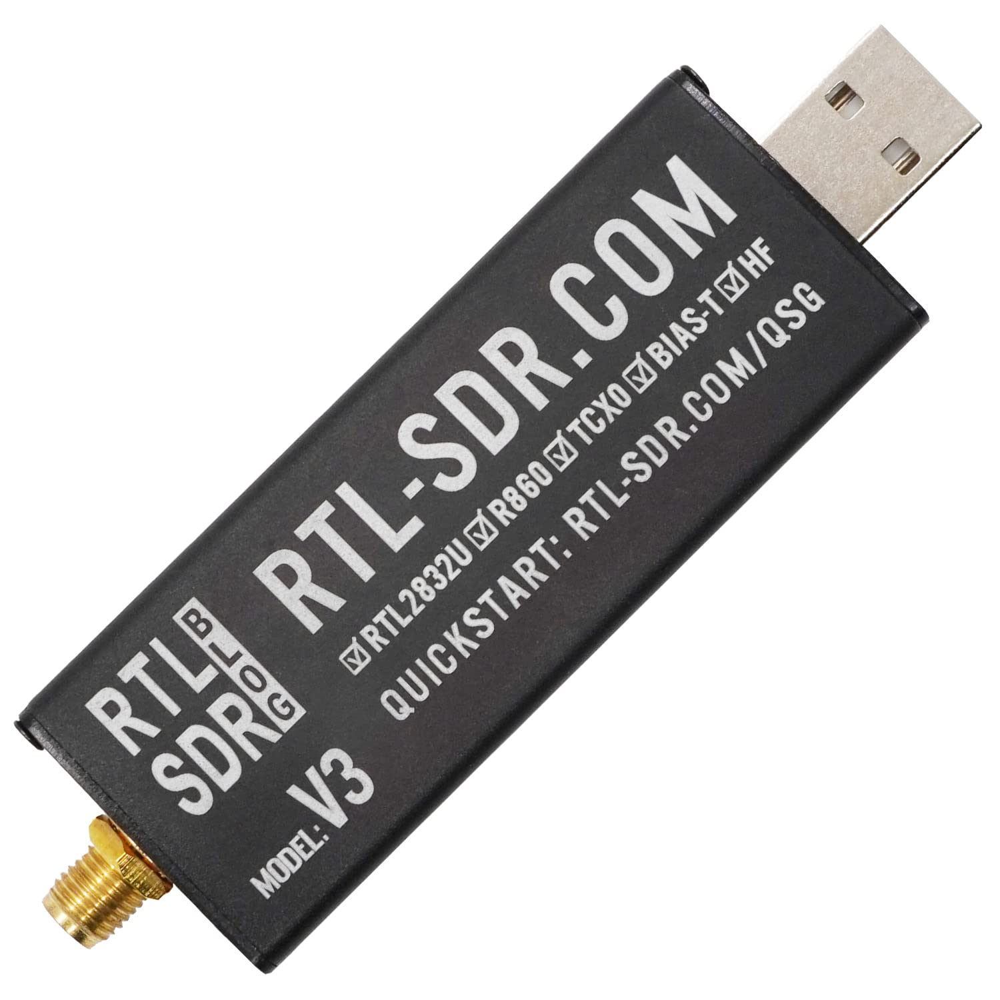<figcaption>RTL-SDR dongle — retail listing (seller)</figcaption></figure>
<figure>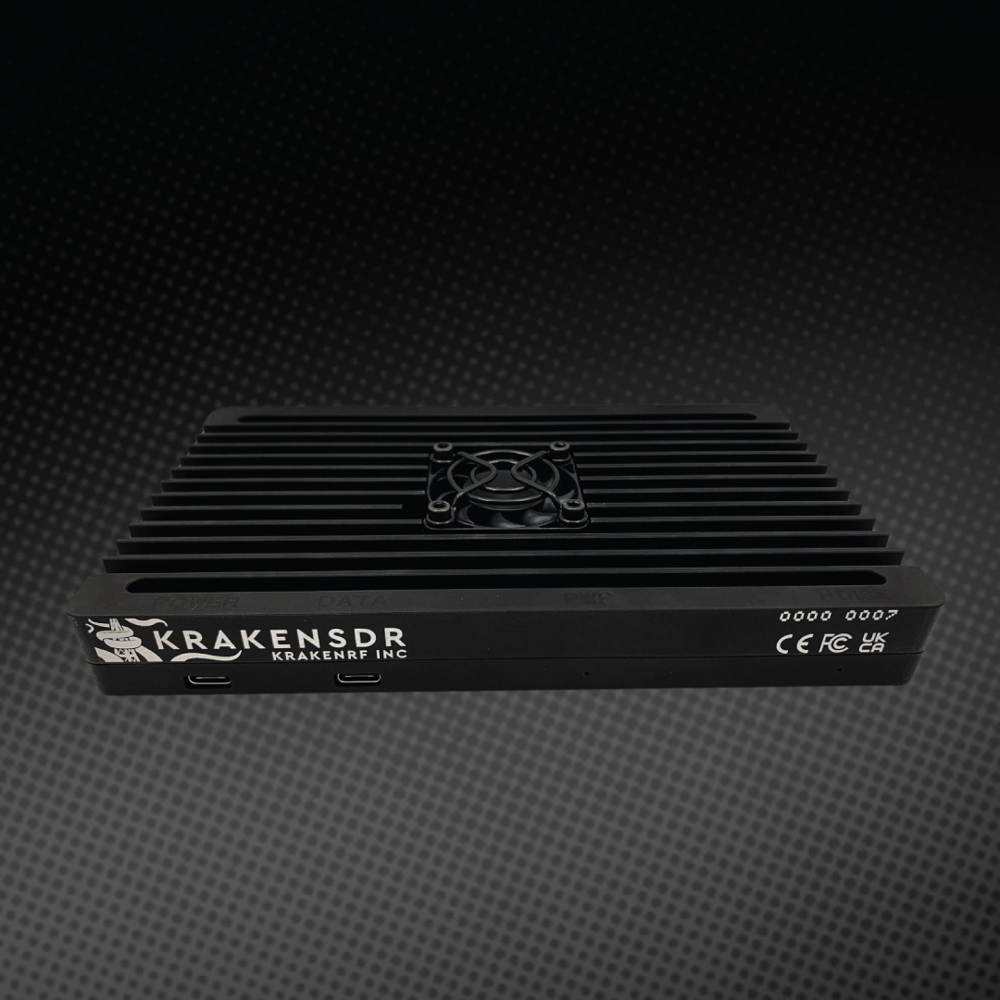<figcaption>KrakenSDR — KrakenRF (vendor)</figcaption></figure>
<figure>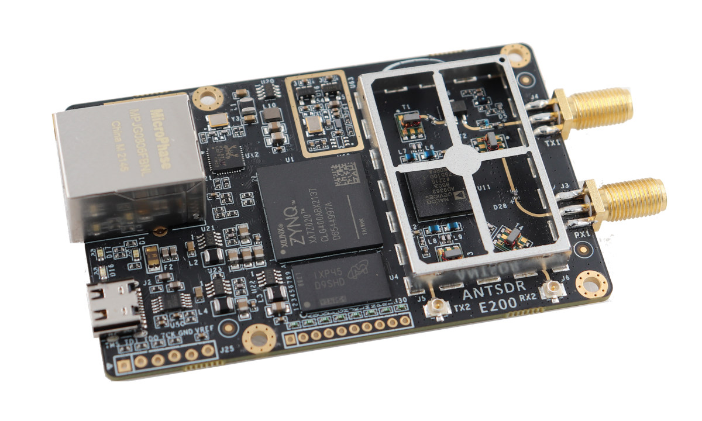<figcaption>AntSDR E200 — CNX Software (press)</figcaption></figure>
<figure>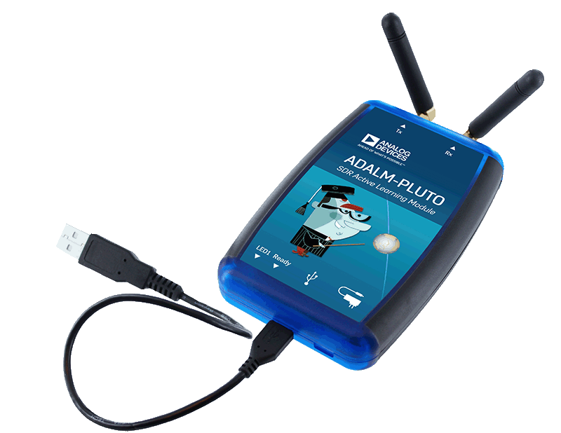<figcaption>ADALM-PLUTO — Analog Devices (vendor)</figcaption></figure>
<figure>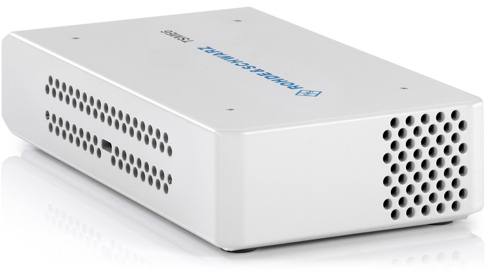<figcaption>R&S TSMx scanner — Rohde & Schwarz (vendor)</figcaption></figure>
<figure>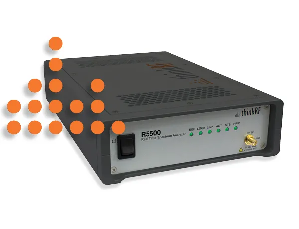<figcaption>ThinkRF R5500 — ThinkRF (vendor)</figcaption></figure>
<figure>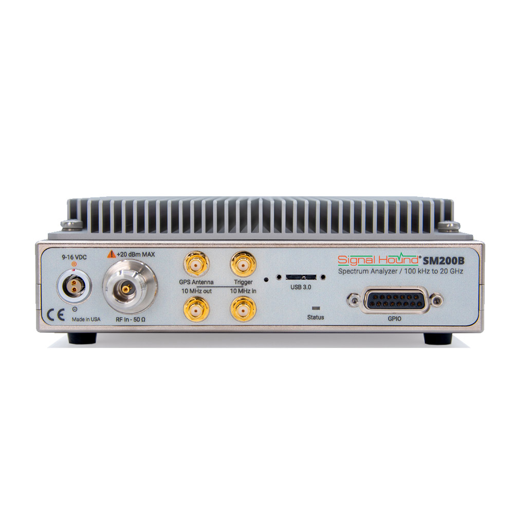<figcaption>Signal Hound SM200B — Signal Hound (vendor)</figcaption></figure>
</p>
<!-- /patch:img -->


### 18.1 Category B — bad actor and DIY

Commodity, orderable by anyone, no account required.

| Device | Band | Duplex | Rate | Use | Price band | Link |
|---|---|---|---|---|---|---|
| **LimeSDR Mini 2.0** | 10 MHz–3.5 GHz | 1×1 | 30.72 MS/s | Best cheap GSM BTS radio, Osmocom-supported | ~$400 | <https://www.crowdsupply.com/lime-micro/limesdr-mini> |
| **LimeSDR USB** | 100 kHz–3.8 GHz | 2×2 | 61.44 MS/s | MIMO, better filtering | ~$700 | <https://www.crowdsupply.com/lime-micro/limesdr> |
| **bladeRF 2.0 micro xA4** | 47 MHz–6 GHz | 2×2 | 61.44 MS/s | YateBTS and srsRAN supported | ~$500 | <https://www.nuand.com/product/bladerf-xa4/> |
| **bladeRF 2.0 micro xA9** | 47 MHz–6 GHz | 2×2 | 122.88 MS/s | Same, more bandwidth | ~$800 | <https://www.nuand.com/product/bladerf-xa9/> |
| **USRP B210** | 70 MHz–6 GHz | 2×2 | 56 MS/s | The reference platform, everything supports it | ~$1,500 | <https://www.ettus.com/all-products/ub210-kit/> |
| **ADALM-PLUTO** | 325 MHz–3.8 GHz | 1×1 | 61.44 MS/s | Cheap 2G/4G, poor filtering | ~$250 | <https://www.analog.com/en/resources/evaluation-hardware-and-software/evaluation-boards-kits/adalm-pluto.html> |
| **AntSDR E200** | 70 MHz–6 GHz | 2×2 | 61.44 MS/s | Zynq-based, standalone capable | ~$500 | <https://www.crowdsupply.com/microphase-technology/antsdr-e200> |
| **HackRF One** | 1 MHz–6 GHz | **Half** | 20 MS/s | Passive sniffing only, not BTS | ~$350 | <https://greatscottgadgets.com/hackrf/one/> |
| **RTL-SDR Blog V4** | 24–1766 MHz | RX only | 2.4 MS/s | Passive 2G scanning, GSM decode | ~$40 | <https://www.rtl-sdr.com/buy-rtl-sdr-dongles/> |
| **KrakenSDR** | 24–1766 MHz | RX only, 5ch | — | Direction finding, coherent array | ~$500 | <https://www.krakenrf.com/> |

**Host:** any x86-64 laptop running Linux. Ubuntu 22.04 LTS. Do not use Windows; the toolchains assume Linux.

**Critical exclusions.** HackRF is half-duplex and cannot run a full GSM transceiver; it is fine for `gr-gsm` sniffing and useless as a BTS. RTL-SDR cannot transmit at all.

### 18.2 Category E — enterprise

Passive-first, calibrated, rack or vehicle mounted. Almost all quote-only.

| Device | Type | Band | Why enterprise buys it | Link |
|---|---|---|---|---|
| **Rohde & Schwarz TSMA6** | Passive scanner + autonomous UE | 350 MHz–4.4 GHz | Reference-grade passive, integrates with ROMES/QualiPoc | <https://www.rohde-schwarz.com/products/test-and-measurement/network-analyzers/rs-tsma6-autonomous-mobile-network-scanner_63493-1103098.html> |
| **Rohde & Schwarz TSME6** | Ultra-compact scanner | 350 MHz–4.4 GHz | Covert passive, USB/Ethernet | <https://www.rohde-schwarz.com/products/test-and-measurement/network-analyzers/rs-tsme6-ultracompact-drive-test-scanner_63493-1103100.html> |
| **ThinkRF R5750** | RF downconverter/analyser | 9 kHz–27 GHz | Wideband capture, software-defined | <https://thinkrf.com/products/> |
| **Signal Hound SM200B** | Spectrum analyser | 20 kHz–20 GHz | Cheaper wideband, good API | <https://signalhound.com/products/sm200b-20-ghz-rf-transceiver/> |
| **Aaronia Spectran V6** | Real-time analyser | up to 6 GHz | Real-time bandwidth for burst capture | <https://aaronia.com/> |

**Supporting:** rack chassis, PoE switch, NTP/GNSS time server, mast or vehicle mount, remote management.

**Enterprise generally does not transmit.** If the requirement includes attach hijack or identity solicitation, enterprise buys into Category G.

### 18.3 Category G — government and nation state

Purpose-built appliances. Public detail is thin; capability claims outrun documentation.

| Platform | Vendor | Reported shape | Link |
|---|---|---|---|
| **Stingray II** | L3Harris | Manpack/vehicle active catcher | <https://www.l3harris.com/> |
| **KingFish** | L3Harris | Portable, IMSI/IMEI/targeting | <https://www.l3harris.com/> |
| **Hailstorm** | L3Harris | 4G/LTE-capable | <https://www.l3harris.com/> |
| **Crossbow** | L3Harris | Transportable multi-RAT | <https://www.l3harris.com/> |
| **IBS / Interceptor** | Septier | Active, 2G–5G | <https://septier.com/> |
| **LightRay** | Septier | Low-cost tactical | <https://septier.com/> |
| **DRT family** | Parsons | Modular SDR receivers and transmitters | <https://www.parsons.com/> |
| **PKI / Phantom** | PKI Electronic Intelligence | Vehicle and fixed | <https://www.pki-electronic.com/> |
| **CellXion** | CellXion | Vehicle-integrated | <https://www.cellxion.com/> |
| **Sunwave** | Sunwave | Low-cost active | <https://www.sunwavetech.com/> |
| **BLiNQ** | BLiNQ Networks | Deployable LTE | <https://blinqnetworks.com/> |
| **Airspan** | Airspan | Small cell based | <https://airspan.com/> |

**Supporting:** GNSSDO, 20–50 W amplifier, band filters, mast, vehicle or aircraft mount, operator laptop, core-network integration, fusion platform.

**Aircraft variant.** A fixed-wing or rotary platform with a belly antenna and a rack holds a wide-area catcher. This is the "dirtbox" shape and requires aviation integration, not just RF skill.

**Maritime and fixed.** Coastal sites and embassy rooftops are permanently installed with directional sectors and fibre backhaul.

### 18.4 Alternatives and crossovers

| If you cannot buy… | Substitute |
|---|---|
| Stingray | USRP N310 + srsRAN + Open5GS + PA, in a vehicle |
| Septier LightRay | LimeSDR + Osmocom on a ruggedised laptop |
| R&S TSMA6 | ThinkRF R5500 + open-source decoder |
| TSME6 | AntSDR E200 in a waterproof box |
| KrakenSDR DF | Two directional antennas and manual bearings |

---

## 19. Software by Category

<!-- patch:img:## 19. Software by Category -->
<p class="plates">
<figure><figcaption>Osmocom — project avatar (project)</figcaption></figure>
<figure><figcaption>srsRAN — project docs (project)</figcaption></figure>
<figure><figcaption>Open5GS — project site (project)</figcaption></figure>
<figure><figcaption>free5GC — project site (project)</figcaption></figure>
<figure><figcaption>Magma — project repo (project)</figcaption></figure>
<figure><figcaption>Kamailio — Wikimedia (Commons)</figcaption></figure>
<figure><figcaption>Asterisk — Wikimedia (Commons)</figcaption></figure>
<figure><figcaption>Wireshark — Wikimedia (Commons)</figcaption></figure>
<figure><figcaption>GNU Radio Companion — GNU Radio Foundation logo, CC BY-ND 2.0 (project)</figcaption></figure>
<figure>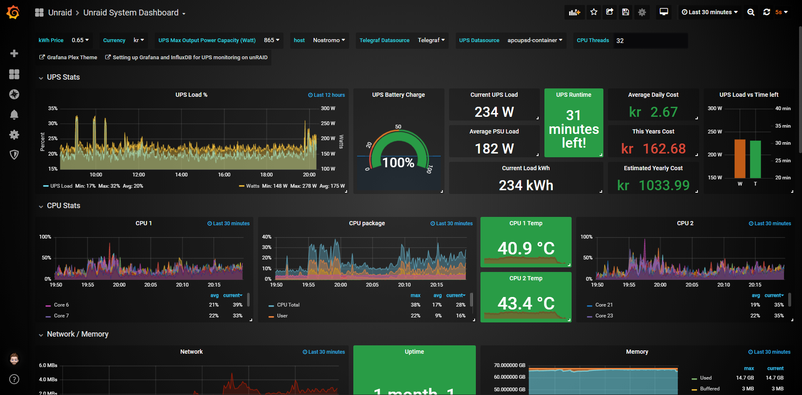<figcaption>Grafana — theme-park docs (project)</figcaption></figure>
<figure>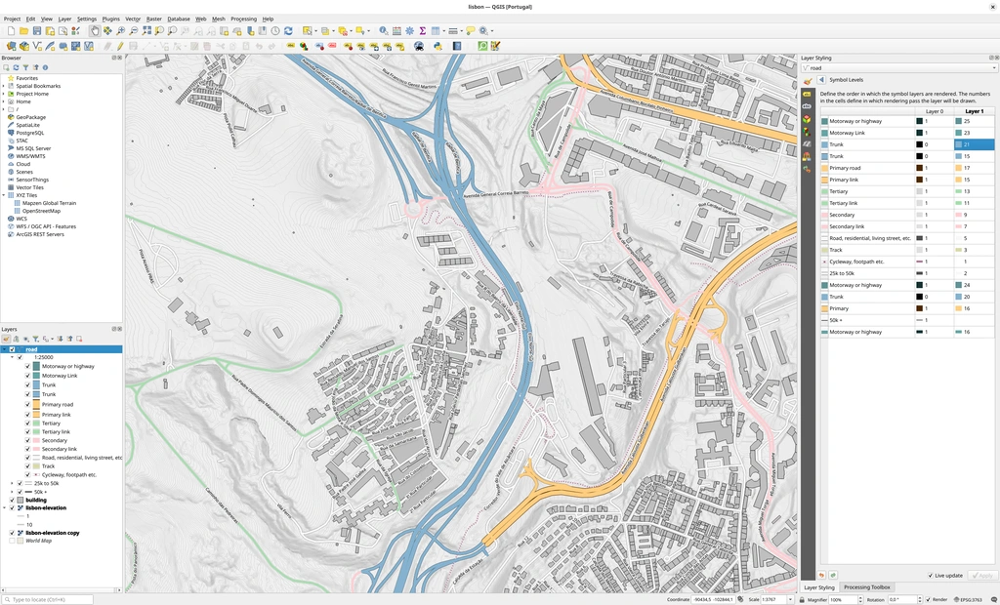<figcaption>QGIS — QGIS project (project)</figcaption></figure>
</p>
<!-- /patch:img -->


### 19.1 Shared components

| Function | Options |
|---|---|
| SDR driver | UHD (Ettus), SoapySDR, LimeSuite, bladeRF CLI |
| Signal framework | GNU Radio |
| Capture and analysis | Wireshark, GQRX, CubicSDR, SDR# |
| Mapping | QGIS, CellMapper |
| Telemetry | InfluxDB + Grafana |

### 19.2 Category B — open-source stacks

| Stack | Generation | State | Link |
|---|---|---|---|
| **Osmocom** (osmo-bts-trx, osmo-trx, osmo-hlr, osmo-msc) | 2G | Active, the reliable choice | <https://osmocom.org/> |
| **YateBTS** | 2G | Dormant but functional, bladeRF/USRP native | <https://yatebts.com/> |
| **srsRAN_4G** | 4G | Maintained, superseded by _Project | <https://github.com/srsran/srsRAN_4G> |
| **srsRAN_Project** | 4G/5G | Active | <https://github.com/srsran/srsRAN_Project> |
| **Open5GS** | 4G/5G core | Active | <https://github.com/open5gs/open5gs> |
| **OpenAirInterface** | 4G/5G | Active, heavier | <https://openairinterface.org/> |
| **Magma** | 4G/5G core | Active, operator-oriented | <https://github.com/magma/magma> |
| **Free5GC** | 5G core | Active, research | <https://github.com/free5gc/free5gc> |
| **gr-gsm** | 2G passive | Maintained | <https://github.com/ptrkrysik/gr-gsm> |
| **Oros42/IMSI-catcher** | 2G passive | Active | <https://github.com/Oros42/IMSI-catcher> |
| **OsmocomBB** | 2G phone-side | Active, needs a C123 handset | <https://osmocom.org/projects/baseband> |
| **Kalibrate** | GSM channel scan | Maintained | <https://github.com/steve-m/kalibrate-rtl> |

### 19.3 Category E — enterprise software

| Product | Function | Link |
|---|---|---|
| R&S ROMES | Drive-test and analysis | <https://www.rohde-schwarz.com/> |
| R&S QualiPoc | Handset-based measurement | <https://www.rohde-schwarz.com/> |
| Keysight Nemo | Drive-test suite | <https://www.keysight.com/us/en/products/nemo.html> |
| Accuver XCAL | Drive-test | <https://www.accuver.com/> |
| VIAVI | Network assurance | <https://www.viavi.com/> |
| ThinkRF APIs | Python/C++ capture | <https://github.com/thinkrf> |

### 19.4 Category G — government software

| Product | Function |
|---|---|
| Vendor GUI suite | Targeting, mission control, reporting |
| Core integration | MME/AMF handoff for lawful intercept |
| Fusion platform | Correlation with SIGINT and OSINT |
| Guavus, Cisco | Analytics and subscriber correlation |

Category G usually pairs vendor software with a lab stack (Osmocom, srsRAN, Open5GS) for validation and for the core-side work.

### 19.5 Detection-side software

| Tool | Platform | Needs | Link |
|---|---|---|---|
| SnoopSnitch | Android | Root, Qualcomm | <https://github.com/srlabs/snoopsnitch> |
| AIMSICD | Android | Root | <https://github.com/CellularPrivacy/Android-IMSI-Catcher-Detector> |
| CellMapper | Android | Nothing | <https://www.cellmapper.net/> |
| KrakenSDR DOA | Linux | KrakenSDR | <https://github.com/krakenrf/krakensdr_doa> |

---

## 20. Repositories With Working Code

Rated by whether it builds and runs today. "Works" means a competent operator can get it running; it does not mean a beginner can.

| Repo | Purpose | State | Works? |
|---|---|---|---|
| <https://github.com/srsran/srsRAN_Project> | 4G/5G RAN | Active | Yes |
| <https://github.com/open5gs/open5gs> | 4G/5G core | Active | Yes |
| <https://github.com/free5gc/free5gc> | 5G core | Active | Yes |
| <https://github.com/magma/magma> | Core, operator shape | Active | Yes, heavy |
| <https://gitlab.eurecom.fr/oai/openairinterface5g> | 4G/5G RAN | Active | Yes, heavy |
| <https://gitea.osmocom.org/cellular-infrastructure/osmo-bts> | 2G BTS | Active | Yes |
| <https://gitea.osmocom.org/cellular-infrastructure/osmo-trx> | 2G transceiver | Active | Yes |
| <https://github.com/Oros42/IMSI-catcher> | 2G passive identity | Active | Yes |
| <https://github.com/ptrkrysik/gr-gsm> | 2G decode | Maintained | Yes |
| <https://github.com/srlabs/snoopsnitch> | Detection | Maintained | Yes |
| <https://github.com/krakenrf/krakensdr_doa> | Direction finding | Active | Yes |
| <https://github.com/EttusResearch/uhd> | USRP driver | Active | Yes |
| <https://github.com/pothosware/SoapySDR> | Driver abstraction | Active | Yes |
| <https://github.com/myriadrf/LimeSuite> | LimeSDR driver | Active | Yes |
| <https://github.com/Nuand/bladeRF> | bladeRF tools | Active | Yes |
| <https://github.com/gnuradio/gnuradio> | DSP framework | Active | Yes |
| <https://github.com/RangeNetworks/OpenBTS> | 2G BTS | **Archived 2017** | Builds with effort |
| <https://github.com/RangeNetworks/OpenBTS-UMTS> | 3G BTS | **Archived** | Painful |
| <https://github.com/yatebts> | 2G BTS | Dormant | Works on bladeRF/USRP |
| <https://github.com/CellularPrivacy/Android-IMSI-Catcher-Detector> | Detection | Dormant | Builds, dated |

> **Do not start with OpenBTS.** It is the most-cited and least-maintained. Osmocom is the same capability with a live community.

---
---

## 21. Build Guide B — Bad Actor and DIY

<!-- patch:img:## 21. Build Guide B — Bad Actor and DIY -->
<p class="plates">
<figure><figcaption>LimeSDR Mini 2.0 — eBay listing (seller)</figcaption></figure>
<figure><figcaption>RTL-SDR dongle — retail listing (seller)</figcaption></figure>
</p>
<!-- /patch:img -->


**Goal:** make nearby handsets attach to your cell and reveal IMSI/IMEI.

**Hardware:** LimeSDR Mini 2.0 (or bladeRF xA4), Ubuntu 22.04 laptop, 2× 900/1800 MHz antennas, USB 3.0 cable, optional 2 W amp.

**Spectrum:** 935–960 MHz downlink / 890–915 MHz uplink (EU) or 869–894 / 824–849 (US) for GSM-900/850. A transmit licence is required in most countries; low power is usually tolerated for short tests.

### 21.1 Prepare the host

```bash
sudo apt update
sudo apt install -y build-essential git cmake libusb-1.0-0-dev \
    libboost-all-dev libgmp-dev libssl-dev python3-pip
```

### 21.2 Install the driver

```bash
git clone https://github.com/myriadrf/LimeSuite.git
cd LimeSuite && mkdir build && cd build
cmake .. && make -j"$(nproc)" && sudo make install && sudo ldconfig
cd ../ && git submodule init && git submodule update
sudo LimeUtil --update
```

### 21.3 Install Osmocom from the nightly feed

```bash
sudo apt install -y gnupg
curl -fsSL https://downloads.osmocom.org/packages/osmocom:/nightly/xUbuntu_22.04/Release.key \
  | sudo gpg --dearmor -o /usr/share/keyrings/osmocom.gpg
echo "deb [signed-by=/usr/share/keyrings/osmocom.gpg] \
  https://downloads.osmocom.org/packages/osmocom:/nightly/xUbuntu_22.04/ ./" \
  | sudo tee /etc/apt/sources.list.d/osmocom.list
sudo apt update
sudo apt install -y osmo-bts-trx osmo-trx-lms osmo-hlr osmo-msc osmo-stp
```

### 21.4 Configure

`/etc/osmocom/osmo-trx-lms.cfg`:

```ini
log stderr
 logging filter all 1
line vty
 bind 127.0.0.1 4237
trx 0
 phy 0
  osmotrx rx-gain 40
  osmotrx tx-attenuation 10
  osmotrx tx-attenuation-max 30
```

`/etc/osmocom/osmo-bts-trx.cfg`:

```ini
log stderr
 logging filter all 1
line vty
 bind 127.0.0.1 4241
phy 0
 osmotrx ip 127.0.0.1
 osmotrx base-port 5700
 osmotrx rx-gain 40
 osmotrx tx-attenuation 10
bts 0
 band GSM-900
 cell_identity 1
 location_area_code 1
 base_station_id_code 1
 trx 0
  arfcn 60
  max_power_red 0
```

`osmo-hlr` needs at least one subscriber for a phone to complete registration. For harvesting, log the attach:

```bash
sudo osmo-hlr -c /etc/osmocom/osmo-hlr.cfg --debug=DHlr
```

### 21.5 Run

Four terminals, in order: `osmo-stp`, `osmo-hlr`, `osmo-msc`, `osmo-trx-lms`, then `osmo-bts-trx`.

```bash
sudo osmo-trx-lms -c /etc/osmocom/osmo-trx-lms.cfg
sudo osmo-bts-trx -c /etc/osmocom/osmo-bts-trx.cfg
```

Watch the `osmo-hlr` and `osmo-bts-trx` logs for `IMSI attach` and `Location Updating Request`.

### 21.6 Verify

On a test handset: Settings → Mobile networks → Network operators → search. Your PLMN (MCC/MNC from `osmo-bts-trx.cfg`, default 001/01) appears. Selecting it forces an attach and an IMSI disclosure.

### 21.7 Alternatives

| Want | Do instead |
|---|---|
| Passive only, no transmit | RTL-SDR V4 + `gr-gsm` + `Oros42/IMSI-catcher` |
| No licence at all | Passive stack above, or a Faraday-shielded bench |
| 4G instead of 2G | srsRAN_4G + Open5GS on bladeRF or B210; see §21.8 |
| 5G | srsRAN_Project + Open5GS; SUCI will usually be opaque |
| Simpler BTS config | YateBTS on bladeRF |

### 21.8 4G variant

```bash
git clone https://github.com/open5gs/open5gs && cd open5gs
meson build --prefix=/usr && ninja -C build && sudo ninja -C build install
git clone https://github.com/srsran/srsRAN_4G && cd srsRAN_4G
mkdir build && cd build && cmake .. && make -j"$(nproc)"
```

Point `enb.conf` at your Open5GS PLMN, set `mme_list` to the local address, start `open5gs-mmed` and friends, then `sudo ./srsenb`. Handsets attach and `srsenb` logs the IMSI in the S1AP `InitialUEMessage`. Set the PLMN to a real carrier's MCC/MNC so handsets accept it.

**5G caveat, stated precisely.** On NR SA the UE sends a SUCI encrypted to its *home* network key, which your rogue core does not hold. You will see an opaque string, not an IMSI. To recover identity you must either bid the UE down to LTE/2G or run null-scheme and hope the UE falls back.

---

## 22. Build Guide E — Enterprise Passive Monitoring

<!-- patch:img:## 22. Build Guide E — Enterprise Passive Monitoring -->
<p class="plates">
<figure><figcaption>R&S TSMx scanner — Rohde & Schwarz (vendor)</figcaption></figure>
<figure><figcaption>ThinkRF R5500 — ThinkRF (vendor)</figcaption></figure>
</p>
<!-- /patch:img -->


**Goal:** continuous, calibrated observation without transmitting. No licence needed.

**Hardware:** ThinkRF R5500/R5750 or R&S TSMA6, PoE switch, GNSS time server, mast or vehicle mount, LNA, rack.

### 22.1 Physical

1. Mount the receive antenna at height, clear of metal.
2. Run low-loss coax; LNA at the mast head, not the rack.
3. Earth the mast. Bond the rack.
4. Connect the scanner to the PoE switch, not directly to a host.
5. GNSS antenna to sky view; verify lock before any timing work.

### 22.2 Network

```text
VLAN 10  management   192.168.10.0/24
VLAN 20  capture      192.168.20.0/24
VLAN 30  out-of-band  10.0.0.0/24
```

Management on a separate VLAN with no internet route. Capture interfaces to the analysis host only.

### 22.3 Configure the scanner

ThinkRF exposes a REST and VITA-49 API; R&S uses ROMES or the TSMA web UI.

```python
# ThinkRF sweep skeleton
import requests
r = requests
scanner = "http://192.168.20.11"
r.put(f"{scanner}/stream", json={
    "rfe_mode": "ZIF",
    "start": 935e6, "stop": 960e6, "step": 200e3,
    "fft": {"window": "HANN", "fshift": 0},
})
```

Set reference level so the noise floor sits at −95 dBm; anything higher and you will clip on strong cells.

### 22.4 Baselines

Capture a 24-hour baseline per site before drawing conclusions. Record per-cell RSCP/RSRP, PCI, TAC and neighbour lists. Store in InfluxDB with a per-cell series.

Alert on: new PCI in a stable TAC, signal 20 dB above baseline, cipher-state change, and cell disappearance inside 30 minutes.

### 22.5 Limitations to accept

A passive sensor cannot tell you a tower is fake. It tells you a tower is *new* or *odd*. Attribution requires a second sensor, a handset-side report, or a comparison against a national regulator register.

### 22.6 Alternatives

| Constraint | Substitute |
|---|---|
| No budget for R&S | ThinkRF R5500, or two AntSDR E200 nodes |
| No rack | AntSDR in an IP67 enclosure, PoE |
| No scanner at all | Handset drive-test with CellMapper plus a scripted comparison |
| Need direction | KrakenSDR array with `krakensdr_doa` |

---

## 23. Build Guide G — Government and Nation State

<!-- patch:img:## 23. Build Guide G — Government and Nation State -->
<p class="plates">
<figure>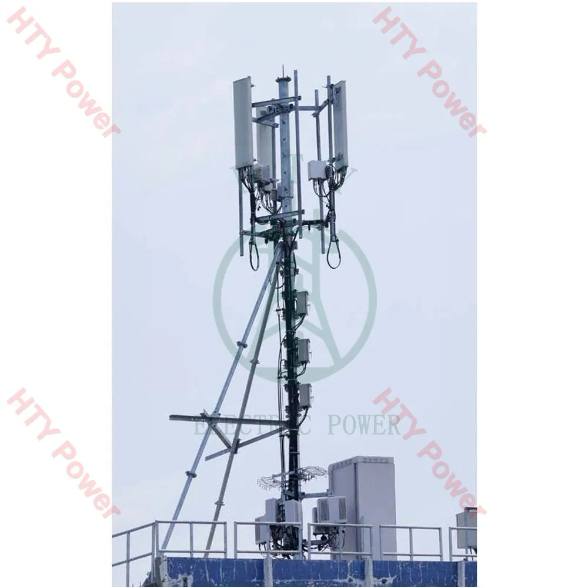<figcaption>Rooftop mast — supplier listing (seller)</figcaption></figure>
<figure><figcaption>Lattice tower — stock (stock)</figcaption></figure>
</p>
<!-- /patch:img -->


**Goal:** active collection with targeting, mobility and core integration.

### 23.1 Site survey first

Never deploy blind. A week of passive survey per site establishes real PCI/TAC/ARFCN assignments, noise floor and neighbour relationships. Deploying without this is how operators jam themselves.

### 23.2 Physical build

1. GNSS antenna with clear sky view; route to GNSSDO.
2. GNSSDO 10 MHz and 1PPS to the SDR external reference.
3. RX chain: antenna → LNA → SDR.
4. TX chain: SDR → band filter → PA → antenna, with a directional coupler and power meter.
5. Bond everything. Separate DC and RF grounds.
6. Verify own emissions on a spectrum analyser before keying up.

### 23.3 Timing verification

```bash
# with a USRP and UHD
uhd_find_devices
uhd_usrp_probe --args "type=b200" | grep -i -A2 "clock"
```

Confirm `Sensor: ref_locked: Yes`. An unlocked reference produces cells that handsets see but will not camp on.

### 23.4 Network configuration

```text
PLMN            clone the target operator's MCC/MNC
LAC / TAC       unused value, or a real neighbour's to force update
ARFCN           real operator channel, or a clear one
TX power        start 10 dB above local serving cell, then reduce
Cipher          A5/0 for 2G, EEA0 to force plaintext
```

### 23.5 Operational sequence

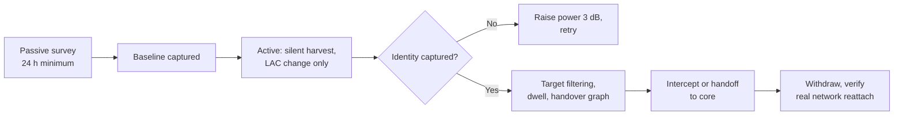

### 23.6 Core integration

For lawful intercept, the catcher must hand the session to a real core with an S1/NG interface or a media gateway. This is where vendor appliances earn their price: the handoff, the CDR generation and the evidence chain are pre-built and supported. A DIY stack can do it, but you will be writing the glue. Part III §29 covers the interfaces.

### 23.7 Alternatives

| Requirement | Substitute |
|---|---|
| No vendor budget | USRP N310 + srsRAN + Open5GS + PA, vehicle-mounted |
| Wide area | Aircraft with belly antenna, or mast at 20 m |
| Direction finding | KrakenSDR array, or two sectors and manual bearings |
| Covert | TSME6-class passive plus a separate active unit |

---

## 24. Capability and Budget Ladder

| Band | Spend | What you get | Realistic use |
|---|---|---|---|
| **Hobby** | < $150 | RTL-SDR + `gr-gsm` + `IMSI-catcher` | Passive 2G sniffing, learning |
| **Entry** | $500–1,500 | LimeSDR/bladeRF + Osmocom | Full 2G attach, real identity harvesting |
| **Serious DIY** | $2,000–4,000 | B210 + GPSDO + amp + filters | 4G attach, usable field rig |
| **Sensor** | $8,000–25,000 | ThinkRF or AntSDR array, rack | Enterprise passive monitoring |
| **Low-end commercial** | $20,000–60,000 | Septier LightRay, Sunwave | Small-agency active |
| **Full commercial** | $100,000+ | Stingray-class, integrated, supported | National and large-agency |

The jump from $4,000 to $25,000 buys calibration and support, not capability. The jump from $25,000 to $100,000 buys integration and the evidence chain.

### 24.1 Rung notes

Each rung is cumulative and each has a specific failure mode that the next rung fixes. Rung 2 fails outdoors without filters. Rung 3 fails on timing without a GNSSDO. Rung 4 fails on attribution without a second sensor. Rung 5 fails in court without the evidence chain. Buy the rung below what you think you need, then discover the gap — it is cheaper than discovering it in a report.

---

## 25. Failure Modes and Calibration

| Symptom | Cause | Fix |
|---|---|---|
| Transmits, nothing attaches | Reference not locked | Fix GNSS, verify `ref_locked` |
| Attaches, drops in seconds | TX power too high, handset reselects away | Reduce 5–10 dB |
| Handsets attach but no IMSI | GUTI cached, no identity request | Force LAC change, or wait for periodic update |
| 4G cell invisible | Wrong ARFCN or PCI conflict | Re-survey, pick clear channel |
| Works on bench, fails outdoors | No band filter, front-end overload | Add filter, reduce gain, enable AGC off |
| `osmo-trx` cannot open device | udev permissions | Install LimeSuite udev rules, replug |
| Neighbouring cells degrade | Power too high, adjacent channel | Lower power, add filter, move ARFCN |
| 5G shows opaque identity | SUCI working as designed | Downgrade to 4G/2G, or null-scheme |
| Timing good but attach rejected | PLMN not in handset list | Use a real carrier PLMN |

**Calibration discipline.** Log noise floor before and after every deployment. A 3 dB shift means something changed in the environment, not in your settings. Re-survey rather than compensate with gain.

### 25.1 Fault tree

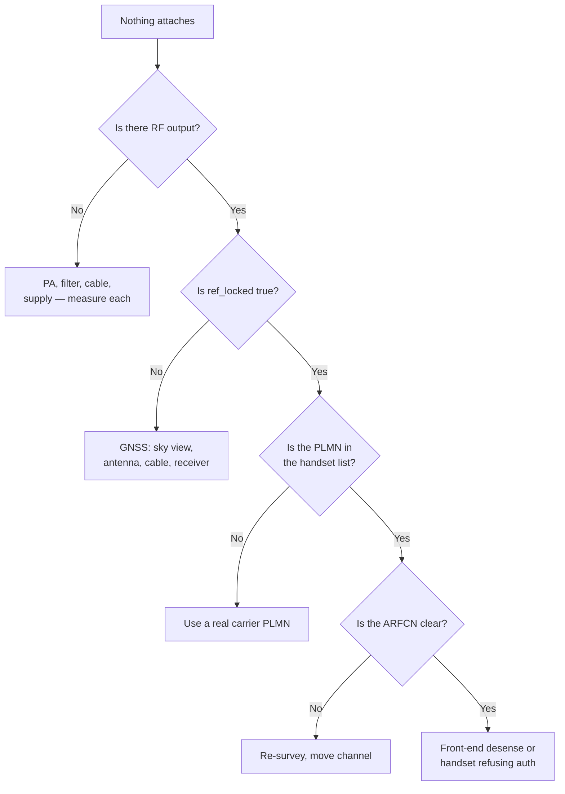

---

## 26. References

**Hardware**

- Ettus Research / NI — <https://www.ettus.com/>
- Nuand bladeRF — <https://www.nuand.com/>
- Lime Microsystems — <https://www.crowdsupply.com/lime-micro>
- Great Scott Gadgets — <https://greatscottgadgets.com/hackrf/one/>
- Analog Devices ADALM-PLUTO — <https://www.analog.com/en/resources/evaluation-hardware-and-software/evaluation-boards-kits/adalm-pluto.html>
- KrakenRF — <https://www.krakenrf.com/>
- MicroPhase AntSDR — <https://www.crowdsupply.com/microphase-technology/antsdr-e200>
- Rohde & Schwarz TSMA6 — <https://www.rohde-schwarz.com/products/test-and-measurement/network-analyzers/rs-tsma6-autonomous-mobile-network-scanner_63493-1103098.html>
- ThinkRF — <https://thinkrf.com/products/>
- Signal Hound — <https://signalhound.com/>
- L3Harris — <https://www.l3harris.com/>
- Septier — <https://septier.com/>
- Parsons — <https://www.parsons.com/>
- Leo Bodnar GPSDO — <https://www.leobodnar.com/shop/>
- Mini-Circuits — <https://www.minicircuits.com/>
- Panorama Antennas — <https://www.panorama-antennas.com/>
- MOS Equipment (Faraday) — <https://mosequipment.com/>
- PortaPow (USB blockers) — <https://portapow.co.uk/>
- Hardkernel ODROID — <https://www.hardkernel.com/>

**Software**

- Osmocom — <https://osmocom.org/>
- srsRAN — <https://github.com/srsran/srsRAN_Project>
- Open5GS — <https://open5gs.org/>
- OpenAirInterface — <https://openairinterface.org/>
- Magma — <https://magma.github.io/magma/>
- Free5GC — <https://free5gc.org/>
- YateBTS — <https://yatebts.com/>
- GNU Radio — <https://www.gnuradio.org/>
- Wireshark — <https://www.wireshark.org/>
- QGIS — <https://qgis.org/>
- InfluxDB — <https://www.influxdata.com/>
- Grafana — <https://grafana.com/>

**Reading**

- Osmocom *OsmoBTS* manual — <https://osmocom.org/projects/osmobts/wiki>
- srsRAN documentation — <https://docs.srsran.com/>
- Open5GS documentation — <https://open5gs.org/open5gs/docs/>
- 3GPP TS 43.020, TS 33.401, TS 33.501

---

*Prices indicative. Commercial platforms quote-only. Verify spectrum rules for your jurisdiction before keying a transmitter.*

---
---

# Part III — Site Survey, Core Handoff, Evidence Chain and Signalling Control

**Deep-dive annex to Parts I and II**

Part version 1.0 · Compiled 2026-11-13

**Part III index**

<details class="toc">
<summary>Show sections</summary>

27. [Scope and the Gap Being Addressed](#27-scope-and-the-gap-being-addressed)
28. [Site Survey, Comprehensively](#28-site-survey-comprehensively)
29. [Handing a Session to a Real Core](#29-handing-a-session-to-a-real-core)
30. [CDR Generation and the Evidence Chain](#30-cdr-generation-and-the-evidence-chain)
31. [Signalling Parameters That Force Downgrade or Plaintext](#31-signalling-parameters-that-force-downgrade-or-plaintext)
32. [Gap Analysis: Commercial, FOSS, Internal](#32-gap-analysis-commercial-foss-internal)
33. [Internal Build Order](#33-internal-build-order)
34. [References](#34-references)

</details>

> **Link caveat.** Web search was unavailable during compilation of this part. All links are from standing knowledge and are marked where drift is likely. Verify before relying on any of them in a procurement document.

---

## 27. Scope and the Gap Being Addressed

Part II said, in one line each, that a serious deployment requires a site survey and that vendor appliances earn their price through core handoff and evidence handling. Both statements were compressed to the point of being unhelpful.

This part expands them. It also states plainly where free software gets you most of the way and where it does not, and how to close the remainder internally.

The gap is real and worth naming precisely:

| Capability | Commercial | FOSS | Internal effort to close |
|---|---|---|---|
| Site survey methodology | Bundled service | Partial tooling | Moderate, mostly process |
| S1/NG core attach | Supported | **Fully available** | Low |
| Media gateway for CS voice | Supported | Available, unintegrated | High |
| CDR generation | Built in | Partial, DIY | Moderate |
| RFC 3161 timestamping | Built in | Available, unintegrated | Low |
| Custody chain and packaging | Built in | Available, unintegrated | Moderate |
| LI mediation (X1/X2/X3) | Built in | **Essentially absent** | High |
| Retention and disclosure export | Built in | DIY | Moderate |

The honest summary: the RF and core layers are solved in free software. The procedural layer — mediation, custody, disclosure — is not, and that is where a DIY programme usually fails an evidential test.

---

## 28. Site Survey, Comprehensively

<!-- patch:img:## 28. Site Survey, Comprehensively -->
<p class="plates">
<figure><figcaption>QGIS — QGIS project (project)</figcaption></figure>
<figure><figcaption>Rooftop mast — supplier listing (seller)</figcaption></figure>
</p>
<!-- /patch:img -->


A site survey is the difference between a deployment that collects and one that jams itself, alerts every handset in range, and produces artefacts nobody can defend. Budget a week per site. Do not skip because you are impatient.

### 28.1 Phase 0 — Desk study

Before leaving the office.

| Task | Detail |
|---|---|
| Regulator register | Pull the national cell register; note operator, technology, channel, azimuth, tilt |
| Public cell maps | CellMapper, OpenCellID; export the local area |
| Coverage prediction | SPLAT!, Radio Mobile, QGIS with a DEM |
| Terrain and clutter | Building heights, foliage, water, elevated structures |
| Existing interference | Historical complaints, nearby transmitters, radar, broadcast masts |
| Legal position | Licence class, power limit, coordination requirement, notification duty |
| Target definition | Harvest, target-follow, or intercept; the answer changes everything |

**Output:** a desk file with the register extract, predicted coverage, a candidate list of ARFCN/PCI to avoid, and the legal position in writing.

### 28.2 Phase 1 — Physical reconnaissance

| Item | Why |
|---|---|
| Access rights | Landlord, roof hatch, lift, keys, hours |
| Power | Available circuits, breaker capacity, UPS space |
| Mast and mounting | Height, existing steel, wind load, lightning protection |
| Earthing | Earth bar present, bond length, soil type |
| Cable route | Length, bends, fire stopping, drip loops |
| GNSS sky view | Hemisphere, obstructions, multipath from metal |
| Security | Physical, CCTV, alarm, who else has access |
| Egress | Fibre, copper, LTE backhaul, Starlink |
| RF safety | MPE calculation for the planned power and height |
| Neighbours | Who is already transmitting here and on what |

**Output:** site book with photographs, measurements, and a marked-up drawing.

### 28.3 Phase 2 — Passive RF survey

Minimum 24 hours, 72 preferred. Receive-only, so no licence needed.

**Equipment:** scanner or SDR with a calibrated front end, GNSS receiver, logging host, directional and omni antennas.

```bash
# GSM channel scan with a supported SDR
kal -s GSM900 -g 40
kal -s GSM850 -g 40

# srsRAN cell search, 4G
sudo ./cell_search -b 20 -f 806000000

# wideband sweep with gr-gsm
grgsm_scanner -b GSM900 -g 40
```

Record, per band:

| Metric | Sampling |
|---|---|
| Noise floor | Every 5 minutes, whole band |
| Occupied channels | Continuous |
| PCI / ARFCN / BSIC inventory | Continuous |
| RSCP / RSRP per cell | Continuous |
| TAC / LAC and neighbour lists | Continuous |
| Cipher indicators | Where visible |
| Time-of-day variation | Continuous, for the full window |

### 28.4 Phase 3 — Analysis

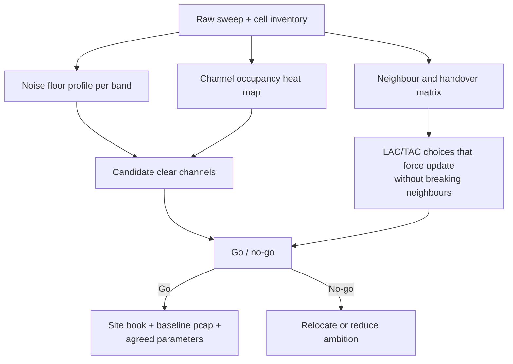

Deliverables from this phase:

- Noise floor profile, with a stated confidence interval
- Occupancy heat map by hour
- Neighbour matrix showing which cells a handset would compare you against
- A shortlist of clear channels and a ranked order of preference
- Recommended LAC/TAC strategy: fresh value, or clone-a-neighbour
- Predicted self-interference footprint at candidate power levels

### 28.5 Phase 4 — Baseline capture

Capture the untouched RF environment for later comparison.

```bash
# ring buffer, 500 MB files, 20 files, sha256 per close
dumpcap -i <iface> -b filesize:512000 -b files:20 -w baseline.pcapng
```

Hash each closed file immediately and append to a manifest. Baseline pcaps are the control group for every later claim of "a new cell appeared."

### 28.6 Phase 5 — Low-power key-up test

Transmit at the lowest useful power, off-peak, and measure:

| Check | Pass condition |
|---|---|
| Own emissions inside the channel | Spectrum analyser, no adjacent splatter |
| Neighbour RSCP unchanged | Within 2 dB of baseline |
| Handsets attach | At least one test handset, quickly |
| No mass reselection | Fewer than 10% of test handsets churn |
| Withdrawal clean | All test handsets return to the real cell inside 60 s |

### 28.7 Phase 6 — Go/no-go gate

| Criterion | Weight | Fail action |
|---|---|---|
| Legal position documented | Mandatory | Stop |
| Noise floor adequate | Mandatory | Relocate |
| Clear channel available | Mandatory | Relocate or narrow band |
| GNSS lock achievable | Mandatory for 4G/5G | Relocate or 2G-only |
| Neighbour impact acceptable | High | Reduce power |
| Physical access stable | High | Relocate |
| Baseline captured and hashed | High | Capture first |

### 28.8 Phase 7 — Post-deployment verification

Repeat the Phase 5 checks after 1 hour, 24 hours and 7 days. Log the delta. A degradation that appears on day three is usually thermal or a neighbour changing configuration, not your settings.

### 28.9 Survey anti-patterns

| Anti-pattern | Consequence |
|---|---|
| Deploying at midday in a quiet window | Night traffic finds the collision you missed |
| Using maximum power "to be safe" | Mass reselection, complaints, self-interference |
| Skipping the desk study | Re-inventing a channel plan the regulator already published |
| Cloning a neighbour's LAC without checking | Both cells fight; handovers thrash |
| No baseline | No way to prove you caused or did not cause a fault |
| Surveying on a different band than deployment | Numbers do not transfer |

---

## 29. Handing a Session to a Real Core

<!-- patch:img:## 29. Handing a Session to a Real Core -->
<p class="plates">
<figure><figcaption>Open5GS — project site (project)</figcaption></figure>
<figure><figcaption>Kamailio — Wikimedia (Commons)</figcaption></figure>
</p>
<!-- /patch:img -->


### 29.1 What the phrase actually means

A catcher that runs its own core is an island. The handset attaches, gets an identity request, and then either sits on a fake network with no service or drops. Handing the session to a real core means the handset gets **genuine service** — real authentication, real data, real voice — while you remain in the path.

There are two distinct architectures and they are often conflated.

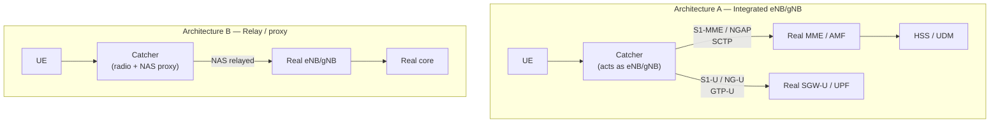

**Architecture A** is cleaner. The catcher *is* an eNB. If the target's IMSI is provisioned in the operator HSS, authentication succeeds properly and the session is fully genuine. The catcher sees all S1AP and can mirror S1-U.

**Architecture B** is stealthier and harder. The catcher terminates the radio and relays NAS to a real base station, which means it must track two cipher states and stay transparent. Handsets are much less likely to notice, but timing and state bugs are constant.

### 29.2 Interfaces, precisely

| Interface | Protocol | Port | Between |
|---|---|---|---|
| S1-MME | S1AP over SCTP | 36412 | eNB ↔ MME |
| S1-U | GTP-U over UDP | 2152 | eNB ↔ SGW-U |
| X2 | X2AP over SCTP | 36422 | eNB ↔ eNB |
| NG (control) | NGAP over SCTP | 38412 | gNB ↔ AMF |
| NG (user) | GTP-U over UDP | 2152 | gNB ↔ UPF |
| N2/N3 | as NG | — | 5G equivalents |
| Mn | H.248 over SCTP/UDP | 2944 | MSC Server ↔ MGW |
| Mc | H.248 | 2944 | (2G/3G equivalent) |
| ISC / SIP | SIP over UDP/TCP | 5060 | S-CSCF ↔ application server |

### 29.3 What "media gateway" means here

A media gateway converts bearer formats and transports. In a 2G intercept it lets the catcher's MSC place the call leg onto the PSTN or an operator MGW.

- **2G/3G CS voice:** catcher MSC → Mn/H.248 → MGW → TDM or SIP egress. FOSS approximation: Asterisk or FreeSWITCH acting as MGW plus a SIP trunk, with `osmo-msc` bridged to it.
- **VoLTE:** far harder. Requires IMS — P-CSCF, S-CSCF, HSS, and the operator's own IMS. Most DIY programmes simply do not do VoLTE intercept and accept CS fallback to 2G/3G.

State this to stakeholders early: **VoLTE intercept in a DIY stack is a project, not a checkbox.**

### 29.4 Building Architecture A with FOSS

You need a core that accepts an external RAN and exposes the interfaces. Open5GS does both.

**Topology (lab):**

```text
srsRAN eNB/gNB  ──S1/NG──►  Open5GS MME/AMF  ──►  Open5GS SGW/UPF  ──►  NAT  ──►  internet
        │                          │
        │                          └──► HSS/UDM  (subscribers.yaml)
        └──S1-U/NG-U──►  UPF (gtp5g kernel module)
```

**Steps:**

```bash
# 1. kernel GTP module, needed for real user-plane throughput
git clone https://github.com/open5gs/gtp5g.git
cd gtp5g && make && sudo make install && sudo depmod -a && sudo modprobe gtp5g

# 2. core
git clone https://github.com/open5gs/open5gs && cd open5gs
meson build --prefix=/usr && ninja -C build && sudo ninja -C build install

# 3. provision the target IMSI so authentication can succeed
sudo open5gs-dbctl add 001010000000001 465B5CE8B199B49FAA5F0A2EE238A6BC E8ED289DEBA952E4283B54E88E6183CA
```

`open5gs-dbctl add <imsi> <ki> <opc>` — you need the Ki and OPc. Without them, the handset fails authentication and you get the identity but no service. This is the single most common failure point in Architecture A: **you must hold credentials for the target's SIM.**

Where you do not, you are limited to identity harvesting, not service handoff.

**Then point srsRAN at it:**

```ini
# enb.conf
[enb]
mcc = 001
mnc = 01
mme_addr = 127.0.1.100
gtp_bind_addr = 127.0.1.1
```

**AMF/MME address binding** must match `mme.yaml` / `amf.yaml` `s1ap_server` / `ngap_server` `bind_address`.

### 29.5 The 5G complication

On NG, the gNB's NGAP carries the SUCI, not the SUPI. Open5GS's UDM must hold the subscriber's SUCI-deconcealment key (the home network private key) to resolve it. If you do not have it, the AMF logs an opaque value and authentication fails.

Three ways through:

1. Hold the operator's home-network private key (rare outside the operator).
2. Force the UE onto null-scheme so the SUPI arrives in plaintext.
3. Do not use 5G — bid down to LTE, where the IMSI is plaintext on request.

### 29.6 Legal-intercept interfaces

Standards worth having on the shelf:

| Standard | Subject |
|---|---|
| ETSI TS 101 671 | HI1/HI2/HI3 handover interfaces |
| 3GPP TS 33.107 | 3GPP network LI architecture |
| 3GPP TS 33.108 | HI2/HI3 for 3GPP networks |

The chain is: network function → **X1** → mediation → **X2/X3** → LEA. X1 is usually SIP or a proprietary export. X2 carries IRI (intercept-related information — signalling) and X3 carries CC (content of communication).

**There is no mature free LI mediation platform.** This is the largest genuine gap in the FOSS stack. Build one, or buy one.

### 29.7 Building minimal mediation internally

A workable X1→X2/X3 skeleton:

| Component | Tool |
|---|---|
| X1 SIP listener | Kamailio with `sipdump`-style capture |
| IRI extraction | `tshark` with S1AP/NAS dissectors, `-T ek` to JSON |
| CC extraction | RTP from `rtpengine` or FreeSWITCH capture |
| Envelope | ASN.1 per TS 33.108, or JSON with a documented schema |
| Transport to LEA | SFTP with per-file hashing, or a REST endpoint |
| Correlation | A shared `xid` across IRI and CC |

```bash
# IRI extraction, eNB-side
tshark -i s1 -Y "s1ap" -T ek -w iri.ndjson -b filesize:102400

# CC capture
dumpcap -i s1u -f "udp port 2152" -w cc.pcapng
```

Document your own envelope schema and version it. An LEA will accept a schema you can defend; it will not accept one you invented on the day.

### 29.8 Relay architecture (B), briefly

Proxy the NAS between the UE and a real eNB. Practical building blocks:

- `srsRAN` in `ue` mode for the upstream leg
- A NAS-aware proxy — no mature FOSS exists; most implementations are bespoke C or Python
- Two cipher contexts, keyed separately, with re-key handling on both sides

Expect three to six months of engineering for a stable relay.

---
---

## 30. CDR Generation and the Evidence Chain

<!-- patch:img:## 30. CDR Generation and the Evidence Chain -->
<p class="plates">
<figure><figcaption>OpenSSL — Wikimedia (Commons)</figcaption></figure>
</p>
<!-- /patch:img -->


### 30.1 Why this is the part that fails

A technically perfect intercept is worthless if you cannot show, months later, that the file is the same file, produced at the time claimed, by the equipment claimed, unaltered. Courts and regulators ask four questions and FOSS answers three of them well:

| Question | FOSS answer |
|---|---|
| Is this the original? | Yes — SHA-256 at capture close |
| When was it taken? | Yes — RFC 3161 trusted timestamp |
| Was it altered? | Yes — hash chain plus immutable storage |
| Who handled it, and in what order? | Partly — auditd and signed manifests |
| Is the tooling validated? | **No** — you validate it yourself |

### 30.2 CDR schema

A defensible CDR carries more than the call. Minimum fields:

```text
record_id          UUIDv4
xid                correlation id, shared with CC
event_type         attach | detach | identity_req | auth | pdp_activate | call_start | sms
timestamp_utc      RFC 3339, millisecond precision
imsi               as observed
imei / imeisv      as observed
msisdn             if resolved
plmn_mcc_mnc       your broadcast value
lac_tac            your broadcast value
cell_id            your cell
rat                GSM | UMTS | LTE | NR
cipher             A5/0 | EEA0 | NEA0 | encrypted
direction          mo | mt
peer               other party
cause_code         release cause
duration_s         where applicable
bytes_up / down
source_node        hostname + build hash
prev_record_hash   hash chain
record_hash        SHA-256 of this record, prev hash included
```

The `prev_record_hash` field turns the CDR set into a hash chain. Removing a record breaks the chain visibly.

### 30.3 Timestamping

Use RFC 3161, not `date`.

```bash
# build a timestamp query over the capture hash
sha256sum exhibit.pcapng > exhibit.sha256
openssl ts -query -data exhibit.sha256 -sha256 -cert -out exhibit.tsq

# submit to a TSA and store the reply
curl -s -H "Content-Type: application/timestamp-query" \
     --data-binary @exhibit.tsq https://freetsa.org/tsr -o exhibit.tsr

# verify later
openssl ts -verify -in exhibit.tsr -data exhibit.sha256 -CAfile cacert.pem
```

FreeTSA (`https://freetsa.org/`) is a public TSA. For production, contract a TSA with an audited clock, or run your own with `openssl ts` plus a GNSS-disciplined NTP source. Never timestamp from an unverified host clock.

### 30.4 Hashing and immutability

```bash
# hash every closed capture immediately
find ./captures -name '*.pcapng' -newer .lastrun -print0 \
  | xargs -0 sha256sum >> manifest.sha256

# verify the whole set before disclosure
sha256sum -c manifest.sha256
```

Storage side: write-once. S3 Object Lock in compliance mode, MinIO with immutability, or WORM optical. Local disk is not evidence storage.

### 30.5 Chain of custody

| Control | Implementation |
|---|---|
| Who touched what | `auditd` rules on the capture and evidence paths |
| Ordering | Hash chain in CDR, monotonic sequence in manifest |
| Transfer record | Signed handover form, countersigned, scanned into the bag |
| Storage integrity | Object lock, versioning, delete-protection |
| Access log export | `auditd` to a remote `syslog-ng` the operator cannot edit |
| Media destruction | Certificate of destruction, referenced in the bag |

```bash
# auditd: watch the evidence tree
auditctl -w /srv/evidence -p war -k evidence
```

### 30.6 Packaging

Use BagIt. It is a Library of Congress standard, it is free, and it produces a verifiable manifest.

```bash
pip install bagit
bagit.py --processes 4 /srv/evidence/exhibit-2026-11-13-001
bagit.py --validate /srv/evidence/exhibit-2026-11-13-001
```

A bag contains `bagit.txt`, `manifest-sha256.txt`, `bag-info.txt` and the payload. Add your custody form and TSR files to the payload, then re-bag. `bag-info.txt` should carry source, contact, capture start and end, tool versions and build hashes.

### 30.7 Tool validation

Nobody validates your stack but you. Minimum:

| Test | Method |
|---|---|
| Capture fidelity | Inject known traffic with `tcpreplay`, verify byte-for-byte |
| Hash correctness | Known-answer test against `sha256sum` on a fixture |
| Timestamp correctness | Verify a TSR against a control file |
| Clock discipline | `chronyc tracking`, offset logged per session |
| Repeatability | Same input, three runs, identical hashes |
| Negative test | Corrupt a byte, confirm verification fails |

Record the results in a validation report per tool version. Re-run on upgrade. This document is what turns a hobby rig into an instrument.

### 30.8 Retention and disclosure

Retention schedule by data class, approved by legal, enforced by lifecycle rules. Disclosure export should be a single command producing a bag plus a redaction log. Redaction itself must be hashed and the original retained.

### 30.9 What FOSS will not give you

- A validated, certified LI mediation platform
- ASN.1 encoders for TS 33.108 out of the box
- Any guarantee an LEA will accept your schema
- Certified time sources without money

Everything else on this page is buildable in a fortnight by one competent engineer.

---

## 31. Signalling Parameters That Force Downgrade or Plaintext

These are the levers. Each is a real field, not a magic string.

### 31.1 PLMN — the gatekeeper

A handset attaches only to a PLMN in its SIM's home list or the operator-controlled PLMN selector. Broadcast a PLMN it does not know and nothing happens.

| Region | Operator | MCC | MNC |
|---|---|---|---|
| US | T-Mobile | 310 | 260 |
| US | AT&T | 310 | 410 |
| US | Verizon | 311 | 480 |
| Canada | Rogers | 302 | 720 |
| Canada | Bell | 302 | 610 |
| Canada | Telus | 302 | 220 |
| UK | Vodafone | 234 | 15 |
| UK | EE | 234 | 30 |
| UK | O2 | 234 | 10 |
| UK | Three | 234 | 20 |
| Germany | Telekom | 262 | 01 |
| Germany | Vodafone | 262 | 02 |
| Germany | O2 | 262 | 03 |
| France | Orange | 208 | 01 |
| France | SFR | 208 | 10 |
| Australia | Telstra | 505 | 01 |
| Japan | NTT docomo | 440 | 10 |
| Japan | KDDI | 440 | 50 |
| Test | 3GPP test PLMN | 001 | 01 |

Full tables: 3GPP TS 23.003 Annex, or the ITU-T E.212 register.

### 31.2 Cipher selection — the plaintext lever

The network sends a *list* of permitted algorithms and the handset takes the first it supports. Send only the null algorithm and you get plaintext.

**GSM — OsmoBTS, in the `bts` node:**

```text
bts 0
 cipher a5/0
```

`a5/0` means no ciphering. `cipher a5/1 a5/3` offers both and lets the handset pick.

**LTE — Open5GS `mme.yaml`:**

```yaml
security:
  integrity_order: [EIA2, EIA1, EIA0]
  ciphering_order: [EEA0]
```

**5G — Open5GS `amf.yaml`:**

```yaml
security:
  integrity_order: [NIA2, NIA1, NIA0]
  ciphering_order: [NEA0]
```

**srsRAN** exposes `cipher_algo` and `integ_algo` in the security section of `enb.conf` / `gnb.conf`. Set `cipher_algo = EEA0` for null ciphering.

### 31.3 LAC / TAC — the identity lever

A handset sends a Location Update when the LAC/TAC changes. That update carries the IMSI if no valid TMSI/GUTI exists for the new area.

Two strategies:

| Strategy | Effect | Risk |
|---|---|---|
| Fresh unused LAC | Guaranteed update, guaranteed IMSI | Every handset in range attaches |
| Clone a real neighbour's LAC | Looks normal | Handsets may not update at all |

```text
bts 0
 location_area_code 4242
```

Pick a value no local cell uses. Verify from the survey.

### 31.4 RAT and band — the downgrade lever

Downgrade is achieved by *absence*, not by a command. Broadcast only 2G and a handset with 2G enabled has nowhere else to go.

| To force | Do |
|---|---|
| 2G | Run only a GSM BTS, no LTE/5G |
| LTE | Run only an eNB, do not advertise NR |
| Plaintext 4G | LTE with `ciphering_order: [EEA0]` |
| Plaintext 5G | NR with `ciphering_order: [NEA0]`, and null-scheme SUCI |

### 31.5 Null-scheme SUCI

To make a 5G UE send SUPI rather than SUCI, the home network must be configured for the null scheme. On your own core:

```yaml
# amf.yaml / udm.yaml, per Open5GS documentation
security:
  suci:
    null_scheme: true
```

The UE still encrypts to its *real* home key by default, so null-scheme only helps when the UE is provisioned against your core. For an unknown handset, bid down to LTE.

### 31.6 Identity solicitation

After attach, the network may send an Identity Request for IMSI or IMEI. In Osmocom the HLR/HLR-side path issues this automatically when no TMSI is cached. To force it, clear the VLR cache or use a fresh LAC.

### 31.7 Device-side codes

Entered on the handset, not transmitted.

| Code | Platform | Function |
|---|---|---|
| `*#*#4636#*#*` | Android | Testing menu; "Set preferred network type" can pin GSM-only or LTE-only |
| `*3001#12345#*` | iOS | Field Test; serving cell, RAT, band, neighbours |
| `*#06#` | Both | IMEI display |
| `*#*#7267782#*#*` | Some Android | RAT/band lock menu, OEM-dependent |

Preferred-network-type values in the Android menu (indicative, OEM varies):

```text
GSM only              → forces 2G, guaranteed downgrade
LTE only              → blocks 2G fallback
NR only               → 5G SA, SUCI applies
LTE/GSM auto (PRL)    → fallback open
```

### 31.8 Sequence that works

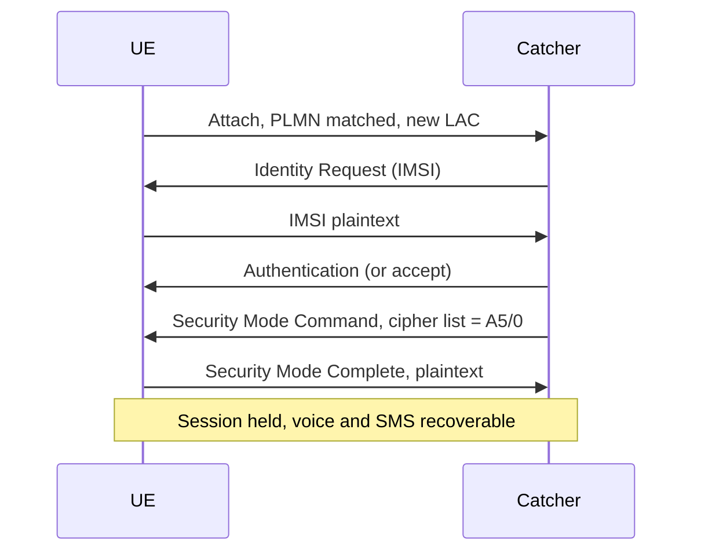

---

## 32. Gap Analysis: Commercial, FOSS, Internal

| Need | Buy | Free | Build |
|---|---|---|---|
| Survey tooling | Vendor service | QGIS, SPLAT!, kalibrate, grgsm_scanner | Methodology in §28 |
| S1/NG attach | Vendor | Open5GS, srsRAN | §29.4 |
| Media gateway | Vendor MGW | Asterisk, FreeSWITCH, Kamailio | §29.7 |
| IMS for VoLTE | Vendor | Kamailio + Open5GS | Large |
| CDR generation | Built in | `tshark -T ek`, custom | §30.2 |
| Timestamping | Built in | `openssl ts`, FreeTSA | §30.3 |
| Custody | Built in | `auditd`, `bagit`, object lock | §30.5 |
| LI mediation | Built in | **none** | §29.7, months |
| Validation | Vendor | **none** | §30.7 |
| Support | Contract | Forums | Time |

---

## 33. Internal Build Order

Do it in this order. Each step is testable before the next.

1. Passive survey rig — scanner, GNSS, logging. No transmit.
2. Hash and timestamp pipeline on dummy files. Prove it works.
3. Open5GS core in the lab, with a known SIM.
4. srsRAN eNB into the core. One handset attaches.
5. CDR emitter, chained. Verify chain breaks on deletion.
6. BagIt packaging plus custody form.
7. Validation report for each tool.
8. Survey a real site. Baseline and gate.
9. Low-power key-up. Verify no neighbour impact.
10. Only then: mediation, IMS, VoLTE.

Steps 1 to 7 are weeks. Steps 8 to 10 are months.

---

## 34. References

**Standards**

- 3GPP TS 23.003 — Numbering, addressing and identification (PLMN, IMSI structure)
- 3GPP TS 33.107 — 3GPP network lawful intercept architecture
- 3GPP TS 33.108 — Handover interfaces for lawful intercept
- ETSI TS 101 671 — Lawful interception handover interfaces (HI1/HI2/HI3)
- IETF RFC 3161 — Time-Stamp Protocol
- IETF RFC 8493 — BagIt file packaging
- ITU-T E.212 — International identification plan for mobile terminals

**Software**

- Open5GS — <https://open5gs.org/> · docs <https://open5gs.org/open5gs/docs/>
- srsRAN — <https://github.com/srsran/srsRAN_Project>
- gtp5g — <https://github.com/open5gs/gtp5g>
- Kamailio — <https://www.kamailio.org/>
- FreeSWITCH — <https://freeswitch.org/>
- Asterisk — <https://www.asterisk.org/>
- Osmocom — <https://osmocom.org/>
- gr-gsm — <https://github.com/ptrkrysik/gr-gsm>
- kalibrate-rtl — <https://github.com/steve-m/kalibrate-rtl>
- Wireshark / tshark / dumpcap — <https://www.wireshark.org/>
- bagit-python — <https://github.com/LibraryOfCongress/bagit-python>
- hashdeep — <https://github.com/jessek/hashdeep>
- OpenSSL `ts` — <https://www.openssl.org/docs/man3.0/man1/openssl-ts.html>
- auditd — <https://github.com/linux-audit/audit-userspace>
- syslog-ng — <https://www.syslog-ng.com/>
- QGIS — <https://qgis.org/>
- SPLAT! — <https://www.qsl.net/kd2bd/splat.html>
- Radio Mobile — <https://www.ve2dbe.com/english1.html>
- CellMapper — <https://www.cellmapper.net/>
- OpenCellID — <https://opencellid.org/>
- FreeTSA — <https://freetsa.org/>
- tcpreplay — <https://tcpreplay.appneta.com/>
- MinIO object lock — <https://min.io/>

**Further reading**

- ETSI LI handover overview — <https://www.etsi.org/standards>
- 3GPP specifications portal — <https://www.3gpp.org/specifications>

---

*Steps 8 to 10 in §33 are where programmes fail. Survey and evidence are the two disciplines that separate an instrument from an experiment.*

---
---

# Part IV — Build Specification, With Numbers

**Every section pairs a full specification with a bootstrap bypass**

Part version 1.0 · Compiled 2026-11-13

**Part IV index**

<details class="toc">
<summary>Show sections</summary>

35. [RF Exposure and Exclusion Zones](#35-rf-exposure-and-exclusion-zones)
36. [TX/RX Isolation and Desense](#36-txrx-isolation-and-desense)
37. [Power Architecture](#37-power-architecture)
38. [Thermal Design](#38-thermal-design)
39. [GNSS and Timing Integrity](#39-gnss-and-timing-integrity)
40. [Calibration and Measurement](#40-calibration-and-measurement)
41. [Host Hardening and Watchdog](#41-host-hardening-and-watchdog)
42. [Rig Security](#42-rig-security)
43. [Configuration Management and Version Pinning](#43-configuration-management-and-version-pinning)
44. [Acceptance Testing](#44-acceptance-testing)
45. [Ground Truth](#45-ground-truth)
46. [UE Fleet and SIM Tooling](#46-ue-fleet-and-sim-tooling)
47. [Documentation Deliverables](#47-documentation-deliverables)
48. [Licensing Checklist](#48-licensing-checklist)
49. [The One-Day Bootstrap Build](#49-the-one-day-bootstrap-build)

</details>

> **How to read this.** Each section has a **Spec** (do this properly), a **Verify** (how you prove it), a **Bootstrap** (the cheap version that gets you running today), and a **Breaks when** (the failure you have accepted). Bootstraps are labelled as cutting corners. They are legitimate for a lab, a demo or a first site. They are not legitimate for an evidential deployment.

---

## 35. RF Exposure and Exclusion Zones

### Spec

Compute maximum permissible exposure, derive an exclusion radius, mark it, and enforce it.

Power density in the far field:

```
S = (P × G) / (4π d²)
d = sqrt( (P × G) / (4π S_limit) )
```

Where `S_limit` is the applicable reference level. FCC OET-65 general population at 900 MHz is `f/1500 = 0.6 mW/cm²` (6 W/m²); at 1800 MHz it caps at 1.0 mW/cm² (10 W/m²). Occupational limits are five times higher. ICNIRP 2020 general public is 4.5 W/m² at 900 MHz.

**Exclusion radius, general population, FCC, metres:**

| TX power | 3 dBi | 6 dBi | 9 dBi |
|---|---|---|---|
| 5 W @ 900 MHz | 0.36 | 0.51 | 0.73 |
| 20 W @ 900 MHz | 0.73 | 1.03 | 1.46 |
| 50 W @ 900 MHz | 1.15 | 1.63 | 2.30 |
| 20 W @ 1800 MHz | 0.56 | 0.80 | 1.13 |
| 50 W @ 1800 MHz | 0.89 | 1.26 | 1.78 |

Divide by `sqrt(5) ≈ 2.24` for occupational limits.

**Far-field caveat.** The formula is valid only beyond `2D²/λ`. A 0.5 m antenna at 900 MHz needs about 1.5 m, so the near-field distance is comparable to the exclusion radius. **Add 50% margin** and never rely on the calculated figure inside `2D²/λ`.

**Practical rules:** mount so the main beam clears head height or points away from walkways; add a physical barrier at the exclusion radius; signage at every approach; keep the radius clear during key-up; log measured values with a broadband probe.

### Verify

Broadband probe measurement at 0.5×, 1× and 2× the calculated radius, on axis and at ±45°. Record. Confirm all readings below `S_limit`.

### Bootstrap

Use the table above, round up one row, add a 2 m cone on the main beam, and put a rope around it. Do not measure.

### Breaks when

You point a 9 dBi panel along a corridor, or someone stands beside a mast-mounted omni, or you raise power later and never revisit the number. Symptom is a warm face and, eventually, a complaint.

---

## 36. TX/RX Isolation and Desense

### Spec

Your transmitter deafens your receiver. This is the number-one self-inflicted failure and it is entirely predictable.

**Requirement.** Leakage at the receiver port must sit below the receiver noise floor plus 3 dB.

GSM noise floor in 200 kHz is approximately `-174 + 10log(200000) = -121 dBm`. Target leakage `≤ -124 dBm`. With 43 dBm (20 W) transmit, required isolation:

```
I ≥ 43 + 124 = 167 dB
```

No duplexer gives 167 dB alone. You reach it by combining mechanisms:

| Mechanism | Typical contribution |
|---|---|
| TX bandpass filter | 60–80 dB at RX band |
| Duplexer / cavity duplexer | 75–90 dB |
| Vertical antenna separation, 10 m | 55–65 dB |
| Vertical separation, 25 m | 65–75 dB |
| Horizontal separation, 10 m | 40–45 dB |
| Cross-polarisation | +3 to 10 dB |

**Vertical separation beats horizontal by roughly 20 dB** because the vertical pattern null does the work. Put TX on top, RX below, never side by side.

**Also required:** LNA with high IIP3 (≥ +10 dBm) and a limiter or switchable attenuator ahead of it, so a `-37 dBm` leak does not compress the front end. AGC off; fixed gain staging.

### Verify

1. Key the PA into a dummy load. Measure leakage at the RX port with a spectrum analyser. Isolation = `P_tx - P_leak`.
2. Repeat on the real antennas at the real separation.
3. Connect the RX chain, key up, and read the noise floor rise. **Target ≤ 1 dB.**

### Bootstrap

TX and RX on the same mast, 3 m vertical, one bandpass on TX, AGC on, and accept 3–6 dB desense.

### Breaks when

Sensitivity collapses, attach range halves, and 4G cells become invisible the moment you transmit. Symptom is "it works on the bench, not in the field."

---

## 37. Power Architecture

### Spec

| Element | Specification |
|---|---|
| Rail | 12 V nominal for RF, 48 V or mains for compute where available |
| Battery | LiFePO4, sized for 8 h at measured average draw × 1.5 |
| BMS | Mandatory, with low-voltage cutoff and cell balancing |
| Fusing | Blade fuse at the battery positive, one per branch, rated 1.5× branch current |
| Breakers | DC-rated only; never AC breakers on DC |
| Inverter | Pure sine, sized 2× continuous load, for any mains kit |
| UPS | Compute on its own UPS, 30 min minimum |
| Grounding | Single-point star; chassis bonded; signal ground separate |
| Vehicle | Split-charge relay with ignition sense; measure alternator headroom first |

**Sizing worked example.** 20 W RF at 30% PA efficiency = 47 W dissipated; 12 V rail draw ≈ 4 A for the PA alone, 1 A compute, 0.5 A scanner, 0.3 A misc ≈ 5.8 A. For 8 h: 46 Ah, ×1.5 = **70 Ah LiFePO4 minimum.** Most builds under-size this by half.

### Verify

Clamp meter on each branch under full load. Voltage at the SDR terminals under load must stay above 11.8 V. Thermal camera on fuses and connectors after 30 minutes.

### Bootstrap

One 20 Ah AGM, a 10 A blade fuse, an inline switch, and a 12 V 5 A supply on mains when available.

### Breaks when

Voltage sags, the SDR browns out mid-capture, or the PA draws a spike the supply cannot source. Symptom is random disconnects and corrupt pcaps.

---

## 38. Thermal Design

### Spec

PA efficiency 25–35% means a 20 W PA dumps 40–50 W as heat. A sealed die-cast box is an oven.

| Element | Specification |
|---|---|
| PA mounting | Thermal pad or paste to an external finned heatsink, PA tab to metal |
| Heatsink | `Rth ≤ 0.8 K/W` for 45 W dissipation to hold ΔT ≈ 36 K |
| Enclosure | Vented or fan-assisted; IP54 with filtered vents is better than IP67 and hot |
| Sun | Light colour, shade, or a double-skin roof |
| Internal ambient | **≤ 50 °C** |
| SDR junction | **≤ 85 °C**, read from telemetry |
| Fan | 40 mm minimum, on a thermostatic switch at 45 °C |
| Telemetry | Temperature logged, alarm at 60 °C internal |

**Worked check.** 47 W into a 3 K/W die-cast box in still air = `ΔT = 141 K`. Hopeless. The same 47 W into a 0.8 K/W external heatsink = 38 K, which is marginal and needs air movement.

### Verify

Run at full power for 60 minutes in the intended enclosure and location, at the hottest part of the day. Log internal temperature. Confirm the PA and SDR stop climbing before 55 °C internal. Repeat with the box in direct sun.

### Bootstrap

Bolt the PA to a CPU heatsink, drill two 30 mm holes for convection, mount in shade, and add a 40 mm fan on a USB feed.

### Breaks when

Output power folds back, the SDR drops USB, or the box cooks in summer. Symptom is "it was fine in winter."

---

## 39. GNSS and Timing Integrity

<!-- patch:img:## 39. GNSS and Timing Integrity -->
<p class="plates">
<figure><figcaption>GNSSDO — Leo Bodnar via Batronix (retail)</figcaption></figure>
</p>
<!-- /patch:img -->


### Spec

LTE and NR need frequency accuracy better than 0.05 ppm and phase alignment. Without it, handsets see the cell and refuse to camp.

| Element | Specification |
|---|---|
| Receiver | Multi-constellation, timing-grade, 1PPS output |
| Antenna | Roof or mast, clear sky, 30° elevation mask, lightning arrestor |
| Cable delay | Measured and compensated |
| Holdover | OCXO, drift logged, alarm on unlock |
| Monitoring | `ref_locked` sensor polled every 60 s, alarm on loss |
| Spoof/jam response | Degrade to 2G-only, or hold with OCXO, and alert |
| Sky view | Surveyed in Phase 1; minimum 6 satellites at 30° mask |

### Verify

`uhd_usrp_probe` → `ref_locked: Yes`. Frequency counter against a reference: error under 0.05 ppm. Pull the antenna and confirm the alarm fires and holdover engages without dropping the cell.

### Bootstrap

Use the SDR's internal TCXO for 2G only, accept 2–5 ppm, and do not attempt 4G.

### Breaks when

Handsets ignore the 4G cell, or attach and immediately drop. Symptom is "the cell is there on the analyser but not on the phone."

---

## 40. Calibration and Measurement

### Spec

Minimum bench: spectrum analyser to 6 GHz, directional coupler, 30 dB and 20 dB 100 W attenuators, 50 W dummy load, power meter, VNA or return-loss bridge, frequency counter, broadband exposure probe.

| Measurement | Frequency |
|---|---|
| Cable loss, every run | On installation and annually |
| VSWR / return loss | Every antenna, every install, `< 1.5:1` |
| TX power at the antenna port | Every install |
| Harmonic and spur check to 3× f | Every install |
| Isolation | Every install and after any mast work |
| Exposure | Every install |

Uncertainty budget documented. Analyser reference level set so the noise floor sits at −90 dBm and nothing clips.

### Verify

Written calibration record per build, with instrument serials and calibration due dates. Any instrument out of calibration invalidates the record.

### Bootstrap

Power meter and dummy load only. Verify forward power, skip return loss and spurs.

### Breaks when

You transmit into a disconnected antenna, radiate harmonics into a neighbour's band, or discover the "20 W" amplifier was delivering 8 W.

---

## 41. Host Hardening and Watchdog

### Spec

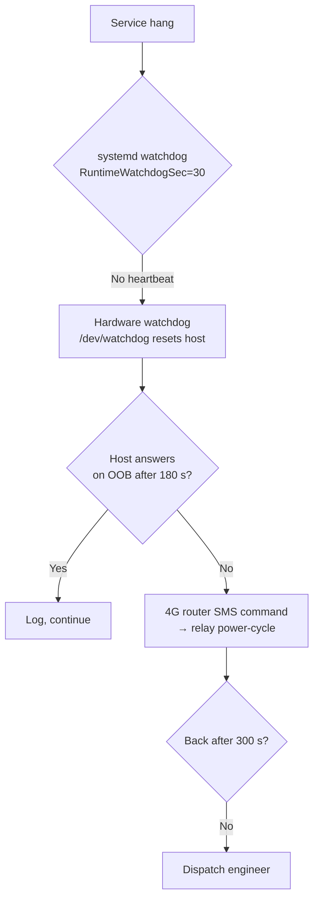

| Control | Setting |
|---|---|
| Read-only rootfs | Overlayfs, `/etc` and `/var` on separate writable partition |
| Hardware watchdog | `/dev/watchdog`, 30 s timeout |
| systemd watchdog | `RuntimeWatchdogSec=30`, `Restart=always` |
| Auto-start | Service enabled at boot, no login required |
| OOB access | Second path: 4G router or serial console |
| Remote power cycle | Relay on the DC rail, SMS or HTTPS triggered |
| Boot time | Under 90 s to service-ready |
| Log shipping | Remote syslog, local ring buffer only |

### Verify

`kill -9` the main service: back inside 60 s. Pull power: back inside 120 s. Block OOB: confirm the SMS reboot fires. Do this before every deployment.

### Bootstrap

`Restart=always` in systemd, a smart plug on the mains, and a human 20 minutes away.

### Breaks when

The service hangs at 02:00 in a locked building and nobody notices until the next working day.


---
---

## 42. Rig Security

### Spec

| Control | Detail |
|---|---|
| SSH | Keys only, `PermitRootLogin prohibit-password`, non-default port |
| Management | TLS on every web interface, self-signed accepted, pinned where possible |
| Segmentation | Management VLAN, capture VLAN, no route between them and the internet |
| Credentials | Per-device unique, in SOPS or Vault, rotated on staff change |
| Disk | LUKS on the evidence partition |
| Patching | Monthly, tracked, with a rollback image |
| Tamper | Case switch, serials recorded, asset register |
| Remote wipe | `cryptsetup luksErase` on command |
| Physical | Locking enclosure, tamper-evident seals, mast lock |

### Verify

External port scan from the capture VLAN: only the intended services. Attempt SSH with a password: refused. Confirm the tamper switch logs.

### Bootstrap

Change every default password, disable password SSH, and lock the box.

### Breaks when

The rig is on a shared network with `admin/admin` and a default port, and someone finds it.

---

## 43. Configuration Management and Version Pinning

### Spec

```text
config/
  base/            templated, no secrets
  sites/<site>/    overrides only
  secrets/         SOPS-encrypted
  manifest.sha256  hash of every rendered file
```

| Rule | Detail |
|---|---|
| Everything in Git | No field change outside version control |
| Rendering | Jinja2 templates, rendered on deploy, never edited in place |
| Secrets | SOPS with age keys, never plaintext in Git |
| Upstream pinning | `srsRAN` and `Open5GS` pinned by commit, not branch |
| Containers | Pinned by digest, never `:latest` |
| Build reproducibility | Toolchain hashed, recorded in every CDR |
| Rollback | Previous rendered config retained, one command to revert |

### Verify

Redeploy from Git to a clean host and diff the rendered output against the running config. Zero difference. Rebuild the image twice: identical hash.

### Bootstrap

Git for configs, no templating, upstream at a tagged release, and a note of the commit in the site book.

### Breaks when

You cannot reproduce a capture from three months ago because the stack moved, and the evidential argument collapses.

---

## 44. Acceptance Testing

### Spec

Every build passes before deployment. Signed record per build.

| Test | Pass criterion |
|---|---|
| Boot from cold, no console | Service ready under 90 s |
| Service kill recovery | Back under 60 s, three consecutive times |
| Power pull recovery | Back under 120 s |
| 72 h soak | No hang, no memory growth over 5%, no dropped capture |
| Capture fidelity | `tcpreplay` known traffic, byte-identical hash |
| Hash correctness | Known-answer test against `sha256sum` |
| Timestamp correctness | TSR verifies against control file |
| Clock discipline | Offset under 50 ms, logged |
| Attach, 2G | Test UE attaches in under 20 s at 1 m |
| Attach, 4G | Test UE attaches with timing locked |
| Desense | Noise floor rise ≤ 1 dB on key-up |
| Isolation | Measured value ≥ 160 dB |
| Exposure | All probe readings below limit |
| Thermal | Stable under 55 °C internal for 60 min |
| Repeatability | Three runs, identical hashes |
| Negative | Corrupt a byte, verification fails |

### Verify

Checklist signed by builder and by a second person. Any fail blocks deployment.

### Bootstrap

Attach test, boot test, and a 4 h soak. Nothing else.

### Breaks when

You deploy a build that cannot survive a reboot and discover it in the field.

---

## 45. Ground Truth

### Spec

You need to know whether a capture is *correct*, not merely present.

| Method | Weight |
|---|---|
| Second independent stack, same site, same time | Highest |
| Operator-side data for one known session | Highest |
| Known-good UE with a programmable SIM, scripted call | High |
| Third-party decoder on the same pcap | Medium |
| Manual NAS decode by a second engineer | Medium |

Compare attach counts, identity values and timings across sources. A 10% divergence means one stack is wrong; find out which before trusting either.

### Verify

Ground-truth session documented, cross-checked, and filed with the build record.

### Bootstrap

One scripted call with a programmable SIM, decoded by hand in Wireshark, compared against your CDR.

### Breaks when

You report a subscriber count that is quietly 30% low because a channel was mis-tuned, and nobody can tell.

---

## 46. UE Fleet and SIM Tooling

### Spec

| Item | Purpose |
|---|---|
| 2G-only feature phone | Baseline downgrade target |
| 2G/4G Android, older OS | Fallback behaviour |
| 5G SA Android | SUCI behaviour |
| iPhone, current iOS | Lockdown Mode behaviour |
| iPhone, older iOS | Pre-Lockdown comparison |
| Programmable SIM ×5 (`sysmoSIM` or 5G test card) | Authentication testing |
| PC/SC reader | `pySim` programming |
| eSIM test profile | eUICC path |

```bash
# program a test SIM
pyimsi --reader 0 --pin 1234
pySim-prog.py -p 0 -t sysmoSIM-GR2 -i 001010000000001 \
  -k 465B5CE8B199B49FAA5F0A2EE238A6BC \
  -o E8ED289DEBA952E4283B54E88E6183CA
```

Without programmable SIMs you cannot test Authentication, only identity harvesting.

### Verify

Each handset documented with model, OS build and baseband version. Every one attaches to a known-good stack.

### Bootstrap

One spare Android handset and one programmable SIM.

### Breaks when

You can only test with handsets that happen to be in the room, and your results do not generalise.

---

## 47. Documentation Deliverables

| Document | Content |
|---|---|
| Site book | Photos, measurements, drawing, access, power, GNSS view |
| As-built | Rendered config, cable schedule, IP plan, serials |
| Baseline record | Noise floor, occupancy, neighbour matrix, hashed pcaps |
| Calibration record | Instrument serials, due dates, measurements |
| Acceptance record | Signed checklist |
| O&M manual | Start, stop, recover, escalate |
| Validation report | Per tool version, per §44 tests |
| Handover pack | All of the above, indexed |

---

## 48. Licensing Checklist

Not legal advice. Confirm locally.

```text
[ ] Regulator identified, contact named
[ ] Licence class determined
[ ] Application submitted, reference recorded
[ ] Coordination with incumbents completed
[ ] Power limit and antenna height limit noted
[ ] Band and channel plan approved
[ ] Notification duty understood
[ ] Type approval position for a home-built transmitter
[ ] Cross-border coordination if applicable
[ ] Insurance covering interference claims
[ ] Complaint contact published
[ ] Renewal date diarised
```

---

## 49. The One-Day Bootstrap Build

A complete, honest bypass. One day, one site, lab-grade only.

### What you need

| Item | Qty |
|---|---|
| LimeSDR Mini 2.0 | 1 |
| Ubuntu 22.04 laptop | 1 |
| 900 MHz 3 dBi omni | 2 |
| 3 m mast or tripod | 1 |
| 20 Ah battery + 10 A fuse | 1 |
| 40 mm USB fan | 1 |
| Programmable SIM + reader | 1 |
| Test Android handset | 1 |

### Sequence

1. Mount TX on top, RX 3 m below. Rope a 2 m cone.
2. Install LimeSuite and Osmocom per §21.
3. `cipher a5/0`, `location_area_code 4242`, PLMN 001/01.
4. `Restart=always`. Fan on the PA. Battery fused.
5. Program one test SIM, attach it, confirm IMSI appears.
6. Run 4 hours. Watch internal temperature and noise floor.

### What this build cannot do

| Missing | Consequence |
|---|---|
| No GNSSDO | 2G only, no LTE |
| No duplexer | 3–6 dB desense |
| No exposure measurement | Calculated radius only, add margin |
| No isolation measurement | Unknown margin |
| No watchdog beyond systemd | Needs a human nearby |
| No version pinning | Not reproducible |
| No ground truth | Correctness unproven |
| No acceptance record | Not defensible |
| No timestamping, no hashing | Not evidential |

### Upgrade order from here

Isolation measurement → GNSSDO → watchdog and OOB → version pinning → hashing and timestamps → acceptance tests → ground truth → exposure survey. In that order. Each one is a day.

---

*The bootstrap is a real build. It is simply a build that has not yet earned the word "evidential."*

---
---

# Part V — 4G/5G Observation Platform: Full Build Guide

**Open hardware, open software, stealth-oriented, extensible**

Part version 1.0 · Compiled 2026-11-13 · Target: lab through field prototype, non-type-approved

**Part V index**

<details class="toc">
<summary>Show sections</summary>

50. [Design Goals and Non-Goals](#50-design-goals-and-non-goals)
51. [Architecture](#51-architecture)
52. [Hardware Selection](#52-hardware-selection)
53. [Software Base Selection](#53-software-base-selection)
54. [Base Build](#54-base-build)
55. [Radio Configuration](#55-radio-configuration)
56. [Stealth Layer](#56-stealth-layer)
57. [Decoding Pipeline](#57-decoding-pipeline)
58. [Data Model and Storage](#58-data-model-and-storage)
59. [API and GUI](#59-api-and-gui)
60. [Telemetry and Charts](#60-telemetry-and-charts)
61. [Carrier Profile System](#61-carrier-profile-system)
62. [Update and Plugin System](#62-update-and-plugin-system)
63. [Deployment Form Factors](#63-deployment-form-factors)
64. [Test and Validation](#64-test-and-validation)
65. [Cost Summary](#65-cost-summary)
66. [Honest Limits](#66-honest-limits)

</details>

> **What "non-compliant" means here.** Not certified, not type-approved, not guaranteed inside spurious-emission limits, and probably operating under experimental or tolerance provisions rather than a proper assignment. That buys enormous freedom in hardware choice and enormous responsibility in testing. It also means you should read Part IV before you key a transmitter in public.
>
> **Search caveat.** Web search was unavailable during compilation. Version-specific config keys and some links are from standing knowledge. Verify against the pinned release documentation before building.

---

## 50. Design Goals and Non-Goals

### Goals

| # | Goal |
|---|---|
| G1 | Full FR1 coverage, 600 MHz to 3.8 GHz, all LTE and NR bands |
| G2 | Passive-first: observe without transmitting by default |
| G3 | Stealth: transmit only in short, well-formed bursts that look like a normal cell |
| G4 | Decode NAS, RRC, S1AP/NGAP and extract identity, capability and location |
| G5 | Human-readable output: live tables, timelines, maps, charts |
| G6 | Carrier profiles, table-driven and updatable without code changes |
| G7 | Plugin architecture for new decoders, exports and analyses |
| G8 | One-command update with rollback |
| G9 | Runs on commodity hardware, no vendor licence |
| G10 | Reproducible: pinned versions, hashed config, versioned schema |

### Non-goals

| # | Non-goal | Why |
|---|---|---|
| N1 | VoLTE intercept | Needs a full IMS core; separate project |
| N2 | FR2 / mmWave | Needs different front ends entirely |
| N3 | Type approval | Out of scope by definition |
| N4 | Real-time user-plane decryption | Needs keys; metadata only |
| N5 | Production LEA mediation | Part III covers the gap; not solved here |

---

## 51. Architecture

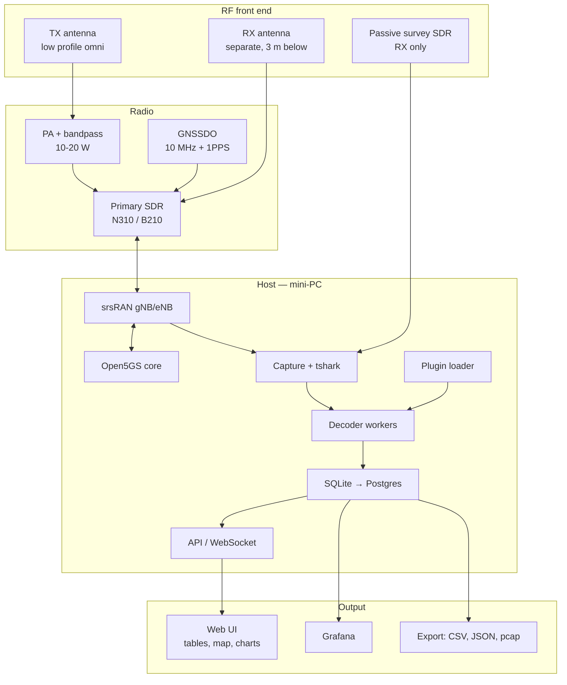

**Three planes.** Radio plane (SDR, timing, RF), control plane (core and RAN), data plane (capture, decode, store, present). Keep them on separate VLANs. The radio plane never touches the internet.

---

## 52. Hardware Selection

<!-- patch:img:## 52. Hardware Selection -->
<p class="plates">
<figure>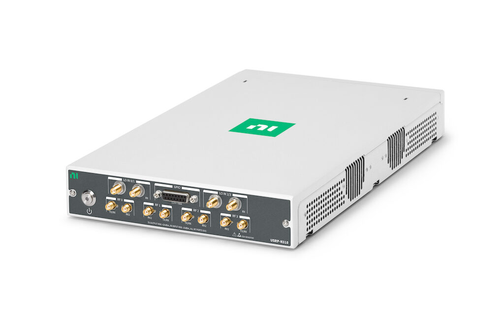<figcaption>USRP N310 — Ettus Research (vendor)</figcaption></figure>
<figure><figcaption>USRP B210 — Ettus Research (vendor)</figcaption></figure>
<figure><figcaption>AntSDR E200 — CNX Software (press)</figcaption></figure>
</p>
<!-- /patch:img -->


### 52.1 Primary SDR

| Option | Band | Duplex | Max rate | 5G 100 MHz? | Price | Verdict |
|---|---|---|---|---|---|---|
| **USRP N310** | 10 MHz–6 GHz | 4×4 | 100 MS/s/ch | **Yes** | ~$7,000 | **Best. Ethernet, on-board GNSSDO, rack-mountable, no USB fragility** |
| USRP N321 | 10 MHz–6 GHz | 4×4 | 100 MS/s/ch | Yes | ~$9,500 | Same, dual 10G, overkill |
| USRP B210 | 70 MHz–6 GHz | 2×2 | 56 MS/s | Marginal | ~$1,500 | **Best budget. 40 MHz max — LTE fine, 5G 100 MHz not** |
| bladeRF 2.0 micro xA9 | 47 MHz–6 GHz | 2×2 | 122 MS/s | Yes on paper | ~$800 | Cheapest capable; USB 3 fragility, weak filtering |
| LimeSDR USB | 100 kHz–3.8 GHz | 2×2 | 61 MS/s | Marginal | ~$700 | Fine for 4G, poor image rejection |
| AntSDR E200 | 70 MHz–6 GHz | 2×2 | 61 MS/s | Marginal | ~$500 | Cheap, standalone capable, immature |

**Recommendation: N310.** It removes USB from the critical path, carries its own GNSSDO, and does 100 MHz. On a tight budget, B210 for 4G only, and accept you will re-buy for 5G.

**Stealth mods:** plain black enclosure, no branding, mount low-profile omni not a panel, keep the PA at 10 W not 50 W, and place the box indoors behind glass where possible.

### 52.2 Passive survey SDR

Separate, receive-only, always on.

| Option | Band | Price | Note |
|---|---|---|---|
| AntSDR E200 | 70 MHz–6 GHz | ~$500 | Wide, standalone |
| RTL-SDR V4 | 24–1766 MHz | ~$40 | Cheap, narrow |
| ThinkRF R5500 | 9 kHz–18 GHz | ~$6,000 | Calibrated |

Survey SDR is what makes stealth possible: you look before you leap, every time.

### 52.3 Supporting

| Item | Spec | Price |
|---|---|---|
| GNSSDO | Leo Bodnar or u-blox NEO-M8T + OCXO | ~$200 |
| PA | 10–20 W, 700–2700 MHz, linear | ~$400 |
| Bandpass filters | Per band set | ~$300 |
| Antennas | 2× wideband omni, 3 dBi, N-type | ~$200 |
| LNA | High IIP3, mast mount | ~$120 |
| Host | Intel N100 mini-PC, 16 GB, 512 GB NVMe | ~$400 |
| Case | Plain aluminium, vented, lockable | ~$150 |
| Cabling | LMR-240 runs, N connectors, weatherproofing | ~$150 |
| Power | 12 V 10 A supply + 20 Ah LiFePO4 + fuses | ~$250 |

### 52.4 Anti-recommendations

HackRF (half duplex, 20 MS/s). Any USB 2.0 SDR. Raspberry Pi 4 as host for anything above 2G. Panel antennas for a stealth build.

---

## 53. Software Base Selection

<!-- patch:img:## 53. Software Base Selection -->
<p class="plates">
<figure><figcaption>srsRAN — project docs (project)</figcaption></figure>
<figure><figcaption>Open5GS — project site (project)</figcaption></figure>
</p>
<!-- /patch:img -->


### 53.1 Chosen stack

| Layer | Choice | Why |
|---|---|---|
| RAN | **srsRAN_Project** | Only mature open 5G gNB; also does LTE; supports UHD natively |
| Core | **Open5GS** | Mature 4G+5G core, YAML config, active, supports null cipher and null-scheme SUCI |
| Decode | **tshark + pycrate** | tshark for field extraction, pycrate for NAS/RRC ASN.1 in Python |
| Capture | **dumpcap** ring buffer | Stable, no shell pipeline loss |
| API | **FastAPI + WebSocket** | Async, typed, OpenAPI for free |
| Frontend | **HTMX + Alpine + uPlot + MapLibre** | No build step, tiny, fast |
| DB | SQLite → **TimescaleDB** | Start simple, scale when needed |
| Telemetry | **Prometheus + Grafana** | Standard |
| Transport | **WireGuard** | Only outbound path |

### 53.2 Rejected

| Option | Why rejected |
|---|---|
| OpenBTS | Archived, 2G only |
| OpenAirInterface | Heavy, brittle, no advantage here |
| Magma | Operator-shaped, too much machinery |
| Free5GC | Fine, but Open5GS has better 4G support and simpler config |
| YateBTS | 2G only |

### 53.3 Version pinning

```text
srsRAN_Project   pinned by commit
Open5GS          pinned by commit
UHD              pinned to the version matching the FPGA image
pycrate          pinned by tag
Python           3.11 exactly
```

Pin everything. Upstream breaks upstream regularly.

---

## 54. Base Build

### 54.1 Host OS

Debian 12 minimal. Read-only rootfs via overlayfs, `/var` and `/etc` writable.

```bash
apt update && apt install -y --no-install-recommends \
  build-essential cmake ninja-build git pkg-config \
  libuhd-dev uhd-host libmbedtls-dev libsctp-dev libyaml-cpp-dev \
  libboost-program-options-dev libconfig++-dev \
  python3.11 python3.11-venv sqlite3 tshark dumpcap \
  wireguard-tools prometheus-node-exporter
usermod -aG wireshark "$USER"
uhd_images_downloader
```

### 54.2 Open5GS

```bash
git clone https://github.com/open5gs/open5gs && cd open5gs
git checkout <PINNED_COMMIT>
meson build --prefix=/usr && ninja -C build && sudo ninja -C build install
sudo systemctl enable --now open5gs-mmed open5gs-sgwud open5gs-smfd \
  open5gs-amfd open5gs-upfd open5gs-nrfd open5gs-scpd \
  open5gs-ausfd open5gs-udmd open5gs-udrd open5gs-pcfd open5gs-nssfd open5gs-bsfd
```

### 54.3 GTP kernel module

```bash
git clone https://github.com/open5gs/gtp5g.git && cd gtp5g
make && sudo make install && sudo depmod -a && sudo modprobe gtp5g
```

### 54.4 srsRAN_Project

```bash
git clone https://github.com/srsran/srsRAN_Project && cd srsRAN_Project
git checkout <PINNED_COMMIT>
mkdir build && cd build
cmake .. -DENABLE_EXPORT=ON -DENABLE_ZEROMQ=OFF -DCMAKE_BUILD_TYPE=Release
make -j"$(nproc)" && sudo make install
sudo ./srsran_install_configs.sh service
```

### 54.5 UHD image

```bash
sudo uhd_images_downloader -t n3xx
uhd_find_devices
uhd_usrp_probe | grep -i ref_locked
```

`ref_locked: Yes` before anything else.

---

## 55. Radio Configuration

### 55.1 Core PLMN and security

`/etc/open5gs/amf.yaml`:

```yaml
amf:
  ngap:
    addr: 10.20.0.10
  guami:
    - plmn_id: { mcc: "310", mnc: "260" }
      amf_id: { region: 2, set: 1, pointer: 1 }
  tai:
    - plmn_id: { mcc: "310", mnc: "260" }
      tac: 4242
  plmn_support:
    - plmn_id: { mcc: "310", mnc: "260" }
      s_nssai:
        - { sst: 1 }
  security:
    integrity_order: [ NIA2, NIA1, NIA0 ]
    ciphering_order: [ NEA0 ]
  security:
    suci:
      null_scheme: true
  network_name: { full: "TestNet", short: "Test" }
```

`/etc/open5gs/mme.yaml`, same pattern for LTE with `ciphering_order: [ EEA0 ]` and `tai`/`plmn_support` matching.

### 55.2 gNB

`/etc/srsran/gnb.yml`, key sections. **Field names track upstream; verify against the release you pinned.**

```yaml
cu_cp:
  amf:
    addr: 10.20.0.10
    port: 38412
    bind_addr: 10.20.0.20
  supported_tracking_areas:
    - tac: 4242
      plmn_list:
        - plmn: "310260"
          tai_slice_support_list:
            - sst: 1

ru_sdr:
  device_driver: uhd
  device_args: type=n3xx,addr=10.20.0.30,clock=external
  srate: 92.16
  tx_gain: 60
  rx_gain: 50

cell_cfg:
  dl_arfcn: 632628        # n78, centre 3500 MHz
  band: 78
  channel_bandwidth_MHz: 100
  common_scs: 30
  plmn: "310260"
  pci: 42
  tac: 4242
  pdcch:
    common:
      ss0_index: 0
  pdsch:
    mcs_table: qam64
  prach:
    prach_config_index: 159
```

For LTE, use `srsRAN_4G` `enb.conf` with `dl_earfcn`, `n_prb`, `mcc`/`mnc`, and `cipher_algo = EEA0`.

### 55.3 Gain staging

Start `tx_gain: 40`, `rx_gain: 40`. Raise TX until the test UE attaches within 20 s at 5 m, then back off 3 dB. Raise RX until noise floor rise on key-up reaches 1 dB, then back off 3 dB.

### 55.4 Verify

```bash
sudo srsran_gnb -c /etc/srsran/gnb.yml
# second terminal
sudo tshark -i <ngap_if> -f "sctp port 38412" -Y "ngap"
```

A test UE with a provisioned SIM should reach `InitialUEMessage`. Provision it:

```bash
sudo open5gs-dbctl add 310260000000001 \
  465B5CE8B199B49FAA5F0A2EE238A6BC E8ED289DEBA952E4283B54E88E6183CA
```

---

## 56. Stealth Layer

Stealth is a set of behaviours, not a setting. Each one is a trade-off.

| Technique | Implementation | Cost |
|---|---|---|
| **Passive-first** | Survey SDR listens 60 s before any key-up; abort if the target band is busy | Slower to collect |
| **Minimum power** | Start 10 dB below the local serving cell, ramp in 1 dB steps | Smaller footprint |
| **Valid PCI** | Survey, pick from the operator's own PCI range, avoid neighbours | Needs the survey |
| **Neighbour TAC clone** | Use a real neighbour's TAC so the update looks routine | Handsets may not update at all |
| **Fresh TAC** | Unused value, forces update | Every handset in range churns |
| **Short dwell** | 30–120 s bursts, then withdraw | Incomplete sessions |
| **Well-formed SIBs** | Disable SIBs you do not need; match the operator's SIB scheduling | Config effort |
| **Timing discipline** | GNSSDO mandatory for NR | Hardware cost |
| **Low-profile antenna** | 3 dBi omni, indoors behind glass | Range |
| **Plain enclosure** | No branding, matte black | Nothing |
| **No outbound except VPN** | WireGuard only, DNS via tunnel | Latency |
| **Cipher downgrade** | EEA0 / NEA0 | **EEA0 is itself a tell** |
| **Withdraw cleanly** | Stop gNB, wait for reattach, verify | Time |

### 56.1 The cipher trade-off

Null cipher gives you plaintext but announces you. A device with network notifications enabled will report "unencrypted network." Choose per mission:

- **Harvesting, undetected:** leave ciphering on, accept metadata only.
- **Intercept, willing to be seen:** force EEA0/NEA0.

### 56.2 Withdrawal sequence

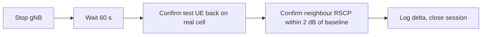

---

## 57. Decoding Pipeline

<!-- patch:img:## 57. Decoding Pipeline -->
<p class="plates">
<figure><figcaption>Wireshark — Wikimedia (Commons)</figcaption></figure>
</p>
<!-- /patch:img -->


### 57.1 Capture

```bash
dumpcap -i ngap0 -f "sctp port 38412" \
  -b filesize:262144 -b files:50 -w /srv/cap/ngap.pcapng
dumpcap -i s1u0 -f "udp port 2152" \
  -b filesize:262144 -b files:50 -w /srv/cap/gtpu.pcapng
```

Hash on close, timestamp, move to evidence store. §30.

### 57.2 Identity extraction

```bash
tshark -r ngap.pcapng -Y "ngap.InitialUEMessage" -T ek \
  | jq -c 'select(.ngap) | {
      ts: .timestamp,
      imsi: .ngap.InitialUEMessage.rrc_SetupRequest?,
      gnb: .ngap.InitialUEMessage.gNB_UE_NGAP_ID
    }'
```

NAS decode for 5GMM:

```bash
tshark -r ngap.pcapng -Y "nas-5gs" -V
```

### 57.3 Python decode with pycrate

```python
from pycrate_mobile.NAS5G import parse_NAS5G

def decode_nas5g(payload_hex: str) -> dict:
    msg = parse_NAS5G(bytes.fromhex(payload_hex))
    msg.show()
    return {
        "type": msg.get_msg_type(),
        "imsi": _extract_suci_or_supi(msg),
        "ue_caps": msg.get_UE_Capability() if hasattr(msg, "get_UE_Capability") else None,
    }
```

`scat` (France Telecom) also decodes NGAP and 5G NAS from pcap and is worth installing as a cross-check.

### 57.4 Worker shape

```python
# workers/decoder.py
import asyncio, hashlib
from pathlib import Path

async def watch(capdir: Path, sink):
    seen = set()
    while True:
        for p in sorted(capdir.glob("*.pcapng")):
            if p in seen or p.with_suffix(".done").exists():
                continue
            for rec in await extract(p):
                await sink(rec)
            p.with_suffix(".done").write_text(hashlib.sha256(p.read_bytes()).hexdigest())
            seen.add(p)
        await asyncio.sleep(2)
```

### 57.5 Decoder coverage

| Layer | Tool | Output |
|---|---|---|
| NGAP / S1AP | tshark, scat | Identity, cause, UE IDs |
| NAS 5GMM / EMM | pycrate, tshark | Identity, capability, APN |
| RRC | tshark, pycrate | Band, PCI, timing advance |
| SIB | tshark | Cell parameters as seen by the UE |
| GTP-U | tshark | Flow metadata, byte counts |

---

## 58. Data Model and Storage

```sql
CREATE TABLE session (
  id            TEXT PRIMARY KEY,     -- uuidv4
  started_utc   TEXT NOT NULL,
  ended_utc     TEXT,
  band          INTEGER,
  arfcn         INTEGER,
  pci           INTEGER,
  tac           INTEGER,
  plmn          TEXT,
  cipher        TEXT,                 -- NEA0 | NEA2 | EEA0 | ...
  site          TEXT,
  prev_hash     TEXT,
  rec_hash      TEXT NOT NULL
);

CREATE TABLE observation (
  id            INTEGER PRIMARY KEY,
  session_id    TEXT REFERENCES session(id),
  ts_utc        TEXT NOT NULL,
  kind          TEXT NOT NULL,        -- attach | identity_req | auth | detach | sms | pdu
  imsi          TEXT,
  suci          TEXT,
  imei          TEXT,
  imeisv        TEXT,
  rat           TEXT,
  ta            INTEGER,
  cause         TEXT,
  raw_hex       TEXT,
  confidence    TEXT NOT NULL         -- A | B | C | D
);

CREATE INDEX idx_obs_imsi ON observation(imsi);
CREATE INDEX idx_obs_ts   ON observation(ts_utc);
```

`rec_hash` chains over `prev_hash` so deletion is visible. `confidence` per §14.3 and Appendix B.

TimescaleDB when the row count passes about 10 million: convert `observation` to a hypertable on `ts_utc`.

---
---

## 59. API and GUI

### 59.1 API

```python
# api/main.py
from fastapi import FastAPI, WebSocket
from fastapi.responses import HTMLResponse

app = FastAPI(title="Observation Platform")

@app.get("/api/sessions")
async def sessions(limit: int = 50):
    return await db.sessions(limit)

@app.get("/api/observations")
async def observations(imsi: str | None = None, since: str | None = None):
    return await db.observations(imsi=imsi, since=since)

@app.websocket("/ws/live")
async def live(ws: WebSocket):
    await ws.accept()
    async for rec in bus.subscribe():
        await ws.send_json(rec)

@app.post("/api/plugins/{name}/enable")
async def enable(name: str):
    return await plugins.enable(name)
```

### 59.2 GUI

Four screens, no more.

| Screen | Content |
|---|---|
| **Live** | Streaming table: time, IMSI/SUCI, RAT, band, TA, cause. WebSocket fed, capped at 200 rows |
| **Session** | One session: parameters, timeline, decoded messages, raw hex on expand |
| **Map** | MapLibre, session pins, TA circles |
| **Admin** | Radio state, gains, cipher, carrier profile, plugin toggles, update |

HTMX for navigation, Alpine for local state, uPlot for charts, no build step.

```html
<!-- live.html -->
<table hx-ext="ws" ws-connect="/ws/live">
  <thead><tr><th>Time</th><th>Identity</th><th>RAT</th><th>Band</th><th>TA</th><th>Cause</th></tr></thead>
  <tbody id="rows" hx-swap-oob="beforeend"></tbody>
</table>
```

### 59.3 Modernisation rules

Dark by default. Monospace for identifiers. Sticky headers. Keyboard: `/` search, `j`/`k` navigate, `s` star. Every identifier clickable to its session. No modal dialogs. Colour-blind safe palette. Works at 1024 px.

---

## 60. Telemetry and Charts

<!-- patch:img:## 60. Telemetry and Charts -->
<p class="plates">
<figure><figcaption>Grafana — theme-park docs (project)</figcaption></figure>
<figure><figcaption>Prometheus — Wikimedia (Commons)</figcaption></figure>
</p>
<!-- /patch:img -->


### 60.1 Metrics

```python
# exporters/radio.py
from prometheus_client import Gauge, Counter

tx_gain      = Gauge("radio_tx_gain_db", "TX gain")
rx_gain      = Gauge("radio_rx_gain_db", "RX gain")
ref_locked   = Gauge("radio_ref_locked", "GNSS lock 1/0")
noise_rise   = Gauge("radio_noise_rise_db", "Noise floor rise on key-up")
temp_pa      = Gauge("thermal_pa_c", "PA temperature")
temp_host    = Gauge("thermal_host_c", "Host temperature")
attach_total = Counter("obs_attach_total", "Attaches", ["rat"])
```

### 60.2 Grafana panels

| Panel | Type |
|---|---|
| Attaches/min by RAT | Time series |
| Unique identities/min | Time series |
| Noise floor rise | Time series with 1 dB threshold |
| PA and host temperature | Gauge with 60 °C redline |
| GNSS lock | Stat, red on 0 |
| Session duration histogram | Histogram |
| Cause code breakdown | Bar |

Provision dashboards from JSON in Git, not by hand.

### 60.3 Alerts

```yaml
- alert: RefUnlocked
  expr: radio_ref_locked == 0
  for: 60s
- alert: PaHot
  expr: thermal_pa_c > 60
  for: 5m
- alert: Desense
  expr: radio_noise_rise_db > 3
  for: 2m
```

---

## 61. Carrier Profile System

Profiles are data, never code. One YAML per PLMN.

```yaml
# profiles/310-260.yaml
plmn: "310260"
operator: "T-Mobile US"
country: US
bands:
  lte: [2, 4, 5, 12, 41, 66, 71]
  nr:  [41, 71, 77, 260, 261]
  preferred_anchor: 2
channels:
  lte_earfcn: [700, 1125, 2450, 5035, 66786]
  nr_arfcn:   [633334, 123400]
apns:
  - { name: "fast.t-mobile.com", type: "default", pdp: ipv4v6 }
  - { name: "ims", type: "ims", pdp: ipv4v6 }
epdg_fqdn: "epdg.epc.mnc260.mcc310.pub.3gppnetwork.org"
tac_pool: [4242, 4243, 4244]
pci_pool: [1, 2, 3, 4, 5, 6, 7, 8]
notes: "B71 needs 600 MHz antenna; B41 is 2.5 GHz TDD"
```

```yaml
# profiles/234-30.yaml
plmn: "23430"
operator: "EE UK"
country: GB
bands: { lte: [3, 7, 20], nr: [78] }
apns:
  - { name: "everytime", type: "default", pdp: ipv4v6 }
epdg_fqdn: "epdg.epc.mnc030.mcc234.pub.3gppnetwork.org"
tac_pool: [4242]
pci_pool: [1, 2, 3, 4]
```

### 61.1 Loader

```python
# core/profiles.py
def load(plmn: str) -> Profile:
    p = PROFILE_DIR / f"{plmn[:3]}-{plmn[3:]}.yaml"
    if not p.exists():
        raise ProfileMissing(f"no profile for {plmn}")
    prof = Profile(**yaml.safe_load(p.read_text()))
    prof.validate()          # bands within SDR range, arfcn decodes to a valid band
    return prof
```

`validate()` refuses to start if a channel does not decode to a band the SDR covers, or if the PLMN is malformed. That single check prevents most wasted deployments.

### 61.2 Update path

Profiles are files. `git pull` on the profiles directory, or import a bundle from the UI, validated before activation. Ship a `profiles/README.md` describing the schema and a JSON Schema for editors.

---

## 62. Update and Plugin System

### 62.1 Updates

```bash
#!/usr/bin/env bash
# /usr/local/sbin/op-update
set -euo pipefail
cd /opt/op
git fetch --tags
NEW=$(git describe --tags --abbrev=0)
[ "$NEW" = "$(git describe --tags --abbrev=0 HEAD)" ] && exit 0
git checkout "$NEW"
make -C build -j"$(nproc)"
systemctl restart op-api op-decoder op-gnb
echo "$NEW" > /var/lib/op/version
```

A/B partitions, or overlayfs with the previous image retained and a `op-rollback` one-liner. Health check after restart; auto-rollback if `/healthz` fails twice.

### 62.2 Plugins

```python
# plugins/base.py
from dataclasses import dataclass

@dataclass
class Plugin:
    name: str
    version: str
    kinds: list[str]          # observation kinds it handles

    def on_observation(self, obs: dict) -> dict | None:
        """Return a mutated observation, or None to drop it."""
        return obs

    def routes(self) -> list:  # optional FastAPI routers
        return []
```

```python
# plugins/ta_geolocate/__init__.py
from plugins.base import Plugin

class TALocate(Plugin):
    name, version, kinds = "ta_geolocate", "1.0.0", ["attach"]

    def on_observation(self, obs):
        if obs.get("ta") is not None:
            obs["distance_m"] = obs["ta"] * 78   # LTE TA ≈ 78 m/unit
        return obs

def register():
    return TALocate()
```

Loader:

```python
def load_all():
    for f in (PLUGIN_DIR).glob("*/__init__.py"):
        spec = importlib.util.spec_from_file_location(f.parent.name, f)
        mod = importlib.util.module_from_spec(spec)
        spec.loader.exec_module(mod)
        p = mod.register()
        REGISTRY[p.name] = p
```

Each plugin gets a manifest, a declared API version, and a toggle in Admin. A plugin that raises is disabled, logged, and does not take the pipeline down.

### 62.3 Feature flags

```yaml
flags:
  passive_first: true
  auto_withdraw_after_s: 120
  force_null_cipher: false
  expose_raw_hex: true
```

Flags in Git, hot-reloaded, audited.

---

## 63. Deployment Form Factors

| Form | Hardware | Notes |
|---|---|---|
| **Bench** | B210, mains, dummy load | Development |
| **Fixed indoor** | N310, mains, 2× indoor omni | Conference room, office |
| **Vehicle** | B210 + battery + mag-mount, laptop | Mobile; needs the power spec from §37 |
| **Backpack** | B210 + 20 Ah LiFePO4 + tripod | Short dwell |
| **Remote headless** | N310 + PoE + WireGuard | No local UI; all via API |

Remote headless is the stealthiest and cheapest to run: no one on site, no vehicle, no visible activity.

---

## 64. Test and Validation

Import the full acceptance suite from §44. Add platform-specific:

| Test | Pass |
|---|---|
| Identity extraction, known SIM | IMSI matches the programmed value |
| SUCI observed on NR SA | Opaque value logged, no crash |
| Downgrade LTE→NR blocked | gNB off, UE stays on LTE |
| Profile validation rejects bad ARFCN | Loader raises |
| Plugin crash isolation | Kill a plugin, pipeline continues |
| Rollback | `op-rollback` restores previous tag and service |

---

## 65. Cost Summary

| Build | Hardware | Notes |
|---|---|---|
| **Minimum viable, 4G only** | ~$2,600 | B210, mini-PC, GNSSDO, PA, filters, antennas, case, power |
| **Recommended, 4G + 5G** | ~$9,200 | N310, everything above at full spec |
| **Remote headless** | ~$9,000 | N310, PoE, no UI hardware |
| Consumables and spares | ~$500/yr | Cable, connectors, fuses |

Add the survey SDR (~$500) to every build. Software is free; engineering time is not.

---

## 66. Honest Limits

| Limit | Consequence |
|---|---|
| **SUCI is opaque on NR SA** | You see a 5G identity you cannot resolve without the home key. Bid down to LTE for IMSI |
| **No VoLTE** | Voice needs an IMS core; not in scope |
| **No FR2** | mmWave needs different front ends |
| **No user-plane decryption** | Metadata only unless you hold keys |
| **Null cipher is visible** | Android 16 network notifications will announce you |
| **Null-scheme SUCI helps only against your own core** | A stranger's UE still encrypts to its home key |
| **`srsRAN` upstream moves** | Pinning is mandatory, not optional |
| **Timing is unforgiving** | No GNSSDO means no 4G, let alone 5G |
| **Profiles rot** | Operators re-farm channels; profiles need maintenance |
| **Not type-approved** | Spurious emissions unproven until you measure |

The two that catch people: SUCI, and the assumption that a working gNB means working identity capture. It does not. Test with a real handset on a real PLMN before you believe anything.

---

*Build the bench, then the pipeline, then the GUI. Stealth is behaviour, not configuration.*

---
---

# Part VI — Visual Reference

**Identification plates for the hardware and software named in Parts II–V**

Part added in 1.1 · Compiled 2026-11-14

**Part VI index**

| Plates | Subject |
|---|---|
| [1–2](#vi-plates--project-art-and-hardware) | Project art |
| [3–10](#vi-plates--project-art-and-hardware) | Hardware: SDRs, receiver, direction finding, mast |
| [11](#vi-plates--project-art-and-hardware) | Defender-side control |
| [12–18](#vi-plates--project-art-and-hardware) | Software: stacks, decode, telemetry, mapping |

> **Why plates.** Text alone does not let a reader recognise a LimeSDR from a bladeRF at a bench, or tell a project's logo from a fork's. These plates exist for identification and orientation. Sizes and quality vary because the sources vary; that is a property of public imagery, not of the hardware.
>
> **Provenance.** Each plate is captioned with its source. Licensing consolidated in §138.3. Vendor product shots are used for identification and commentary; re-host them if you redistribute this document.

---

## VI. Plates — project art and hardware

### Plate 1 — Project banner


Generated for this document, 2026-11-14. Not a photograph; a cover mark. Replace with a photograph of the actual rig once one exists.

### Plate 2 — SDR front end, exploded

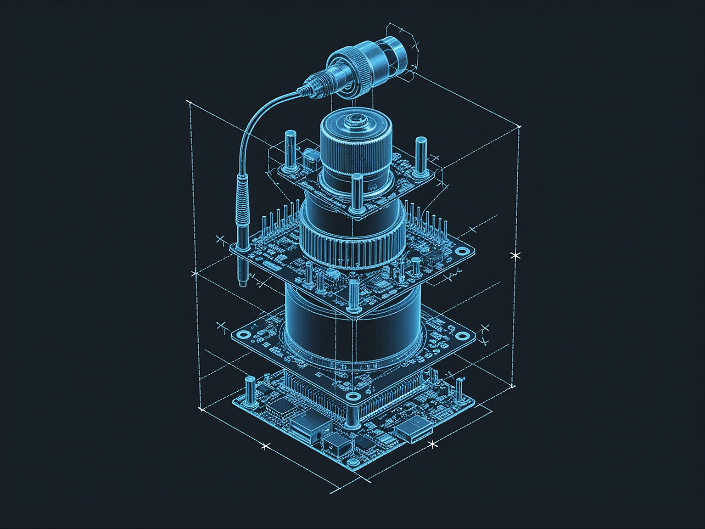

Generated for this document, 2026-11-14. Assembly order for the chain described in §17.3 and §36: antenna port, bandpass can, amplifier, SDR, host link. It shows sequence, not duplex topology - the receive branch and the vertical separation that buys the isolation are specified in section 36, not shown here.

### Plate 3 — LimeSDR Mini 2.0


Cheapest credible transmit-capable board. 10 MHz–3.5 GHz, 1×1, 30.72 MS/s. The §21 build guide radio. Source: eBay listing photograph. Poor image rejection; add the bandpass.

### Plate 4 — Ettus USRP B210


70 MHz–6 GHz, 2×2, 56 MS/s, USB 3. The §65 minimum-viable and §52.1 budget pick. Everything supports it, which is exactly why it is the reference platform. Source: Ettus Research product photography.

### Plate 5 — bladeRF 2.0 micro


47 MHz–6 GHz, 2×2, up to 122 MS/s. Native YateBTS and srsRAN support, better filtering than the Lime. USB 3 fragility is the recurring field complaint. Source: Nuand product photography.

### Plate 6 — HackRF One


1 MHz–6 GHz, 20 MS/s, **half duplex**. Excellent passive sniffer with `gr-gsm`; cannot run a GSM transceiver. The most commonly over-bought board in this field. Source: HackRF project documentation.

### Plate 7 — RTL-SDR Blog V4


24–1766 MHz, receive only, ~2.4 MS/s. The §24 rung 0 and the cheapest way to confirm your own BCCH is on air. Source: retail product photograph.

### Plate 8 — KrakenSDR


Five-channel coherent receiver, 24–1766 MHz, receive only. Direction finding via `krakensdr_doa`. §24 rung 1, and the tool that answers "where is it coming from" rather than "is it there". Source: KrakenRF product photography.

### Plate 9 — Rooftop mast and sector antennas


What a surveyed site looks like from outside: mast, sector mounts, cable tray, lightning down-conductor. Compare against the §28.2 checklist. Source: supplier product photograph.

### Plate 10 — Lattice tower


The macro cell you are competing with. Climbing a lattice gives height and therefore range, at the cost of cable loss and access. Source: stock vector.

### Plate 11 — Android 2G toggle


The §9.2 control, as implemented. Note that the label is per-SIM and that the setting is carrier-profile dependent. Source: Android Open Source Project documentation.

### Plate 12 — Osmocom


The 2G stack in §19.2 and §21: `osmo-bts-trx`, `osmo-trx`, `osmo-hlr`, `osmo-msc`. Live community, mirrored on GitHub. Source: project avatar.

### Plate 13 — srsRAN Project


The 4G/5G RAN in §53.1 and §54.4. The only mature open 5G gNB. Source: project documentation.

### Plate 14 — Open5GS


The core in §29.4, §54.2 and §55.1. Supports null cipher and null-scheme SUCI, which is why it is chosen here over the alternatives. Source: project site.

### Plate 15 — Wireshark


`tshark` and `dumpcap` do the capture and field extraction in §30 and §57. Every claim in this document that says "logged" passes through this toolchain. Source: Wikimedia Commons.

### Plate 16 — GNU Radio Companion


Where custom DSP goes when `gr-gsm` does not cover it. Steep, and worth it once. Source: GNU Radio wiki.

### Plate 17 — Grafana


The §60 telemetry surface. Dashboards provisioned from JSON in the repository, never hand-built. Source: theme-park documentation.

### Plate 18 — QGIS


Coverage prediction and cell mapping in §28.1. Pair with SPLAT! for terrain and CellMapper for the register. Source: QGIS project.

---

### VI.1 How to use the plates in a procurement document

| Task | Plates |
|---|---|
| Brief a non-technical sponsor | 1, 9, 10 |
| Specify a minimum viable rig | 3, 4, 6, 7 |
| Specify an enterprise sensor | 8, 9, 17, 18 |
| Brief a build engineer | 2, 3, 4, 5, 12, 13, 14 |
| Brief a defender | 11 |
| Show the decode and evidence chain | 15, 16, 17 |

A plate is an aid, not a specification. Pair every image in a procurement document with the part number and the interface from §18.

---
---

# Part VII — Category Deep Dives

**Government, enterprise and adversary treated as subjects**

Part added in 2.0 · Compiled 2026-11-14

**Part VII index**

<details class="toc">
<summary>Show sections</summary>

83. [The Three Categories Compared](#83-the-three-categories-compared)
84. [Government and Nation-State Operations](#84-government-and-nation-state-operations)
85. [Government Procurement and Programme Shape](#85-government-procurement-and-programme-shape)
86. [Enterprise Business Case and Justification](#86-enterprise-business-case-and-justification)
87. [Enterprise Operating Model and SOC Integration](#87-enterprise-operating-model-and-soc-integration)
88. [Adversary Economics](#88-adversary-economics)
89. [Criminal Use Cases in Detail](#89-criminal-use-cases-in-detail)
90. [Adversary Counter-Forensics](#90-adversary-counter-forensics)
91. [Commercial Market Map and Pricing](#91-commercial-market-map-and-pricing)
92. [Public Programmes and Known Deployments](#92-public-programmes-and-known-deployments)

</details>

---

## 83. The Three Categories Compared

Parts I–V treated the technology. This part treats the actors. The technology is common; the actors differ in authority, budget, patience and accountability, and those differences produce completely different deployments.

| Dimension | Government | Enterprise | Adversary |
|---|---|---|---|
| **Authority** | Licence or statutory power | Licence exemption or carrier consent | None; tolerance and low power |
| **Budget** | $100k–$500k+ | $8k–$70k | $600–$30k |
| **Procurement** | Years, competitive tender, type approval | Weeks, POC then contract | Days, cash or card |
| **Transmit** | Yes, amplified | Rarely | Yes, low power |
| **Timing** | GNSSDO, holdover | GNSS or NTP | None |
| **Mobility** | Vehicle, aircraft, maritime | Rack, occasionally vehicle | Foot, bag |
| **Integration** | Core handoff, fusion, LI | SIEM, ticketing | None |
| **Evidence** | CDR chain, custody, court | Logs, internal report | Screenshots |
| **Staffing** | Trained operators, shifts | SOC analysts | One person |
| **Support** | Vendor contract, SLA | Vendor contract | Forum posts |
| **Failure cost** | Case collapse, oversight scandal | Budget cut | No arrest |
| **What they fear** | Disclosure, challenge in court | False positives, alert fatigue | Detection, being caught on site |
| **Where they fail** | Procedure, custody, validation | Business case, attribution | Power, timing, staying too long |

### 83.1 The same rig, three ways

The identical hardware is deployed completely differently:

- **Government** puts it in a vehicle with 50 W, a GNSSDO, an operator and a CDR chain, and uses it under a warrant.
- **Enterprise** puts it on a roof with a PoE injector and no amplifier, and feeds the output to a SIEM that mostly ignores it.
- **Adversary** puts it in a rucksack, keys up for ninety seconds outside a target building, and writes the IMSIs into a spreadsheet.

The physics does not change. The accountability does.

### 83.2 Where the categories blur

| Blur | Example |
|---|---|
| Police as enterprise | A campus security team with a passive sensor is behaving like enterprise but reporting to a public body |
| Enterprise as government | A carrier running its own collection is regulated like a government |
| Adversary as enterprise | A private investigation firm with a commercial passive rig |
| Government as adversary | A state operating without a warrant in a permissive jurisdiction |

Decide which accountability regime applies before deciding which build guide to follow. A police force that follows the adversary build guide will have a rig that cannot survive a disclosure request.

### 83.3 The public variations

Beyond the three, four public-facing variations recur:

1. **Carrier-side monitoring.** The operator sees everything in its core and deploys catchers for its own assurance. No licence needed, no evidence chain.
2. **Regulator drive-test.** National regulators run calibrated passive fleets to police coverage obligations.
3. **Event security.** Temporary deployable masts and catchers around stadia, summits, and borders.
4. **Research and education.** University testbeds running open stacks, frequently on the wrong band for their country and permanently half-broken.

None of these is a distinct technology. Each is a distinct accountability posture.

---

## 84. Government and Nation-State Operations

### 84.1 Mission types

| Mission | Objective | Shape |
|---|---|---|
| **Presence** | Establish who is in a building at a time | Short dwell, 2G, handheld |
| **Target development** | Confirm a named subject's handset | Directed, allow-list, repeated |
| **Association mapping** | Establish who meets whom | Long dwell, handover graph |
| **Intercept** | Content of voice or SMS | 2G, core handoff, CDR chain |
| **Border screening** | Mass identity collection at crossings | Fixed, high capacity, no attribution |
| **Event coverage** | Detect and characterise devices at a venue | Deployable mast, multi-unit |
| **Area denial** | Prevent service in a location | Catcher plus jammer adjunct |

### 84.2 The operating cycle

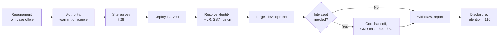

### 84.3 Authority models

| Model | Where | Consequence |
|---|---|---|
| **Warrant per deployment** | US federal, much of EU | Slow, documented, defensible |
| **Statutory power, no warrant** | UK, parts of EU, Australia | Fast, challengeable |
| **Licence-only, no statutory power** | Many jurisdictions | Fast, evidence weak |
| **No framework at all** | Some states | Whatever the operator says |

The legal basis determines whether a deployment produces evidence or merely intelligence. An operator who does not know which regime they are in will produce the wrong artefact.

### 84.4 Staffing and shifts

Real operations run in shifts with a supervisor, an RF operator and an analyst. Single-operator deployments exist and are exhausting: the operator cannot watch the spectrum, the target list and the log at once. Plan two people minimum for anything over four hours.

### 84.5 Failure modes specific to government

| Failure | Consequence |
|---|---|
| No warrant on file for the date of collection | Evidence excluded |
| Custody break between operator and analyst | Chain challenged |
| Unvalidated tooling | Expert torn apart on the stand |
| Over-collection of non-targets | Minimisation complaint, retention breach |
| NDA with the vendor | Disclosure fought in court |
| No survey | Self-jamming, complaints, neighbour degradation |
| Attribution to a named person without ground truth | Wrong person named |

§136 and §137 exist for the last two.

### 84.6 Aircraft, maritime and fixed

- **Aircraft** gives wide area at the cost of per-user link budget and a hard thermal and power envelope. Requires aviation integration, not RF skill alone.
- **Maritime** is coastal and port work: high sites, directional sectors, salt corrosion, and long cable runs.
- **Fixed** is embassy and critical-infrastructure work: permanent, fibre backhaul, directional, and usually passive plus a separate active unit.

---

## 85. Government Procurement and Programme Shape

### 85.1 Why it takes years

| Stage | Typical duration |
|---|---|
| Requirement definition | 3–9 months |
| Market survey and RFI | 2–6 months |
| Business case and budget | 3–12 months |
| Tender and evaluation | 3–9 months |
| Contract and security vetting | 2–6 months |
| Delivery, acceptance, training | 3–12 months |

Anything faster is a sole-source urgent operational requirement, and it costs more and delivers less.

### 85.2 Requirement definition

Write the requirement in mission terms, not product terms.

| Bad | Good |
|---|---|
| "IMSI catcher" | "Establish the identities of handsets present in a 200 m radius of a named address, in under 10 minutes, without alerting the user" |
| "4G capable" | "Resolve identity from a handset camped on LTE band 20 within 30 s of arrival" |
| "Easy to use" | "A trained operator with no RF background can complete a harvest in five actions" |

### 85.3 Evaluation matrix

Score, do not vibe.

| Criterion | Weight |
|---|---|
| Meets identity requirement at range | 20 |
| Meets timing and RAT requirement | 15 |
| Evidence chain and export | 15 |
| Core handoff and LI interface | 10 |
| Support and SLA | 10 |
| Training package | 5 |
| Integration with existing fusion | 10 |
| Cost of ownership over 5 years | 10 |
| Security accreditation | 5 |

Full matrix in §133.

### 85.4 Contract clauses that matter

- **Acceptance test procedure**, agreed before signature, with pass criteria.
- **Source code escrow** for anything with a decoder you rely on.
- **NDA carve-out** for court disclosure, negotiated at contract not at trial.
- **Calibration and recalibration** included, with certificates.
- **Training** included and repeatable annually.
- **Spares and MTBF** commitment.
- **Roadmap commitment** for new bands and generations.
- **Data ownership** of everything collected.
- **Right to test independently** and publish a validation report.

### 85.5 Total cost of ownership

| Line | Year 1 | Years 2–5 |
|---|---|---|
| Capital | $100k–500k | — |
| Support | 15% of capital | 15% of capital |
| Calibration | $3k | $3k/yr |
| Training | $10k | $10k/yr |
| Spectrum and licences | $1k–10k | same |
| Staff | 2 FTE | 2 FTE |

A $250k capital purchase is roughly $1.2M over five years. Programmes that budget only the capital fail at year three.

### 85.6 Programme failure modes

| Failure | Cause |
|---|---|
| Shelfware | Bought without a staffing plan |
| Under-use | Requirement written for a capability nobody owns |
| Reputational damage | Deployed without a survey, complaints follow |
| Case collapse | Evidence chain not built into the workflow |
| Vendor lock | Decoder in escrow never taken up, migration impossible |

---

## 86. Enterprise Business Case and Justification

### 86.1 What enterprise is actually buying

Not interception. **Assurance.** The enterprise wants to know whether the executive fleet is being tracked, whether the campus has an unexpected transmitter, and whether a specific incident was a fake cell or a coverage fault.

### 86.2 The honest business case

| Argument | Strength |
|---|---|
| Executive protection for a named, high-profile leadership team | Strong |
| Regulatory or contractual assurance obligation | Strong if it exists in writing |
| Due diligence on a merger or litigation | Moderate, case-specific |
| General "we should have one" | Weak, becomes shelfware |
| Replacing handset-only detection | Moderate; sensor beats a phone |

### 86.3 The counter-case

- Coverage is the carrier's problem until proven otherwise.
- A passive sensor generates alerts nobody actioned in the first month.
- Attribution requires a second sensor and an analyst.
- The evidence is rarely admissible for anything.
- Cost is $8k–$70k plus a person.

If you cannot name the person who will read the alerts, do not buy.

### 86.4 Cost and value framing

| Item | Cost |
|---|---|
| Sensor | $8k–$70k |
| Install | $2k–$10k |
| Analyst time | 0.2 FTE |
| Annual support | 15% of capital |

Value is not measurable in money. Frame it as: reduced dwell time on false incidents, a defensible answer when the board asks "were we tracked", and a shorter path from anomaly to decision. Those are the only three that survive a budget review.

### 86.5 Approvals path

Typically CISO sponsors, security operations owns, finance approves capital, legal reviews retention, facilities approves roof access. Four approvals, and any one of them can stop it. Bring the retention schedule and the roof survey to the first meeting, not the last.

### 86.6 Alternatives cheaper than buying

| Alternative | Effect |
|---|---|
| Carrier 2G barring on the fleet | Removes the largest exposure, free |
| MDM baseline enforcement | Closes the config gaps, free |
| Quarterly drive-test with a contractor | Periodic assurance, ~$5k/quarter |
| Handset detection apps on a pilot group | Weak, cheap |
| Rung 0–2 DIY rig for the security team | Understanding and occasional proof, ~$1k |

A DIY rig plus carrier barring covers most of the real need for a fraction of the sensor cost. Buy the sensor when the need becomes continuous and the analyst exists.

---

## 87. Enterprise Operating Model and SOC Integration

### 87.1 Roles

| Role | Responsibility |
|---|---|
| Sensor owner | Availability, patching, calibration |
| Detection engineer | Rules, thresholds, tuning |
| Triage analyst | Reads alerts, corroborates, closes |
| Incident commander | Owns an escalation |
| Legal liaison | Retention, disclosure, DSARs |
| Facilities | Roof, power, access |

One person can hold three of these in a small team. Nobody can hold all six.

### 87.2 The tuning problem

Out of the box, every rule fires on legitimate behaviour. The first month is entirely false positives from reattach after airplane mode, from legitimate 2G-only rural cells, and from carrier maintenance.

Tuning order: baseline a week with no alerts → enable one rule at a time → suppress by geofence for known rural areas → suppress by carrier for known maintenance windows → only then enable fleet correlation.

### 87.3 Alert design

| Bad alert | Good alert |
|---|---|
| "2G detected" | "2G detected for 6 min in a mapped 4G area at HQ" |
| "New cell" | "New cell, same TAC, 22 dB above baseline, three devices affected" |
| "Cipher null" | "Cipher dropped to null mid-session, device X, cell Y" |

Every alert carries: device, location, duration, the baseline it deviates from, and what to do next. An alert without a next action is noise.

### 87.4 Integration points

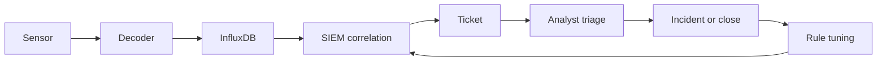

SIEM via syslog or a webhook. Tickets in the existing system, never a second one. Tuning is a feedback edge, not an afterthought.

### 87.5 Metrics

Alerts per day · true positive rate · mean time to triage · mean time to close · percentage suppressed by geofence · devices covered · sensor uptime · incidents per quarter.

If true positive rate is under 20% after three months, the rule set is wrong, not the analyst.

### 87.6 What to do with a positive

1. Corroborate with a second signal.
2. Preserve logs and screenshots.
3. Notify the device owner and their manager.
4. Rotate SMS-2FA credentials if the device held any.
5. Check whether the device left the site during the window.
6. Write a short report with a confidence grade.
7. Tune the rule from what you learned.

---
---

## 88. Adversary Economics

### 88.1 Why an adversary builds

Not to intercept. To answer three cheap questions:

1. **Is the target handset here right now?** Presence.
2. **What is its IMSI?** So it can be found again, or so SMS 2FA can be intercepted.
3. **Is it alone?** Occupancy of a building before entry.

Each is worth money. A burglar who knows a flat is empty at 14:00 has a cheaper job. A fraudster with an IMSI and a SIM-swap path has an account. A process server with a presence confirmation has a service.

### 88.2 Cost structure

| Item | Cost | Reusable |
|---|---|---|
| RTL-SDR V4 | $40 | Yes, passive only |
| LimeSDR Mini 2.0 | $400 | Yes |
| Antenna | $20 | Yes |
| Laptop | $300 used | Yes |
| Battery pack | $40 | Yes |
| **Total entry** | **~$800** | — |
| Commercial grey-market box | $5k–30k | Yes, no skill needed |
| Time to first IMSI | 1–3 days of evenings | — |

The economics are brutal: the marginal cost of the second harvest is zero, so the tool is used far beyond its first purpose.

### 88.3 Return on the investment

| Use | Value |
|---|---|
| Pre-burglary occupancy check | Avoided wasted entry, $200–2,000 |
| 2FA interception | Account takeover, $500–50,000 |
| Process serving | Confirmation of presence, $50–300 |
| Debt recovery | Locating a vehicle or person, $100–1,000 |
| Corporate intelligence | Competitor movements, $1,000–10,000 |
| Insurance fraud | Staged presence, case-dependent |

A single successful 2FA interception pays for the rig many times over. That is why the criminal use case concentrates on SMS-delivered codes rather than voice.

### 88.4 Skill floor

| Task | Skill needed |
|---|---|
| Passive 2G sniffing | Low: install, run, read |
| Active 2G harvest | Moderate: config, channel choice |
| 4G harvest | Moderate-high: timing, core |
| Intercept and decode voice | High |
| Avoiding detection | Moderate: power, dwell, timing |

Most criminal use sits at "active 2G harvest," which is a weekend of learning from a good guide — this one, or the ones it cites.

### 88.5 Grey market

Commercial IMSI-only boxes circulate second-hand, frequently ex-law-enforcement, frequently with no documentation and a dead battery. Prices are $5k–30k. Buyers get a working harvest and no idea how to calibrate it. The failure mode is a box that works in one city and not the next.

---

## 89. Criminal Use Cases in Detail

### 89.1 Pre-burglary occupancy

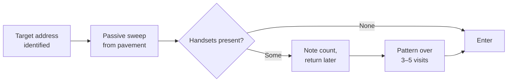

A passive sweep needs no licence and no transmission, so it is the safest criminal method. Counting handsets through a wall is a decent proxy for occupancy. Active harvesting adds the IMSI, useful if the target is worth following.

### 89.2 SMS 2FA interception

The high-value case. The attacker camps the target's handset on their own cell, triggers a login, and reads the code from the SMS as it passes.

| Step | Detail |
|---|---|
| 1 | Identify the target's IMSI by harvesting near them |
| 2 | Camp them, force A5/0 |
| 3 | Trigger a password reset or login on the target service |
| 4 | Read the SMS at the catcher |
| 5 | Complete the takeover |

Success depends on the target using SMS 2FA, being in range, and the service not binding the session to a device. All three are common.

### 89.3 Process serving and debt recovery

Presence confirmation at an address. Low skill, low value, high volume. A passive sweep answers it. The output is a timestamped photograph of "three handsets detected at 08:14."

### 89.4 Corporate intelligence

Association mapping: who visits a competitor's office. Passive, long dwell, handover graph. Sold as a report.

### 89.5 Vehicle tracking

Camping a vehicle's handset and following the handover chain. Requires mobility and repeated deployment. Practical for high-value targets only.

### 89.6 Insurance and staged claims

Confirming or fabricating presence. Weak evidence, so the value is in narrative rather than proof.

### 89.7 What criminals do badly

| Failure | Consequence |
|---|---|
| Too much power | Every handset in the street attaches; target lost in the noise |
| No survey | Channel collision with the real network |
| Long dwell | Detection apps flag it; residents notice dropped calls |
| No timing | 4G attempts fail; they fall back to 2G and stay there |
| No log | Cannot prove anything afterwards |

The last one matters: a harvest with no timestamped record is a story, not evidence.

---

## 90. Adversary Counter-Forensics

### 90.1 What the adversary does to avoid detection

| Technique | Effect against defenders |
|---|---|
| Very short dwell (30–90 s) | Below most detection thresholds |
| Passive-only first pass | Completely invisible |
| Real carrier PLMN clone | No "unknown network" tell |
| Neighbour TAC clone | No forced update storm |
| Low power, directional | Small footprint, few complaints |
| Cipher left on | No null-cipher alert |
| Off-peak timing | Fewer handsets, fewer notices |
| Withdrawal on first anomaly | Gone before a second observation |

### 90.2 The short-dwell problem

A 60-second dwell with cipher intact produces: no null-cipher alert, no sustained-2G alert, and often no identity alert if the handset already held a GUTI. The only residue is a cell that appeared and vanished.

Counter: keep a baseline of cells per location and alert on transient cells with a known TAC. That is R-05 in §7.4, and it is the rule most worth tuning.

### 90.3 What the adversary cannot hide

| Unavoidable residue | Why |
|---|---|
| The cell existed | BCCH must transmit |
| The ARFCN was occupied | Spectrum is finite |
| Timing advance changed | The handset's TA updates on attach |
| Battery drain on the target | Attach costs power |
| Billing record gap | The real network saw an implicit detach |

Billing records are the strongest counter-forensic lever and the one defenders use least. A gap in the carrier's own CDR at the time of the anomaly is independent corroboration the attacker cannot edit.

### 90.4 The arms race in one table

| Adversary move | Defender counter |
|---|---|
| Passive first | Baseline cells, alert on transients |
| Short dwell | Billing-record correlation |
| Cipher left on | TA and attach-time anomaly |
| Real PLMN clone | Neighbour-list inconsistency |
| Low power | Fleet correlation over a wider area |
| Off-peak | 24-hour baseline, not business hours |
| Directional | Multi-point sensors |

### 90.5 What the adversary gains from being detected

Almost nothing, if the detection is not acted on. A defender who logs an anomaly and does nothing has given the adversary a free pass. The counter-forensic conclusion is: detection without a response process is theatre.

---

## 91. Commercial Market Map and Pricing

<!-- patch:91 -->
<details>
<summary><strong>Verification — §91 price bands (all rows D-grade)</strong></summary>

Replace each band with a live quote. §143 is the procedure; §D.5 is how a grade rises.

STATUS: UNVERIFIED

| Platform | Band as written | Quoted | Quote ref | Date | By |
|---|---|---|---|---|---|
| L3Harris Stingray II | see §91 | ☐ | | | |
| L3Harris KingFish | see §91 | ☐ | | | |
| L3Harris Hailstorm | see §91 | ☐ | | | |
| L3Harris Crossbow | see §91 | ☐ | | | |
| Septier IBS | see §91 | ☐ | | | |
| Septier Interceptor | see §91 | ☐ | | | |
| Septier LightRay | see §91 | ☐ | | | |
| PKI Phantom | see §91 | ☐ | | | |
| CellXion | see §91 | ☐ | | | |
| Sunwave | see §91 | ☐ | | | |
| Parsons DRT | see §91 | ☐ | | | |
| R&S TSMA6 | see §91 | ☐ | | | |
| R&S TSME6 | see §91 | ☐ | | | |
| ThinkRF R5500/5750 | see §91 | ☐ | | | |
| Signal Hound SM200B | see §91 | ☐ | | | |
| Aaronia Spectran V6 | see §91 | ☐ | | | |
| Keysight Nemo | see §91 | ☐ | | | |
| Anritsu field test | see §91 | ☐ | | | |

</details>
<!-- /patch:{key} -->


Prices are indicative 2026 bands. Every catcher is quote-only. Treat as D-grade until quoted.

### 91.1 Active catchers — government tier

| Vendor | Platform | Reported class | Band |
|---|---|---|---|
| L3Harris | Stingray II | Manpack/vehicle | $150k–400k |
| L3Harris | KingFish | Portable | $100k–250k |
| L3Harris | Hailstorm | 4G/LTE | Quote only |
| L3Harris | Crossbow | Transportable | Quote only |
| Septier | IBS | Active 2G–5G | $80k–250k |
| Septier | Interceptor | Active | Quote only |
| Septier | LightRay | Low-cost tactical | $20k–60k |
| PKI | Phantom | Vehicle/fixed | $60k–200k |
| CellXion | Vehicle integration | Vehicle | $80k–250k |
| Sunwave | Active catcher | Low-cost | $15k–50k |
| Parsons/DRT | Modular SDR | Modular | $50k–200k |

### 91.2 Passive sensors — enterprise tier

| Vendor | Platform | Class | Band |
|---|---|---|---|
| Rohde & Schwarz | TSMA6 | Scanner + UE | $40k–70k |
| Rohde & Schwarz | TSME6 | Ultra-compact | $25k–45k |
| ThinkRF | R5500/R5750 | Wideband | $12k–25k |
| Signal Hound | SM200B | Analyser | $8k–15k |
| Aaronia | Spectran V6 | Real-time | $15k–60k |
| Keysight | Nemo | Drive-test | $30k–80k |
| Anritsu | Field test | Drive-test | $20k–50k |

### 91.3 Open and DIY

| Item | Cost |
|---|---|
| RTL-SDR V4 | $40 |
| HackRF One | $350 |
| LimeSDR Mini 2.0 | $400 |
| bladeRF xA4 | $500 |
| AntSDR E200 | $500 |
| KrakenSDR | $500 |
| USRP B210 | $1,500 |
| USRP N310 | $7,000 |

### 91.4 Market structure

Three tiers with almost no overlap:

- **Government** buys integration and support. Price is secondary to accreditation, NDA terms and a training package.
- **Enterprise** buys calibration and a support contract. Price is negotiated but the buyer rarely has a technical evaluator, so vendor reputation dominates.
- **Adversary** buys nothing or the cheapest thing that works. Price is everything.

The gap in the market is between $4,000 and $20,000: too expensive for an individual, too cheap for an agency to take seriously. Almost nobody sells there, which is why the DIY route exists.

### 91.5 Pricing pathologies

- **NDA surcharge.** Buyers who want disclosure rights pay more, or are refused.
- **Integration tax.** Anything needing a core handoff doubles.
- **Training bundling.** Cheap units arrive with no training, which is why they sit on shelves.
- **Calibration subscriptions.** A unit without recalibration is out of spec in two years.
- **Band unlocks.** Some vendors charge per band.
- **Second-hand decay.** Ex-law-enforcement units lose value fast once the battery and documentation are gone.

### 91.6 How to buy well

| Do | Don't |
|---|---|
| Require an acceptance test with pass criteria | Accept a demo as acceptance |
| Require calibration certificates | Assume calibration is included |
| Negotiate an NDA carve-out | Sign the standard NDA |
| Buy the training | Assume the manual is enough |
| Get five-year TCO | Compare capital only |
| Test with your own handsets and SIMs | Test with the vendor's |

---

## 92. Public Programmes and Known Deployments

<!-- patch:92 -->
<details>
<summary><strong>Verification — §92 programme claims (B and C grades)</strong></summary>

Each claim needs a primary source. Unsourced claims drop to D and say so.

STATUS: UNVERIFIED

| Actor | Claim as written | Grade | Primary source | Confirmed by | Date |
|---|---|---|---|---|---|
| US FBI | see §92 | B | | | |
| US CBP | see §92 | B | | | |
| US local police | see §92 | B | | | |
| US NSA | see §92 | B | | | |
| UK police | see §92 | B | | | |
| UK GCHQ | see §92 | C | | | |
| Germany BfV/BND | see §92 | C | | | |
| France DGSE | see §92 | C | | | |
| Israel | see §92 | C | | | |
| China MSS | see §92 | C | | | |
| Russia | see §92 | C | | | |
| Canada | see §92 | B | | | |
| Australia | see §92 | C | | | |
| Netherlands | see §92 | B | | | |

</details>
<!-- /patch:{key} -->


Compiled from public reporting, litigation and disclosure. Grades per §14.3.

| Actor | Reported deployment | Grade |
|---|---|---|
| US FBI | Vehicle and aircraft ("dirtbox") | B |
| US CBP | Border fixed and mobile | B |
| US local police | Wide, via federal grant programmes | B |
| US NSA | Airborne GSM collection, fixed diplomatic sites | B |
| UK police | Vehicle and fixed, statutory power | B |
| UK GCHQ | Fixed and mobile, SIGINT integration | C |
| Germany BfV/BND | Domestic mobile | C |
| France DGSE | Diplomatic fixed, mobile | C |
| Israel | Vendor origin, dense domestic use | C |
| China MSS | Dense fixed, border and urban | C |
| Russia | Fixed urban, aggressive 2G retention | C |
| Canada | Federal and provincial, disclosed in litigation | B |
| Australia | Federal, statutory | C |
| Netherlands | Municipal, disclosed | B |

### 92.1 Litigation that shaped disclosure

US cases established that local police must disclose the existence of a catcher under some circumstances, and that vendor NDAs were being used to resist. The practical residue: **always ask whether the NDA has a court-disclosure carve-out** (§85.4).

### 92.2 Border deployments

Border zones are the highest-volume public deployment and the least disclosed. Expect collection at land crossings, and expect it to be passive or very short dwell.

### 92.3 Airborne

"Dirtbox" is the public shorthand for aircraft-mounted collection. Wide area, low per-user margin, high value for association mapping.

### 92.4 What remains undisclosed

- Exact capability of current-generation units
- Which bands are enabled in which agency's units
- Retention periods for collected non-targets
- The number of units in service almost everywhere

Treat any figure you see as a floor.

---
---

# Part VIII — Technical Supplements

**Gap-closing sections: generations, interworking, core signalling, credentials, concealment, exploitation**

Part added in 2.0 · Compiled 2026-11-14

**Part VIII index**

<details class="toc">
<summary>Show sections</summary>

93. [3G and UMTS Specifics](#93-3g-and-umts-specifics)
94. [Wi-Fi Calling, ePDG and IMS](#94-wi-fi-calling-epdg-and-ims)
95. [SS7, Diameter and Core-Side Attacks](#95-ss7-diameter-and-core-side-attacks)
96. [The SIM, eSIM and Credential Layer](#96-the-sim-esim-and-credential-layer)
97. [SUCI Scheme Profiles in Detail](#97-suci-scheme-profiles-in-detail)
98. [Baseband Exploitation](#98-baseband-exploitation)
99. [Cell Broadcast and Public Warning Abuse](#99-cell-broadcast-and-public-warning-abuse)
100. [Timing Advance, Measurement Reports and Ranging](#100-timing-advance-measurement-reports-and-ranging)
101. [Small Cells, Femtocells and Repeaters: the Confusion](#101-small-cells-femtocells-and-repeaters-the-confusion)
102. [Rogue Wi-Fi and Captive Portal Interworking](#102-rogue-wi-fi-and-captive-portal-interworking)
103. [Non-Terrestrial Networks and Direct-to-Device](#103-non-terrestrial-networks-and-direct-to-device)
104. [6G and the Trajectory](#104-6g-and-the-trajectory)
105. [What Still Cannot Be Done](#105-what-still-cannot-be-done)

</details>

---

## 93. 3G and UMTS Specifics

3G is the generation most often skipped in guides and most often present in the field. It matters because it is the fallback when 4G is unavailable and because many 3G catchers are actually easier than 4G ones.

### 93.1 Architecture

```text
UE ──Uu──► NodeB ──Iub──► RNC ──Iu-CS──► MSC ──► PSTN
                        └──Iu-PS──► SGSN ──► GGSN
```

| Node | Function | Catcher relevance |
|---|---|---|
| **NodeB** | Radio, spreading, power control | Must be emulated |
| **RNC** | Radio resource control, ciphering control | Must be emulated or proxied |
| **MSC / SGSN** | Circuit / packet switching | Handoff target |

### 93.2 Why 3G catchers are rarer

| Reason | Detail |
|---|---|
| Two-node stack | A NodeB alone is useless; you need RNC behaviour |
| Spreading and scrambling | Real DSP work, not just framing |
| Power control | Closed-loop; a rogue NodeB must fake it convincingly |
| Identity not needed | TMSI is normally used, so IMSI requires an explicit request |
| Cost | Historically more hardware than 2G |

### 93.3 What a 3G catcher gets

| Item | Available? |
|---|---|
| IMSI | Yes, via Identity Request |
| IMEI | Yes |
| Location | Yes, via timing and cell |
| Voice | Only with full CS domain and AKA bypass |
| SMS | Yes, if CS domain is held |

### 93.4 Security properties

| Property | UMTS |
|---|---|
| Network authentication | Yes (AUTN, sequence number) |
| Cipher | UEA1 (KASUMI), UEA2 (SNOW 3G) |
| Integrity | UIA1/UIA2, mandatory on signalling |
| Null cipher | UEA0, rarely offered |
| Identity concealment | None |
| Known break | KASUMI cryptanalysis (2010), impractical in the field |

The AUTN sequence-number check is what makes UMTS harder to spoof than GSM: a catcher must present a fresh AUTN or the UE rejects it with a synchronisation failure.

### 93.5 Open implementations

| Stack | State | Note |
|---|---|---|
| **OpenBTS-UMTS** | Archived | Ran on USRP; painful to build |
| **srsRAN_4G** | 4G only | No UMTS |
| **OpenAirInterface** | 4G/5G | No usable UMTS |

There is no mature open 3G stack. If you need 3G, buy, or accept significant engineering.

### 93.6 Defender relevance

3G is a downgrade target and a fallback. It offers no identity concealment, so a handset on 3G leaks IMSI on request. Turning 3G off is the correct mitigation where coverage allows, which is most of Europe and much of Asia; it is a bad idea in the rural US and in markets where 3G is still the coverage layer.

### 93.7 3G sunset status

| Region | Status |
|---|---|
| US | Complete, all majors |
| Western Europe | Largely complete, some rural remnants |
| Eastern Europe | Partial |
| Asia-Pacific | Mixed, advanced markets complete |
| Africa, LatAm | Substantially live |

---

## 94. Wi-Fi Calling, ePDG and IMS

<!-- patch:img:## 94. Wi-Fi Calling, ePDG and IMS -->
<p class="plates">
<figure><figcaption>Asterisk — Wikimedia (Commons)</figcaption></figure>
</p>
<!-- /patch:img -->


Wi-Fi Calling is the largest hole in a purely cellular defence model: it takes the traffic off the radio entirely, which is good, and onto whatever Wi-Fi is present, which is not.

### 94.1 How it works


The UE discovers the ePDG by DNS: `epdg.epc.mnc<MNC>.mcc<MCC>.pub.3gppnetwork.org`. It builds an IPsec tunnel, then registers to IMS over it.

### 94.2 The attack surface

| Surface | Attack |
|---|---|
| **DNS** | Poison the ePDG FQDN, point the UE at a rogue ePDG |
| **Captive portal** | Intercept the DNS and the tunnel establishment |
| **Rogue ePDG** | Terminate IPsec, see SIP registration (IMPI, often IMSI-derived) |
| **Rogue IMS** | Accept registration, relay or record calls |
| **Certificate** | Weak validation accepts a forged ePDG certificate |

### 94.3 What a rogue ePDG yields

| Item | Detail |
|---|---|
| IMPI | SIP identity, frequently `IMSI@ims.mnc...mcc...` |
| IMPU | Public identity, the phone number |
| Registration timing | Presence |
| Call metadata | Who, when, duration |
| Content | Only if the media path is also intercepted |

A rogue ePDG therefore yields identity **without any radio at all** and without a licence, since it operates on Wi-Fi and IP.

### 94.4 Defender controls

| Control | Effect |
|---|---|
| Wi-Fi Calling off on untrusted networks | Removes the surface |
| Private DNS / DoT | Protects the ePDG lookup |
| VPN on public Wi-Fi | Tunnel inside a tunnel; the rogue ePDG still sees SIP but not media |
| Certificate pinning where the OS allows | Blocks forged ePDG certs |
| Prefer cellular for sensitive calls | Keeps the cellular threat model |

### 94.5 The trade-off

Wi-Fi Calling is often the *better* path: it bypasses a cellular catcher entirely, and a rogue ePDG is rarer than a catcher. The rule is not "always off" — it is "off on Wi-Fi you do not control, on for a hotel network you trust more than the local macro cell."

### 94.6 IMS in brief

| Element | Role |
|---|---|
| P-CSCF | First SIP hop, policy |
| I-CSCF | Entry point, S-CSCF selection |
| S-CSCF | Registration, service execution |
| HSS | Subscriber data, Cx interface |
| ISIM | IMS identity on the UICC |

Full IMS is a project; §66 lists it as a non-goal for the platform build for good reason.

---

## 95. SS7, Diameter and Core-Side Attacks

<!-- patch:img:## 95. SS7, Diameter and Core-Side Attacks -->
<p class="plates">
<figure><figcaption>Kamailio — Wikimedia (Commons)</figcaption></figure>
</p>
<!-- /patch:img -->


Everything so far has been radio. This section is the layer above: abuse of the core signalling network, which reaches a subscriber anywhere on earth with no proximity at all.

### 95.1 Why this matters

A catcher needs you nearby. An SS7 attack needs a signalling route and your MSISDN. The two are complementary and are frequently confused in public discussion. They are not the same threat and are not defended the same way.

### 95.2 SS7 MAP operations of interest

| Operation | Effect |
|---|---|
| `SendRoutingInfo` | Locates the serving MSC |
| `ProvideSubscriberInfo` | Subscriber state, location |
| `AnyTimeInterrogation` | Location and state without a call |
| `UpdateLocation` | Registers a fake VLR, diverting traffic |
| `InsertSubscriberData` | Alters service profile |
| `SendParameters` | Gets authentication vectors for a clone |
| `MT-ForwardSM` | Delivers SMS to the attacker, not the subscriber |

### 95.3 The classic attacks

| Attack | Mechanism | Result |
|---|---|---|
| **Location tracking** | `AnyTimeInterrogation` / `ProvideSubscriberLocation` | Cell-level position, repeatedly |
| **SMS interception** | Fake VLR via `UpdateLocation` | 2FA codes, all SMS |
| **Call interception** | Register fake MSC, forward legs | Voice |
| **Denial of service** | `CancelLocation`, bogus profile | Service loss |
| **Fraud** | Subscription manipulation | Billing diversion |
| **Authentication-vector theft** | `SendParameters` | Offline SIM cloning path |

### 95.4 Diameter equivalents

| Interface | Operation | Effect |
|---|---|---|
| S6a/S6d | `ULR` / `AIR` | Location update, auth vectors |
| S6a | `IDR` / `DSR` | Subscriber data manipulation |
| Gx | Policy manipulation | Throttle, block, charge |
| Sh | `UDR` / `PUR` | Application server data |

Diameter is better protected than SS7 (TLS is available, `S6a` is often firewalled) but the same operation classes exist.

### 95.5 Why the attacks still work

| Cause | Detail |
|---|---|
| Flat trust model | Interconnect partners are trusted by default |
| Roaming | A visited network must be able to reach the HLR |
| Legacy | SS7 predates authentication entirely |
| Grey routes | Cheap interconnect with poor filtering |
| Detection lag | Anomaly detection is uncommon and reactive |

### 95.6 Defences available to a subscriber

Almost none directly. Available levers:

- **Signalling firewalls** at the operator, which the subscriber can request but not enforce.
- **SMS 2FA migration** to TOTP, passkeys or hardware keys — removes the largest payoff.
- **Number reputation** — a rarely-targeted number is less likely to be enumerated.
- **Short-lived service numbers** for high-risk work.

### 95.7 The relationship to catchers

| Property | Catcher | SS7 |
|---|---|---|
| Proximity needed | Yes | No |
| Licence needed | Yes | No |
| Identity needed to start | No | MSISDN |
| Content | Voice/SMS on 2G | SMS, voice with effort |
| Detection | Handset-side possible | Essentially none |

The combined picture: a catcher gets your IMSI, an SS7 route gets your messages. Defending one without the other is half a defence.

---

## 96. The SIM, eSIM and Credential Layer

### 96.1 The UICC

| Element | Function |
|---|---|
| **Ki** | 128-bit long-term secret, never leaves the card |
| **OPc / OP** | Operator variant, used with Ki in Milenage |
| **IMSI** | Subscriber identity |
| **Milenage** | A3/A8 replacement, produces RES and CK/IK |
| **ISIM** | IMS identity, AKA for SIP |
| **OTA keys** | KIC/KID for remote provisioning SMS |

### 96.2 Why the SIM is still the trust anchor

Every authentication in every generation derives from Ki on the card. That is why SIM cloning was historically devastating and why physical SIM theft matters.

### 96.3 SIM cloning

| Method | Requirement | Effort |
|---|---|---|
| Compromise Ki from the operator | Insider or SS7 vector theft | Low once vectors held |
| Physical extraction | Card in hand, side-channel | Moderate |
| Full card clone | Ki + OPc, programmable UICC | Moderate |
| OTA exploit | KIC/KID plus crafted SMS | High |

A cloned SIM attaches as the subscriber. The real handset and the clone fight over location updates, which is itself detectable.

### 96.4 eSIM / eUICC

| Property | Consequence |
|---|---|
| Soldered eUICC | No physical swap; theft is harder |
| Profile download over IP | New remote attack surface |
| GSMA SGP.22 (consumer) | LPAd provisioning, activation codes |
| SM-DP+ / SM-DS | Profile generation and discovery servers |
| Bootstrap profile | First-install connectivity, distinct exposure |
| Remote management | Operator can reprovision without a visit |

**Nothing about eSIM changes the air interface.** A SUCI-concealed identity is no better because the card is soldered. What eSIM does change is theft resistance and remote provisioning speed.

### 96.5 The provisioning attack surface

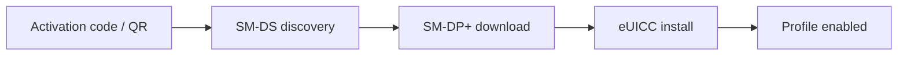

Each step is IP-based and therefore interceptable if the client is on hostile Wi-Fi. An activation code seen once is reusable if not single-use.

### 96.6 Defender controls

| Control | Effect |
|---|---|
| Never photograph an activation QR in public | Prevents code capture |
| Provision on trusted Wi-Fi or cellular | Removes interception |
| Prefer eSIM for theft-prone travel | Physical resilience |
| Prefer physical SIM where swap speed matters | Service continuity |
| Carrier-side SIM-swap lock/PIN | Blocks social-engineering swaps |

The last one is the highest-value control and is almost never enabled. Ask the carrier for a swap lock and a port-out PIN.

### 96.7 Test SIMs for builders

`sysmoSIM`, `5Gisim` and `pySim` let you program known Ki/OPc and test authentication. §46 covers the procedure. Without them you can only test identity harvesting, never Authentication or AKA.

---

## 97. SUCI Scheme Profiles in Detail

### 97.1 What SUCI is

The Subscription Concealed Identifier replaces the SUPI on the air interface in 5G. It is an ECIES-encrypted structure built by the UE using the home network's public key.

| Field | Content |
|---|---|
| Type | SUPI type (IMSI) |
| Home network public key identifier | Which key was used |
| Scheme identifier | Profile A, Profile B, or null |
| Scheme output | Encrypted MSIN, or plaintext for null |
| MAC | Message authentication code over the above |

The MCC/MNC are **not** encrypted. Only the MSIN is.

### 97.2 The profiles

| Scheme ID | Name | Protection |
|---|---|---|
| 0 | **Null scheme** | None; MSIN in plaintext |
| 1 | **Profile A** | ECIES, curve secp256r1, AES-128-CTR, HMAC-SHA-256 |
| 2 | **Profile B** | ECIES, curve X25519, AES-128-CTR, HMAC-SHA-256 |
| 3–127 | Reserved | — |

### 97.3 What each profile means for a catcher

| Scheme | Catcher sees | Outcome |
|---|---|---|
| Null | MCC/MNC plus plaintext MSIN | Full IMSI, trivially |
| Profile A/B | MCC/MNC plus opaque blob | Identity hidden, but network identified |

Even under a real profile the **home network is revealed**, because MCC/MNC travel in the clear. A catcher learns "this is a Vodafone UK subscriber" without learning which one.

### 97.4 The null-scheme failure

Deploying null scheme is legal, easy, and common where an operator has not built key management. It hands identity back entirely. Detection is trivial: the scheme identifier in the SUCI is 0.

Measurement work has repeatedly found null scheme in live networks. Treat any 5G network as null-scheme until proven otherwise.

### 97.5 SUCI-catcher attacks

The attack does not decrypt anything. It exploits a different property: the SUCI is deterministic for a given subscriber and key.

| Step | Detail |
|---|---|
| 1 | Capture a SUCI from a target while nearby |
| 2 | Move to a second location, capture again |
| 3 | Identical SUCI = same subscriber |
| 4 | Correlate against a known subscriber by triggering AKA at a known time |
| 5 | Confirm identity by elimination |

Chlosta et al. (WiSec 2021) demonstrated it. The mitigation is for the UE to refresh the SUCI, which later work addressed by replaying a captured SUCI back at the UE and detecting the response.

### 97.6 The SUCI replay counter-attack

If a catcher replays a captured SUCI to the UE, the UE may respond in a way that reveals a match. Braunschmied (2025) implemented and evaluated the practical version. The defender-side consequence: SUCI is a meaningful but partial gain, and a targeted adversary can still confirm identity.

### 97.7 Defender position, stated honestly

| Claim | Reality |
|---|---|
| "5G hides your identity" | Only under a real profile, only on SA, and only against a passive observer |
| "SUCI is broken" | Overstated. It defeats passive harvesting and slows targeted work |
| "Turn off 5G to be safe" | Wrong. SA with SUCI beats LTE |
| "Null scheme is rare" | It is not |

Practical position: prefer SA, prefer a carrier that runs a real profile, keep 2G and 3G off, and accept that a determined targeted adversary can still confirm who you are.

---

## 98. Baseband Exploitation

A catcher does not have to be convincing if it can serve the handset a parsing bug.

### 98.1 The baseband

| Property | Detail |
|---|---|
| Separate processor | Own RTOS, own firmware, own memory |
| Runs before the OS | Parses radio frames regardless of Android/iOS state |
| Large attack surface | SIBs, NAS, RRC, SMS, MMS, IMS, ePDG |
| Poor visibility | No crash logs to the user, no patch notes |
| Long patch path | Chip vendor → handset vendor → carrier → user |

### 98.2 Exploit classes

| Class | Vector |
|---|---|
| Parser memory corruption | Malformed SIB, NAS, RRC |
| SMS/MMS parsing | Delivery of a crafted message |
| IMS / SIP parsing | Rogue IMS or ePDG |
| OTA provisioning | Crafted OTA SMS |
| Wi-Fi offload | Rogue ePDG, captive portal |

### 98.3 Delivery via catcher

The catcher controls everything the handset parses: SIB contents, NAS messages, SMS payloads, and any IMS signalling it terminates. It can therefore deliver a crafted input with no user action and no visible message.

### 98.4 What an exploit yields

| Level | Consequence |
|---|---|
| Baseband crash | Denial of service, detection signal |
| Baseband code execution | Access to the modem, call and SMS control |
| Baseband-to-application | On some platforms, memory shared with the OS |
| Full device | With a chained app-layer exploit |

### 98.5 Patch lag, quantified

| Stage | Typical delay |
|---|---|
| Vendor fix | 1–6 months |
| Handset vendor integration | 1–6 months |
| Carrier certification | 1–3 months |
| User application | Days to never |

The Requirements Freeze means a device can be permanently behind on baseband features and fixes regardless of OS updates.

### 98.6 Defender controls

| Control | Effect |
|---|---|
| Patch promptly | Only real control |
| Buy devices with a long support window | Extends the patch horizon |
| Prefer vendors with a baseband CVE disclosure record | Predictability |
| Lockdown Mode / Advanced Protection | Reduces adjacent surface |
| Accept that patched-latest is the floor, not the ceiling | Honesty |

### 98.7 Detection signals

A baseband crash is detectable: sudden radio loss, then reattach, with no coverage cause. It is also a normal event, so it is weak corroboration. A crash *immediately* after an anomaly sequence is worth logging.

---
---

## 99. Cell Broadcast and Public Warning Abuse

### 99.1 What Cell Broadcast is

Cell Broadcast (CBS, GSM) and Public Warning System (PWS — ETWS in 3GPP, CMAS/WEA in North America) send text to every handset in a cell area with no per-subscriber addressing and no acknowledgement.

| Property | Detail |
|---|---|
| Channel | CBCH, on the BCCH carrier |
| Addressing | Message ID + cell list, not IMSI |
| Audience | Every capable handset in range |
| Acknowledgement | None |
| Alerting | ETWS/CMAS can force a sound, bypass silent mode, wake the screen |
| Authentication | Effectively none on the air interface |

### 99.2 Why it is abuse-relevant

A catcher is a base station. A base station can send cell broadcasts. Therefore **a catcher can put arbitrary text on every phone in range**, with a loud alert, and the phone has no way to verify the source.

| Abuse | Effect |
|---|---|
| Fake emergency alert | Panic, evacuation, or movement |
| Fake government message | Authority laundering |
| Phishing link in a "warning" | Mass click |
| Denial of service | Repeated forced alerts drain battery and disrupt |
| Protest or event messaging | Counter-messaging to a crowd |
| Presence confirmation | Any delivery report? No — but device behaviour is observable |

### 99.3 The phishing case in detail

A message reading "Emergency: water main burst, boil water, details at hxxp://…" arriving with a real alert tone is more convincing than an SMS. The link goes wherever the attacker wants. Nothing in the handset validates it.

### 99.4 Defender controls

| Control | Effect |
|---|---|
| Turn off "emergency alerts" except extreme | Reduces nuisance, does not stop delivery |
| Treat links in alerts as untrusted | Same as SMS |
| Check the message ID if the OS shows it | Real CMAS/ETWS IDs differ from attacker-chosen |
| Verify against a second source | The only reliable check |

The reliable control is cultural: **a warning is not a verification.** Treat any alert containing a link as an SMS.

### 99.5 Building it

OsmoBTS and srsRAN both support CBCH/SIB scheduling. A minimal CBCH injection:

```text
# OsmoBTS: enable CBCH on the BCCH carrier
bts 0
 cbch channel 0
```

Then send a message via the CBSC interface. There is no mature open CBSC; most implementations write directly to the CBCH queue. Expect effort.

### 99.6 Detection value

Cell broadcast is a *cheap* way to confirm a catcher is present: an unexpected alert is a strong signal, and it is one of the few that is unambiguous. It is also the cheapest way for an attacker to influence behaviour, which is why it is underrated on both sides.

---

## 100. Timing Advance, Measurement Reports and Ranging

### 100.1 Timing advance as a range measurement

TA exists so a handset's uplink arrives in the right slot. It is expressed in units of the symbol period, and each unit maps to a fixed distance.

| Generation | Unit | Metres per unit | Max range |
|---|---|---|---|
| GSM | 1 bit period | ~554 m | ~35 km |
| LTE | 16 × Ts | ~78 m | ~100 km (with extended TA) |
| NR | 16 × Tc | ~39 m | ~100 km (with extended TA) |

A TA value is therefore a coarse range from the serving cell. At 78 m per LTE unit, TA 0–3 puts the handset within roughly 250 m.

### 100.2 Ranging maths

```text
d = TA × unit_length
```

For a sector antenna with known azimuth and beamwidth, TA gives an arc. Two sectors intersecting give a fix. Three give a better one.

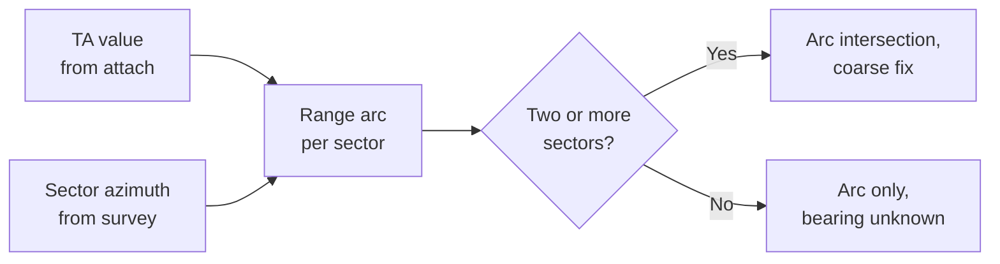

### 100.3 Accuracy, honestly

| Error source | Magnitude |
|---|---|
| TA quantisation | ±39–78 m |
| Multipath | 50–500 m urban |
| Timing reference error | Adds directly to range |
| Sector beamwidth | Arc width at range |
| Antenna downtilt | Range compression |

A TA fix is **tens to hundreds of metres**, not metres. It is a search area, not a pin. Never present it as a GPS substitute.

### 100.4 Measurement reports

The serving cell can request neighbour measurements. A catcher that reads them learns:

| Reading | Inference |
|---|---|
| Neighbour PCI and RSRP | Which real cells are near the target |
| RSRQ | Load and interference |
| Report timing | Movement rate |
| Handover events | Direction of travel |

A sequence of measurement reports across a route is a usable track, and the target generates them without any cooperation.

### 100.5 Multi-sector builds

Three sectors at 120° with individual TA logging give a workable triangulation with no extra hardware beyond the antennas. This is the cheapest geolocation upgrade available and is routinely ignored.

### 100.6 Limits

- TA is only available while the handset is attached and synced.
- Idle-mode handsets report no TA.
- A handset in a moving vehicle invalidates a fix within seconds.
- Dense urban multipath can be worse than the quantisation by an order of magnitude.

---

## 101. Small Cells, Femtocells and Repeaters: the Confusion

Most "is this a catcher?" questions are really "is this small box a legal cell?" Usually yes.

### 101.1 The categories

| Device | Owner | Backhaul | Legitimate? | Detects as |
|---|---|---|---|---|
| **Macro cell** | Operator | Fibre/microwave | Yes | Normal |
| **Small cell / micro** | Operator | Fibre | Yes | Odd but legal |
| **Femtocell** | Operator, in a home | Consumer broadband | Yes | Odd, low power, closed group |
| **Repeater** | Operator or landlord | None (amplifies) | Yes, if licensed | Same PCI as donor |
| **Catcher** | Agency or adversary | Local | Depends | Anomalous |

### 101.2 Telling them apart

| Discriminator | Legal cell | Catcher |
|---|---|---|
| Neighbour list | Populated, consistent | Empty or inconsistent |
| Cipher | Normal operator set | Often null, or forced |
| TAC | In the operator's plan | Often reused oddly |
| Persistence | Stable for months | Hours |
| Coverage shape | Designed, gradual | Sharp, local |
| Capacity | Real throughput | Trickle or nothing |
| Operator's own map | Listed | Not listed |
| Second handset | Same behaviour | Same behaviour |

None of these is decisive alone. **The single best test is asking the carrier whether the cell ID is theirs** — and it is the test people skip.

### 101.3 Femtocells specifically

A femtocell is a legal base station in someone's house. It broadcasts a real PLMN, uses real ciphering, and is closed to subscribers outside its group. It looks exactly like what it is: a small cell. The confusion arises because it is in a residential area where a handset "should" see a macro.

### 101.4 Repeaters specifically

A repeater repeats the donor cell, including its PCI. A handset sees the same cell ID at higher strength. Signal jumps with no cell change are the signature. Repeaters are also the commonest cause of a false "catcher" report.

### 101.5 What to do with the ambiguity

1. Note the cell ID.
2. Check the operator's published coverage and CellMapper.
3. Ask the carrier.
4. Compare cipher and neighbour list.
5. Only then write "probable catcher."

Grade it **C** unless the carrier confirms it is not theirs. §14 Appendix B.

---

## 102. Rogue Wi-Fi and Captive Portal Interworking

### 102.1 The vector

A captive portal is a legal man-in-the-middle by design. It intercepts DNS, redirects HTTP, and holds the client until a click. Every technique a rogue AP needs is already standard captive-portal behaviour.

### 102.2 What a rogue AP can do

| Action | Technique |
|---|---|
| See all DNS | Intercept port 53, log queries |
| Redirect HTTP | Transparent proxy |
| Serve a fake portal | Any web server |
| Capture credentials | Portal that asks for an email password |
| Serve a fake OS update | Content injection on HTTP |
| Block the ePDG lookup | Poison DNS for `epdg.*` |
| Force a Wi-Fi Calling re-registration | Tunnel break, then rogue ePDG |

### 102.3 What it cannot do

- Break TLS without a certificate the client trusts (unless it installs one).
- See inside a VPN.
- Break certificate pinning.
- See traffic from an app with its own pinned transport.

### 102.4 Defender controls

| Control | Effect |
|---|---|
| VPN on before joining | Traffic protected from the first packet |
| Private DNS / DoT | DNS cannot be poisoned |
| HTTPS-only browsing | Portal cannot inject |
| Do not install a portal's CA certificate casually | Preserves pinning |
| Check the portal certificate issuer | Real venues use real CAs |
| Turn Wi-Fi off when not using it | Removes the surface |

### 102.5 The ePDG poisoning case

The specific attack worth knowing: poison the ePDG FQDN, present a rogue IPsec endpoint with a forged certificate, and capture SIP registration. Yields IMPI, IMPU and call metadata without a radio and without a licence.

Mitigations: Private DNS, VPN, and Wi-Fi Calling off on untrusted networks.

### 102.6 Wi-Fi vs cellular, decided

| Situation | Prefer |
|---|---|
| Hotel, trusted, cellular weak | Wi-Fi with VPN |
| Airport, busy | Cellular |
| Conference venue | Cellular, or Wi-Fi plus VPN and no calls |
| Abroad, roaming costs | Wi-Fi plus VPN, calls over Signal |
| Hostile state | Cellular only, no Wi-Fi at all |

---

## 103. Non-Terrestrial Networks and Direct-to-Device

### 103.1 What is changing

Satellite direct-to-device moves the base station into orbit. The handset talks to a satellite using the same air interface, and the satellite or a ground gateway connects to a core.

| Architecture | Path |
|---|---|
| **NTN, transparent** | UE → satellite → ground gateway → gNB → core |
| **NTN, regenerative** | UE → satellite (gNB on board) → core |
| **Direct-to-device (D2D)** | UE → satellite → operator core, unmodified handset |

### 103.2 Security consequences

| Consequence | Direction |
|---|---|
| No local catcher in range | Good: satellite is not on the roof next door |
| Very large cells | Bad: coarse location, thousands of users per beam |
| Long propagation delay | Changes TA and HARQ behaviour |
| Doppler | Large frequency shift; timing is hard |
| New gateway surface | Bad: ground gateways are attack points |
| SUCI applies | Neutral to good, if a real profile is used |

### 103.3 What a catcher can and cannot do

A terrestrial catcher cannot impersonate a satellite. But:

- It can still bid a dual-capability handset down to terrestrial 2G.
- It can deny terrestrial service so the handset falls to satellite, which is slower and coarser.
- A ground gateway compromise reaches further than any roof.

### 103.4 Defender position

NTN is a net improvement for identity exposure and a net regression for location precision. It is not a mitigation you can choose yet — availability is limited and the handset must support it.

### 103.5 Timeline, cautiously

Constellation deployment is fast; handset support, spectrum coordination and regulatory approval are slow. Treat NTN as an emerging path, not a current defence.

---

## 104. 6G and the Trajectory

### 104.1 What is actually being specified

| Theme | Meaning |
|---|---|
| Integrated sensing and communication | The network senses the environment as well as serving it |
| AI-native air interface | Learned scheduling and channel estimation |
| Sub-THz | 100 GHz+, short range, high capacity |
| Native NTN | Satellite as a first-class access |
| Deterministic networking | Bounded latency guarantees |
| Post-quantum security | Migration away from current asymmetric primitives |

### 104.2 What matters for this subject

| Development | Effect on catchers |
|---|---|
| Post-quantum SUCI | Removes the classical cryptanalysis path |
| Stronger mutual auth defaults | Raises the bar for spoofing |
| ISAC | The network itself becomes a sensor — better location for everyone, including attackers |
| AI-native | Harder to reason about failure modes; harder to audit |
| Sub-THz | Shorter range per cell, more cells, more handover surface |

### 104.3 The pattern to expect

Every generation has followed the same shape: better concealment, better authentication, no defence against downgrade, and optional configuration that operators under-deploy. There is no reason to expect 6G to break the pattern.

The durable defender strategy is generation-agnostic:

1. Turn off the oldest generations.
2. Keep the device patched.
3. Use the strongest concealment the network offers.
4. Log and corroborate.
5. Do not trust a single indicator.

None of that changes in 6G.

### 104.4 What will not change

The handset must still identify itself before it can be authenticated. Any generation that keeps that ordering keeps the problem.

---

## 105. What Still Cannot Be Done

A list of honest gaps, so nobody promises otherwise.

### 105.1 Technically impossible today

| Cannot | Why |
|---|---|
| Prove a tower is fake from a consumer handset | The handset has no trust anchor for the tower |
| Decrypt 5G SUPI without the home key | ECIES to a key you do not hold |
| Get VoLTE content from a DIY catcher | Needs full IMS plus media path |
| Intercept content on LTE/5G without core access | No plaintext to intercept |
| Defeat downgrade by protocol alone | No standard mechanism |
| Detect a passive-only collector | It never transmits |
| Get metre-level location from TA | Quantisation is 39–78 m |

### 105.2 Practically out of reach for a small programme

| Cannot | Why |
|---|---|
| Certified LI mediation | No mature FOSS, expensive to build |
| Type approval | Cost and time |
| Aircraft integration | Aviation certification |
| FR2 / mmWave | Different front ends, immature open stacks |
| 24/7 multi-site operations | Staffing |

### 105.3 Cannot be fixed by technology at all

| Cannot | Why |
|---|---|
| Stop a determined state targeting you | Resources are asymmetric |
| Stop a baseband exploit with no patch | Vendor timeline |
| Get coverage and maximum hardening at once | Lockdown Mode costs coverage |
| Guarantee a court accepts your evidence | Depends on the court |
| Make a legacy 2G device safe | Design limit |

### 105.4 What "complete" means for this document

Complete means every question in scope has an answer, including "the answer is no." A guide that claims no gaps is a sales document. This one has a §105.

---
---

# Part IX — Programme and Operations

**Safety, environment, supply chain, reproducibility, metrics, governance, training, law, data protection, insurance, postmortems**

Part added in 2.0 · Compiled 2026-11-14

**Part IX index**

<details class="toc">
<summary>Show sections</summary>

106. [RF Safety Incidents and Emergency Procedures](#106-rf-safety-incidents-and-emergency-procedures)
107. [Environmental Ratings and Installation](#107-environmental-ratings-and-installation)
108. [Supply Chain and Component Provenance](#108-supply-chain-and-component-provenance)
109. [Reproducible Builds](#109-reproducible-builds)
110. [Programme KPIs and Metrics](#110-programme-kpis-and-metrics)
111. [Governance, RACI and Decision Rights](#111-governance-raci-and-decision-rights)
112. [Training Curriculum](#112-training-curriculum)
113. [Competence Assessment](#113-competence-assessment)
114. [Jurisdiction and Authority Matrix](#114-jurisdiction-and-authority-matrix)
115. [Data Protection and Minimisation](#115-data-protection-and-minimisation)
116. [Retention Matrix](#116-retention-matrix)
117. [Insurance, Liability and Complaints](#117-insurance-liability-and-complaints)
118. [Postmortems and Lessons Learned](#118-postmortems-and-lessons-learned)

</details>

---

## 106. RF Safety Incidents and Emergency Procedures

### 106.1 The incident types

| Incident | Cause | Presentation |
|---|---|---|
| **RF burn** | Contact with a live antenna or open connector | Localised heat, no visible mark initially |
| **Warmth / heating sensation** | Standing in a main beam above ~10 W/m² | Face and hands warm, headache |
| **Pacemaker interaction** | Close proximity to a radiator | Palpitations, device alarm |
| **Startle / fall** | Sudden alert or surprise at height | Injury, not RF |
| **Battery thermal event** | LiFePO4 or Li-ion abuse | Heat, swelling, smoke |
| **Electric shock** | Mains or DC contact | Burn, cardiac risk |
| **Interference complaint** | Out-of-band or overload | Neighbours' service loss |

### 106.2 Immediate actions

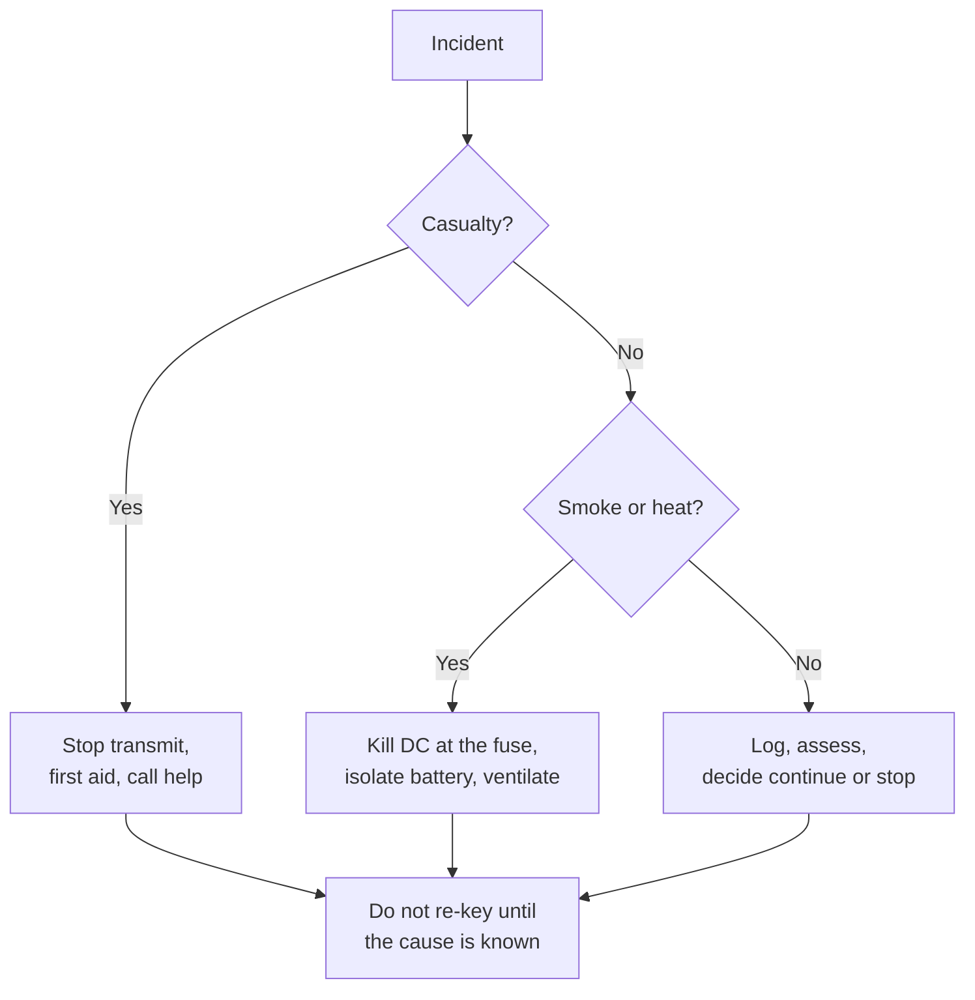

**RF burn.** Kill transmit first, then treat. Cool water, no ice, cover loosely, and get it looked at — RF burns are deep and look trivial.

**Pacemaker.** Move the casualty out of the beam, not just away from the mast. Ask about the device type and call the ambulance if symptomatic.

**Battery event.** Disconnect the fuse, then the battery terminal. Do not move a swelling pack with bare hands. Ventilate. A LiFePO4 pack vents less violently than Li-ion but still vents.

### 106.3 Prevention

| Control | Detail |
|---|---|
| Exclusion radius marked and enforced | §35 |
| No key-up with a disconnected antenna | Dummy load or verified connection |
| Barrier at head height | Physical, not painted line |
| Signage | At every approach, at eye level |
| Two-person rule at height | One transmits, one watches |
| Pacemaker declaration in the team | Recorded on the roster |
| Fire blanket and extinguisher | Dry powder or CO₂ near the rig |
| First aid kit | With burns dressing |

### 106.4 Emergency contacts card

Every site book carries: site address, grid reference, access notes, nearest A&E, site owner contact, network operator interference desk, and the on-call engineer. Printed, in the site book, not only on a phone.

### 106.5 Post-incident

Do not re-key until the cause is understood. Record: what was transmitting, power, distance, duration, antenna, and what the casualty was doing. A single RF burn is a reportable near-miss even if trivial.

---

## 107. Environmental Ratings and Installation

### 107.1 IP codes, correctly

The first digit is solids, the second is liquids. IP54 is dust-protected and splash-resistant; IP67 is dust-tight and immersion-resistant.

| Rating | Meaning | Fit for |
|---|---|---|
| IP20 | Fingers only | Indoor rack |
| IP54 | Dust-protected, splashing | Sheltered outdoor |
| IP65 | Dust-tight, water jets | Exposed outdoor |
| IP67 | Dust-tight, immersion | Mast, marine |

**The trap:** IP67 sealed boxes overheat. A sealed box has no convection. The correct outdoor answer is usually **IP54 with filtered vents and a fan**, not IP67 and a dead PA.

### 107.2 Environmental limits

| Parameter | Operating | Storage |
|---|---|---|
| Temperature | −10 to +50 °C | −20 to +60 °C |
| Humidity | 5–95% non-condensing | 5–95% |
| Altitude | To 3,000 m | To 6,000 m |
| Vibration | Vehicle class | — |

Derate output power above 40 °C ambient.

### 107.3 Installation sequence

1. Access and permit confirmed.
2. Earth bar checked and bonded.
3. Mast or bracket fixed; wind load checked.
4. Antenna mounted; drip loop formed at every entry.
5. Cable run with bend radius respected and fire stopping fitted.
6. Lightning arrestor at the entry point, bonded to earth.
7. Enclosure mounted in shade.
8. Power and data through separate glands.
9. Sealant on horizontal entries only, never on the underside.
10. Photograph the as-built before closing.

### 107.4 Weatherproofing

| Item | Method |
|---|---|
| Connectors | Self-amalgamating tape, then PVC, then a drip loop |
| Glands | Correct size, cable-matched, torque to spec |
| Entry points | From below, never the top face |
| Sealant | Neutral-cure silicone, horizontal seams only |
| Cable ties | UV-stable, not nylon indoor ties |

### 107.5 Corrosion

Marine and industrial sites need stainless fixings, a dielectric grease on every connector, and an inspection interval of six months. Aluminium against steel needs an isolating washer.

### 107.6 Lightning

| Control | Detail |
|---|---|
| Air termination | Mast above the antenna |
| Down conductor | Separate, bonded to earth |
| Arrestor | At the cable entry, gas discharge or quarter-wave |
| Earth resistance | Under 10 Ω, measured and recorded |
| Disconnect | Antenna lead out during storms if the rig is unattended |

A rig without lightning protection is a rig you will replace.

---

## 108. Supply Chain and Component Provenance

### 108.1 Why it matters

You are transmitting with these parts. A counterfeit PA, a relabelled SDR or a clone SBC produces emissions you did not design, and a failure you cannot explain.

### 108.2 Risk by category

| Category | Counterfeit risk | Consequence |
|---|---|---|
| SDR boards | Medium | Wrong tuning, spurs, driver mismatch |
| Power amplifiers | High | Spectral regrowth, thermal failure |
| Filters | Medium | Out-of-band emissions |
| Cables and connectors | High | Loss, intermittency, arcing |
| Batteries | High | Fire |
| SBCs and storage | Medium | Instability, data loss |

### 108.3 Provenance controls

| Control | Detail |
|---|---|
| Buy from the vendor or an authorised distributor | Primary control |
| Record serial number and supplier per unit | Build record |
| Photograph the part on receipt, serial visible | Traceability |
| Verify SDR with a known test signal | Functional proof |
| Verify PA output on a meter | Functional proof |
| Check batteries for a BMS and correct labelling | Safety |
| Avoid marketplace listings for critical parts | Except for known-good sellers |

### 108.4 A note on used equipment

Used SDRs are usually fine. Used amplifiers frequently are not: the output stage is the first thing degraded. Used batteries should be assumed at end of life.

### 108.5 Firmware provenance

| Control | Detail |
|---|---|
| Download from the project's own release | Never a mirror |
| Verify checksums or signatures where published | Always |
| Record the exact version and hash | Build record |
| Re-verify before a rebuild | §109 |

### 108.6 Bill of materials discipline

The BOM is a controlled document: part number, supplier, serial, price, date, and a photo. It is what lets you rebuild and what lets you defend a claim about what was transmitting.

---

## 109. Reproducible Builds

### 109.1 The requirement

A rebuild of the same commit, with the same toolchain, must produce a functionally identical system. Without it you cannot rebuild after a disk failure, cannot compare two units, and cannot prove what was running.

### 109.2 What must be pinned

| Item | Pin |
|---|---|
| Base OS | Image digest |
| Compiler and toolchain | Version and hash |
| Python and packages | Version, hash |
| SDR driver | Commit |
| UHD FPGA image | Version and hash |
| RAN and core | Commit |
| Config templates | Commit |
| Kernel and modules | Version and hash |

### 109.3 Method

```bash
# record the toolchain
gcc --version > build-env.txt
python3 --version >> build-env.txt
uhd_config_info --version >> build-env.txt 2>/dev/null || true
dpkg -l >> build-env.txt
sha256sum /usr/bin/gcc /usr/bin/python3 >> build-env.txt

# build in a container with a pinned base
podman build --build-arg BASE=debian@sha256:<digest> -t op-build:$(git rev-parse --short HEAD) .
```

### 109.4 Verification

Build twice, diff the manifests. Differences are expected only in timestamps and paths; anything else is a leak. Set `SOURCE_DATE_EPOCH` and normalise paths to reduce noise.

### 109.5 Functional equivalence test

Byte-identical binaries are a bonus; functional equivalence is the requirement. Run the acceptance subset (§44) against a fresh build and compare results.

### 109.6 Record

`build-env.txt`, the image digest, the commit, the functional test results, and the builder's name, all filed with the build record. A build without this is an anecdote.

---

## 110. Programme KPIs and Metrics

### 110.1 Why metrics

Programmes drift. Metrics make drift visible before it becomes a failure. They are also the only defence against a stakeholder asking "is this working" and getting an opinion.

### 110.2 Technical KPIs

| KPI | Target | Why |
|---|---|---|
| Sensor uptime | >99% | Availability is the product |
| Capture gap >60 s per 24 h | 0 | Continuity |
| Calibration currency | 100% | Validity |
| Patch latency, median | <14 days | Exposure |
| Desense, measured | ≤1 dB | Sensitivity |
| Isolation, measured | ≥160 dB | Sensitivity |
| Thermal max, internal | ≤55 °C | Reliability |
| GNSS lock availability | >99% | Timing validity |

### 110.3 Process KPIs

| KPI | Target |
|---|---|
| Acceptance tests passed first time | >90% |
| Builds reproducible | 100% |
| Change lead time | <5 days |
| Rollback rate | <10% |
| Incidents with a postmortem | 100% |
| Documentation current | 100% |

### 110.4 Outcome KPIs

| KPI | Target |
|---|---|
| Alerts per device-day | Trend down |
| True positive rate | >40% |
| Mean time to triage | <30 min |
| Mean time to close | <24 h |
| Identities resolved per deployment | Baseline plus trend |
| Non-target over-collection | Under retention policy limit |

### 110.5 Anti-metrics

| Metric | Why it misleads |
|---|---|
| Total identities collected | Rises with dwell, not with value |
| Alerts generated | Rises with sensitivity, not accuracy |
| Capital spend | Not correlated with capability |
| Bands supported | Not correlated with use |

### 110.6 Reporting cadence

Weekly technical, monthly process, quarterly outcome, annual programme review. One page each. A dashboard nobody reads is a cost.

---

## 111. Governance, RACI and Decision Rights

### 111.1 Why governance

Every failure in Part VII traces to a decision nobody owned. Governance assigns the decisions before they are needed.

### 111.2 RACI

| Activity | Sponsor | Programme lead | RF engineer | Analyst | Legal | Facilities |
|---|---|---|---|---|---|---|
| Business case | **A** | R | C | C | C | I |
| Requirement definition | A | **R** | C | C | C | I |
| Site selection | I | A | **R** | I | I | C |
| Spectrum authority | I | A | C | I | **R** | I |
| Build and acceptance | I | A | **R** | I | I | I |
| Deployment authorisation | A | **R** | C | I | C | I |
| Day-to-day operation | I | A | **R** | C | I | I |
| Triage | I | I | C | **R** | I | I |
| Retention decisions | I | A | I | C | **R** | I |
| Disclosure | A | C | C | C | **R** | I |
| Decommission | A | **R** | C | I | C | C |

A = accountable, R = responsible, C = consulted, I = informed.

### 111.3 Decision rights that must be explicit

| Decision | Who decides |
|---|---|
| Whether to deploy at a site | Programme lead, on the survey gate |
| Whether to key up today | RF engineer, on conditions |
| Whether to stop an operation | RF engineer, unilaterally |
| Whether to escalate to incident | Analyst, with commander notified |
| Whether to retain beyond schedule | Legal |
| Whether to disclose | Legal, with sponsor informed |
| Whether to decommission | Sponsor |

The RF engineer's unilateral stop right matters most. Write it down and mean it.

### 111.4 Escalation ladder

```text
Operator → RF engineer → Programme lead → Sponsor → Legal/Comms
```

Timescales: immediate for safety, 1 hour for service loss, 1 day for policy.

### 111.5 Governance artefacts

Programme charter · RACI · decision log · risk register · change board terms · annual review minutes. Five documents, reviewed annually, not a bureaucracy.

---
---

## 112. Training Curriculum

### 112.1 Design principle

Train to the task, not to the product. Every module ends with a task the trainee performs unaided. Nothing is taught "for awareness."

### 112.2 Role tracks

| Track | Audience | Duration |
|---|---|---|
| **A — Awareness** | Managers, sponsors, legal | 2 h |
| **B — Operator** | Field operators | 3 days |
| **C — Engineer** | Build and maintain | 10 days |
| **D — Analyst** | Triage and reporting | 2 days |
| **E — Expert witness** | Anyone who may testify | 2 days, annual refresh |

### 112.3 Track B — Operator

| Module | Content | Assessment |
|---|---|---|
| B1 | What a catcher is and is not | Written, 10 questions |
| B2 | Legal basis and authority for the site | Oral |
| B3 | Exclusion zone and RF safety | Practical |
| B4 | Start-up and shutdown sequence | Practical, unaided |
| B5 | Reading the spectrum and status | Practical |
| B6 | Anomaly recognition and stop rules | Scenario |
| B7 | Logging and evidence capture | Practical |
| B8 | Fault response and escalation | Scenario |

Pass standard: all practicals unaided, written ≥80%.

### 112.4 Track C — Engineer

| Module | Content |
|---|---|
| C1 | RF fundamentals, link budget |
| C2 | SDR architecture and drivers |
| C3 | Timing and GNSS discipline |
| C4 | Isolation and desense |
| C5 | Power and thermal |
| C6 | Site survey method |
| C7 | Core and handoff |
| C8 | Evidence chain and validation |
| C9 | Configuration management |
| C10 | Acceptance testing |

### 112.5 Track D — Analyst

Alert triage · corroboration discipline · grading · writing a defensible finding · over-collection handling · when to escalate · when to say "unknown."

### 112.6 Track E — Expert witness

Duty to the court · what your tooling does and does not prove · validation records · limits of the method · cross-examination practice (§137) · refreshing on tool changes.

### 112.7 Delivery requirements

| Requirement | Detail |
|---|---|
| Instructor | Practitioner, not a trainer |
| Ratio | 1:4 maximum for practicals |
| Environment | Real rig, real handsets, real spectrum |
| Materials | Current, versioned, matching the deployed stack |
| Records | Attendance, assessment, result, trainer |

### 112.8 Refresher cadence

Annual for all tracks. Immediate re-training after any stack change, any postmortem action, or any failed assessment.

### 112.9 What not to train

Vendor GUI click-paths that change every release. Train the concept and the sequence; the GUI will move.

---

## 113. Competence Assessment

### 113.1 Principle

Assessment is by observed task, not by multiple choice. A certificate that only proves attendance is worthless.

### 113.2 Assessment grid

| Competence | Method | Pass |
|---|---|---|
| Set up and key up unaided | Observation | No prompts, under 20 min |
| Set up and shut down cleanly | Observation | No prompts, verification done |
| Compute and mark exclusion zone | Written plus observed | Correct, marked |
| Recognise desense | Scenario | Identified, corrected |
| Diagnose no-attach | Fault injection | Correct fault tree branch |
| Capture and hash evidence | Observation | Verifies correctly |
| Triage an alert | Scenario set | Correct grade, correct action |
| Write a finding | Written | Defensible, graded, no overclaim |
| Testify | Mock cross-examination | Survives §137 sample |

### 113.3 Currency

| Role | Reassessment |
|---|---|
| Operator | Annual |
| Engineer | Annual, plus on major stack change |
| Analyst | Annual |
| Expert | Every testimony cycle |

### 113.4 Lapse

A lapsed competence removes the right to perform the task unsupervised. It does not remove the person from the roster; it puts them back on supervised duty.

### 113.5 Records

Assessment record per person per competence, with date, assessor, result and any remediation. Retained for the employment period plus six years.

### 113.6 Assessor qualification

Assessors hold the competence themselves and have assessed at least three candidates. One assessor per four candidates maximum, and never the person who trained them in the same cycle where avoidable.

---

## 114. Jurisdiction and Authority Matrix

Not legal advice. Confirm with counsel in every jurisdiction of operation.

### 114.1 The axes

Authority to operate depends on four independent questions:

| Question | Why it changes everything |
|---|---|
| Is there a statutory power? | Determines whether evidence is admissible |
| Is there a licence class? | Determines whether you may transmit at all |
| Is there a notification duty? | Determines whether you must announce the deployment |
| Is there a retention regime? | Determines what you may keep |

### 114.2 Model positions

| Model | Transmit basis | Evidence basis | Typical shape |
|---|---|---|---|
| **A — Statutory, licensed** | Licence plus statute | Strong | Warranted deployment, full chain |
| **B — Statutory, unlicensed** | Statute overrides licence | Medium | Police, low power, no licence needed |
| **C — Licensed, non-statutory** | Licence only | Weak | Private operator, civil use |
| **D — Licence-exempt** | Tolerance or exemption | Very weak | Adversary, research, demo |
| **E — Carrier consent** | Contract with the operator | Depends on contract | Carrier-run, enterprise on carrier land |

### 114.3 Country sketch

| Country | Model | Notes |
|---|---|---|
| US | B for LE, C for private | Federal grants, state variation, NDA litigation history |
| UK | B | Ofcom and RIPA framework, statutory power |
| Germany | B / C | Federal and state split, strict retention |
| France | B / C | ANFR coordination, CNIL retention |
| Netherlands | B | Municipal deployments, disclosure history |
| Canada | B | Federal and provincial, litigation-driven disclosure |
| Australia | B | Federal statutory |
| Israel | A | Dense domestic use |
| UAE, Saudi | C / D | Licensed, less disclosure |
| Russia, China | A | Statutory, opaque |
| Brazil, Mexico | C | Licensed, patchy |
| Kenya, Nigeria | C / D | Licensed, expensive |

### 114.4 The four questions, in practice

Before any deployment, answer in writing:

1. **On what basis may we transmit here?** Licence number, statute section, or carrier consent reference.
2. **What may we collect?** Metadata only, or content; targets only, or all.
3. **What must we tell whom?** Regulator notification, site owner, carrier.
4. **How long may we keep it?** Days, months, or until case closure.

If any answer is "unknown," you are in Model D whether you meant to be or not.

### 114.5 Cross-border operations

A rig carried across a border is a rig operating under a different regime. Re-check before key-up. Portable rigs used in three countries need three authorities.

### 114.6 Common errors

| Error | Consequence |
|---|---|
| Assuming a licence from home applies | Unlicensed transmission abroad |
| Assuming statutory power travels | Evidence challenged |
| No notification where required | Complaint, shut down |
| Retention set by habit | Breach |
| Model D treated as Model A | Case collapse |

---

## 115. Data Protection and Minimisation

### 115.1 The core problem

A catcher collects thousands of non-targets. Each IMSI is personal data in most regimes, and the lawful basis was usually written for the target alone.

### 115.2 Lawful basis, per regime

| Regime | Usual basis |
|---|---|
| GDPR | Legal obligation, or public task for authorities; legitimate interests for private |
| UK GDPR | Same, with the DPA 2018 Part 3 overlay for LE |
| US | Statute-specific; no general federal privacy law |
| Others | Varies widely; frequently absent |

For a private operator, legitimate interests is the only plausible basis and it needs a documented balancing test.

### 115.3 Minimisation in practice

| Control | Effect |
|---|---|
| Target allow-list at collection | Cuts volume at source |
| Short dwell | Fewer non-targets |
| Collect identity only, not capability | Less per record |
| Aggregate non-targets to a count | Keeps the statistic, drops the person |
| Hash non-target IMSIs with a rotating salt | Correlatable within a window, not across |
| Purge non-targets at schedule | Bounded retention |

The hashing-with-salt technique is the single most useful control: it lets you say "three devices present" without holding three identities.

### 115.4 DSAR handling

A subject access request can arrive from anyone in range. You need a search by IMSI, and a story for "we held it for 30 days and no longer have it." Both must be true.

```sql
-- DSAR search
SELECT session_id, ts_utc, kind FROM observation WHERE imsi = '...' ORDER BY ts_utc;
```

### 115.5 Transparency

Publish: what you collect, why, how long, and how to ask. A one-page notice on a website satisfies most regimes and costs nothing.

### 115.6 Processor and transfer issues

If the sensor feeds a cloud SIEM, that is a transfer. Check the region, the contract and the retention at the destination. Cloud default retention is usually longer than your policy.

### 115.7 The minimisation test

For every field you collect, ask: "if a regulator read this record, could I justify each column?" If not, drop the column.

---

## 116. Retention Matrix

### 116.1 Classes

| Class | Content | Default | Maximum |
|---|---|---|---|
| **R0** | Session metadata (parameters, times, site) | 5 years | 7 years |
| **R1** | Target identity records | Case closure + 1 year | 7 years |
| **R2** | Non-target identity records | 30 days | 90 days |
| **R3** | Content (2G voice/SMS) | Case closure + 1 year | 7 years |
| **R4** | Raw IQ / pcap | 90 days | 1 year |
| **R5** | Hashed non-target aggregates | 2 years | 3 years |
| **R6** | Evidence packs (bagged, timestamped) | Case closure + 6 years | 10 years |
| **R7** | Build and calibration records | Life of rig + 6 years | — |
| **R8** | Postmortems and validation reports | 6 years | 10 years |

### 116.2 Rules

1. Retention starts at collection, not at case closure, for R2 and R4.
2. Case closure restarts the clock for R1, R3 and R6.
3. Legal hold suspends all deletion for the affected records only.
4. Deletion is verified, not assumed — a lifecycle rule that never fired is not deletion.
5. Deletion is recorded: date, class, count, method, operator.
6. Backups age out on the same schedule; a backup is not an exemption.

### 116.3 Enforcement

Object lifecycle rules on the store, with a monthly reconciliation report. Sample ten deletions a quarter and confirm the object is gone.

### 116.4 The audit question

"What did you hold on 14 March, and why?" must be answerable from the retention record without guessing. If it is not, the schedule is decorative.

---

## 117. Insurance, Liability and Complaints

### 117.1 What can go wrong

| Risk | Consequence |
|---|---|
| Interference to a neighbour's service | Complaint, regulator action, damages |
| Out-of-band emissions | Licence breach |
| Personal injury in the exclusion zone | Claim |
| Property damage from a mast or fall | Claim |
| Data breach | Regulatory fine, claim |
| Wrongful attribution | Reputational, sometimes legal |
| Equipment theft | Loss |

### 117.2 Cover to check

| Cover | Why |
|---|---|
| Public liability | Injury and property |
| Professional indemnity | Wrongful findings |
| Equipment all-risks | Theft, damage |
| Cyber | Data breach |
| Interference liability | Often an extension, not standard |
| Working at height | Often excluded by default |

Interference liability is the one most often missing and most likely to be needed.

### 117.3 Complaint handling

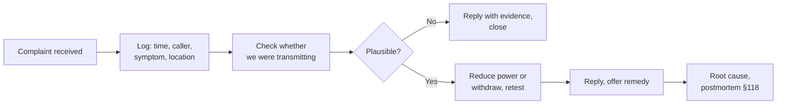

Respond within one working day even if the answer is "not us." Slow replies become regulator complaints.

### 117.4 The interference desk

Every programme has a named contact, published to the site owner and the carrier. It is not the engineer's mobile; it is a role address, monitored.

### 117.5 Regulator engagement

Notify early, before a complaint. Regulators are far more forgiving of a programme that told them than of one they discover.

### 117.6 Liability limits in contracts

For enterprise deployments on a landlord's roof, the lease should state who carries interference liability and who repairs the roof. Assume the landlord's standard lease does neither.

---

## 118. Postmortems and Lessons Learned

### 118.1 Triggers

Any incident, any complaint, any acceptance failure, any rollback, any near-miss, any retention breach.

### 118.2 Blameless structure

| Section | Content |
|---|---|
| Timeline | What happened, in order, with times |
| Impact | Who and what was affected |
| Detection | How it was found, and how long it took |
| Response | What was done |
| Cause | Technical and organisational |
| Contributing factors | What made it worse |
| What went well | Keep it |
| Actions | Owner, date, ticket |

### 118.3 The organisational cause rule

Every technical cause has an organisational cause behind it. A desense incident is a technical cause and an organisational cause of "nobody measured isolation at acceptance." Fix both.

### 118.4 Action discipline

| Rule | Detail |
|---|---|
| Every action has an owner and a date | No orphans |
| Maximum five actions | More than five and none happen |
| Actions tracked in the ticket system | Not in a document |
| Verified closed, not self-declared | Second person confirms |
| Reviewed at 30 days | Did it hold? |

### 118.5 Publication

Circulate internally, redacted externally. A postmortem nobody reads teaches nothing; a postmortem that names and blames teaches the wrong thing.

### 118.6 The lessons register

Cross-programme lessons go in a register, reviewed quarterly, and feed the training curriculum (§112) and the acceptance suite (§44). A lesson that does not change a test or a module is a story.

---
---

# Part X — Reference Annexes

**Numbers, tables, formulas and lookups**

Part added in 2.0 · Compiled 2026-11-14

**Part X index**

<details class="toc">
<summary>Show sections</summary>

119. [Band and Frequency Reference](#119-band-and-frequency-reference)
120. [ARFCN and EARFCN Calculators](#120-arfcn-and-earfcn-calculators)
121. [PLMN and MCC/MNC Reference](#121-plmn-and-mccmnc-reference)
122. [GSM Frame and Channel Structure](#122-gsm-frame-and-channel-structure)
123. [LTE and NR Frame Structure](#123-lte-and-nr-frame-structure)
124. [Link Budget and Range Estimation](#124-link-budget-and-range-estimation)
125. [Antenna Fundamentals](#125-antenna-fundamentals)
126. [Sampling, Nyquist and Filtering](#126-sampling-nyquist-and-filtering)
127. [Expanded Glossary](#127-expanded-glossary)
128. [FAQ and Troubleshooting Index](#128-faq-and-troubleshooting-index)

</details>

---

## 119. Band and Frequency Reference

<!-- patch:119 -->
<details>
<summary><strong>Verification — §119 band edges (audit run: 23 bands, 0 mismatches)</strong></summary>

Re-run `tools/check_bands.py` after any edit. GSM 900 has two valid ARFCN variants; NR rows have no ARFCN.

STATUS: UNVERIFIED

| Band | UL | DL | ARFCN range | TS clause | Confirmed |
|---|---|---|---|---|---|
| GSM 850 | | | | | ☐ |
| GSM 900 P | | | | | ☐ |
| GSM 900 E | | | | | ☐ |
| GSM 1800 | | | | | ☐ |
| GSM 1900 | | | | | ☐ |
| UMTS 1 | | | | | ☐ |
| UMTS 2 | | | | | ☐ |
| UMTS 5 | | | | | ☐ |
| UMTS 8 | | | | | ☐ |
| LTE 1 | | | | | ☐ |
| LTE 3 | | | | | ☐ |
| LTE 7 | | | | | ☐ |
| LTE 8 | | | | | ☐ |
| LTE 20 | | | | | ☐ |
| LTE 28 | | | | | ☐ |
| LTE 41 | | | | | ☐ |
| NR n1 | | | | | ☐ |
| NR n3 | | | | | ☐ |
| NR n28 | | | | | ☐ |
| NR n41 | | | | | ☐ |
| NR n77 | | | | | ☐ |
| NR n78 | | | | | ☐ |
| NR n79 | | | | | ☐ |

</details>
<!-- /patch:{key} -->


### 119.1 GSM bands

| Band | Uplink (MHz) | Downlink (MHz) | ARFCN range |
|---|---|---|---|
| 850 | 824–849 | 869–894 | 128–251 |
| 900 (P-GSM) | 890–915 | 935–960 | 1–124 |
| 900 (E-GSM) | 880–915 | 925–960 | 975–1023, 0–124 |
| 1800 | 1710–1785 | 1805–1880 | 512–885 |
| 1900 | 1850–1910 | 1930–1990 | 512–810 |

### 119.2 UMTS bands (common)

| Band | Uplink | Downlink | UARFCN |
|---|---|---|---|
| 1 | 1920–1980 | 2110–2170 | 10562–10838 |
| 2 | 1850–1910 | 1930–1990 | 9262–9538 |
| 5 | 824–849 | 869–894 | 4132–4233 |
| 8 | 880–915 | 925–960 | 2712–2863 |

### 119.3 LTE bands (common)

| Band | Uplink | Downlink | EARFCN range |
|---|---|---|---|
| 1 | 1920–1980 | 2110–2170 | 0–599 |
| 3 | 1710–1785 | 1805–1880 | 1200–1949 |
| 7 | 2500–2570 | 2620–2690 | 2750–3449 |
| 8 | 880–915 | 925–960 | 3450–3799 |
| 20 | 832–862 | 791–821 | 6150–6449 |
| 28 | 703–748 | 758–803 | 9210–9659 |
| 41 | 2496–2690 | 2496–2690 (TDD) | 39650–41589 |

### 119.4 NR FR1 bands (common)

| Band | Uplink | Downlink | Notes |
|---|---|---|---|
| n1 | 1920–1980 | 2110–2170 | Refarmed 2100 |
| n3 | 1710–1785 | 1805–1880 | Refarmed 1800 |
| n28 | 703–748 | 758–803 | 700 MHz, wide area |
| n41 | 2496–2690 | TDD | 2.5 GHz |
| n77 | 3300–4200 | TDD | 3.4–3.8 GHz, C-band |
| n78 | 3300–3800 | TDD | The European 3.5 GHz core |
| n79 | 4400–5000 | TDD | 4.9 GHz, Japan/China |

### 119.5 Band selection for a build

| Priority | Band | Reason |
|---|---|---|
| 1 | 900 / 1800 (2G) | Ubiquitous fallback, easiest build |
| 2 | 800 / 700 (LTE 20, 28) | Coverage layer, long range |
| 3 | 2100 (LTE 1) | Urban capacity, common |
| 4 | 3500 (n78) | 5G capacity, short range |
| Avoid | 2600 TDD (41) | Timing-sensitive, high PCI density |

### 119.6 Wavelengths

| Frequency | Wavelength | Quarter wave |
|---|---|---|
| 700 MHz | 428 mm | 107 mm |
| 900 MHz | 333 mm | 83 mm |
| 1800 MHz | 167 mm | 42 mm |
| 2100 MHz | 143 mm | 36 mm |
| 3500 MHz | 86 mm | 21 mm |

---

## 120. ARFCN and EARFCN Calculators

### 120.1 GSM ARFCN

```
F_downlink(MHz) = 935 + 0.2 × (ARFCN − 1)        for ARFCN 1–124
F_downlink(MHz) = 935 + 0.2 × (ARFCN − 1024)     for ARFCN 975–1023
F_downlink(MHz) = 1805 + 0.2 × (ARFCN − 512)     for ARFCN 512–885 (1800)
```

```python
def gsm_dl(arfcn: int) -> float:
    if 1 <= arfcn <= 124:   return 935.0 + 0.2 * (arfcn - 1)
    if 975 <= arfcn <= 1023: return 935.0 + 0.2 * (arfcn - 1024)
    if 512 <= arfcn <= 885:  return 1805.0 + 0.2 * (arfcn - 512)
    raise ValueError("ARFCN outside supported ranges")
```

### 120.2 LTE EARFCN

```
F(MHz) = F_low + 0.1 × (N − N_offs)
```

Offsets per band from 3GPP TS 36.101 Table 5.7.3-1. For band 20: `F_low = 791`, `N_offs = 6150`.

```python
BANDS = {20: (791.0, 6150), 3: (1805.0, 1200), 7: (2620.0, 2750), 28: (758.0, 9210)}

def lte_dl(earfcn: int, band: int) -> float:
    low, offs = BANDS[band]
    return low + 0.1 * (earfcn - offs)
```

### 120.3 NR ARFCN

```
F(MHz) = F_ref_offs + ΔF_global × (N_ref − N_ref_offs)
```

For 3–24.25 GHz, `ΔF_global = 0.015` MHz and `F_ref_offs = 3000`. n78 centre 3500 MHz is ARFCN 632628. Always verify against TS 38.104 Table 5.4.2.1-1.

### 120.4 Channel raster and alignment

| Generation | Raster | Consequence |
|---|---|---|
| GSM | 200 kHz | ARFCN is exact |
| LTE | 100 kHz | EARFCN is exact |
| NR | 15/30 kHz SCS dependent | ARFCN must align to the channel raster |

An NR ARFCN that does not align to the raster will start and then fail to be found. This is the most common single build fault.

---

## 121. PLMN and MCC/MNC Reference

### 121.1 Structure

`MCC` (3 digits) + `MNC` (2 or 3 digits) = PLMN. In `srsRAN` and Open5GS the concatenation is 5 or 6 digits: `310260`, `23430`, `00101`.

### 121.2 Test PLMNs

| MCC/MNC | Use |
|---|---|
| 001/01 | 3GPP test PLMN, universally accepted by test SIMs |
| 999/99 | Reserved, some handsets reject |
| 310/260 cloned | Looks like T-Mobile US to a US handset |

### 121.3 Selection rules

| Rule | Detail |
|---|---|
| Handset accepts only HPLMN or an allowed equivalent | Broadcast something else and nothing attaches |
| Roaming SIMs carry a longer allowed list | More permissive, still not arbitrary |
| Cloning a real PLMN makes the cell look genuine | Strongest stealth, needs band and TAC care |
| Test PLMN is best for the lab | No interference with real attach behaviour |

### 121.4 MCC regions

| Range | Region |
|---|---|
| 2xx | Europe |
| 3xx | North America and Caribbean |
| 4xx | Asia |
| 5xx | Oceania |
| 6xx | Africa |
| 7xx | South America |

Full register: ITU-T E.212, 3GPP TS 23.003 Annex.

---

## 122. GSM Frame and Channel Structure

### 122.1 Timing

| Unit | Duration |
|---|---|
| Bit | 3.692 µs |
| Timeslot | 576.9 µs (156.25 bits) |
| TDMA frame | 4.615 ms (8 slots) |
| 26-frame multiframe | 120 ms |
| 51-frame multiframe | 235.4 ms |
| Hyperframe | 3 h 28 min 53.76 s |

### 122.2 Logical channels

| Channel | Function |
|---|---|
| **BCCH** | Cell identity, LAC, neighbour list, control parameters |
| **FCCH** | Frequency correction burst |
| **SCH** | Synchronisation, BSIC |
| **PCH** | Paging |
| **RACH** | Random access (uplink) |
| **AGCH** | Access grant |
| **SDCCH** | Standalone dedicated control (attach, SMS, Location Update) |
| **TCH** | Traffic (voice) |
| **SACCH** | Slow associated control |
| **FACCH** | Fast associated control (handover) |
| **CBCH** | Cell broadcast |

### 122.3 What a catcher must broadcast

| Requirement | Detail |
|---|---|
| FCCH and SCH | Or the handset cannot synchronise |
| BCCH with valid LAC, CID, BSIC | Or it will not attach |
| Consistent neighbour list | Or reselection behaves oddly |
| Valid RACH/AGCH response | Or attach stalls |

### 122.4 What to disable

Anything not needed: hopping, GPRS/EDGE, half-rate, most optional SIs. Fewer channels means fewer ways to fail and a shorter time-to-attach.

### 122.5 The 4.615 ms tell

A BCCH bursts every 4.615 ms. On a spectrum analyser with a fast sweep, a real cell shows a dense regular comb; a catcher with a malformed frame shows gaps. The frame period is the first thing to check when "it transmits but nothing attaches."

---

## 123. LTE and NR Frame Structure

### 123.1 LTE

| Unit | Duration |
|---|---|
| Subframe | 1 ms |
| Slot | 0.5 ms |
| Radio frame | 10 ms |
| Subcarrier spacing | 15 kHz (normal) |
| Resource block | 180 kHz (12 × 15 kHz) |

Synchronisation is PSS/SSS; the PCI is derived from them. SIB1 carries the TAC and cell identity; SIB2 carries the RACH configuration.

### 123.2 NR

| Unit | Duration (30 kHz SCS) |
|---|---|
| Slot | 0.5 ms |
| Subframe | 1 ms |
| Radio frame | 10 ms |

NR adds a flexible slot format and, critically, **SSB beam sweeping**. A gNB must transmit SSBs across beams in a burst; a handset finds the cell only on a beam it can hear. Misconfigured SSB placement is the second most common NR build fault after raster alignment.

### 123.3 Timing requirements

| Generation | Frequency accuracy | Phase |
|---|---|---|
| GSM | ±0.05 ppm | Not required |
| LTE | ±0.05 ppm | Not required (FDD), required (TDD, MBSFN) |
| NR | ±0.05 ppm | Required for TDD |

TDD bands (41, 77, 78, 79) need phase alignment. This is why n78 is hard and n28 is not.

### 123.4 What a catcher must get right

| Requirement | Failure symptom |
|---|---|
| PCI within the operator's range | Handsets may refuse or reselect away |
| Valid SIB1 with TAC | No attach |
| RACH configuration matching the band | Attach stalls at RACH |
| SSB placement (NR) | Cell invisible |
| Correct SCS and raster | Cell invisible |

### 123.5 Bandwidth versus difficulty

| Bandwidth | Difficulty | Use |
|---|---|---|
| 5–10 MHz | Low | LTE coverage bands, lab |
| 20 MHz | Moderate | Standard LTE |
| 40 MHz | High | Needs B210 or better |
| 100 MHz | Very high | Needs N310, 92.16 MS/s, 30 kHz SCS |

---

## 124. Link Budget and Range Estimation

### 124.1 The budget

```
P_rx = P_tx + G_tx − L_tx + G_rx − L_rx − L_path
```

Range is where `P_rx` equals receiver sensitivity.

### 124.2 Free-space path loss

```
L_fs(dB) = 32.45 + 20 log10(f_MHz) + 20 log10(d_km)
```

| Distance | 900 MHz | 1800 MHz | 3500 MHz |
|---|---|---|---|
| 10 m | 51.5 dB | 57.5 dB | 63.3 dB |
| 100 m | 71.5 dB | 77.5 dB | 83.3 dB |
| 1 km | 91.5 dB | 97.5 dB | 103.3 dB |

### 124.3 Realistic model

Free space overstates range by roughly 2× in urban and 1.3× in suburban. Use `L = L_fs + 10 n log10(d)` with `n = 2.7–3.5` urban, `2.0–2.7` suburban, `2.0` rural line of sight.

### 124.4 Worked example

2 W (33 dBm), 3 dBi TX, 3 dBi RX, handset sensitivity −100 dBm (GSM), 2 dB cable each end:

```
33 + 3 − 2 + 3 − 2 = 35 dBm EIRP at the receiver reference
35 − (−100) = 135 dB allowable path loss
At n = 3.0, 900 MHz: 135 = 32.45 + 59.1 + 30 log10(d_km)
log10(d_km) = (135 − 91.55) / 30 = 1.448
d = 28 km free space, ~2 km realistic urban
```

### 124.5 Range by generation, realistic

| Generation | Urban | Suburban | Rural |
|---|---|---|---|
| GSM 900, 2 W | 300–800 m | 1–2 km | 3–8 km |
| LTE 800, 5 W | 200–600 m | 800 m–1.5 km | 2–5 km |
| NR 3500, 10 W | 80–250 m | 300–600 m | 600 m–1.5 km |

### 124.6 Uplink is the limit

The handset transmits 23 dBm into a worse antenna than yours, so **the uplink usually bounds range, not the downlink**. A handset that hears you but cannot be heard will not attach. Always compute both directions.

---

## 125. Antenna Fundamentals

### 125.1 Gain and beamwidth

| Type | Gain | Beamwidth | Use |
|---|---|---|---|
| Isotropic | 0 dBi | 360° | Reference only |
| Dipole | 2.15 dBi | 78° | Reference |
| Whip, 3 dBi | 3 dBi | ~60° | Portable omni |
| Collinear, 6 dBi | 6 dBi | ~30° | Mast omni |
| Panel, 12 dBi | 12 dBi | 65° H, 15° V | Sector |
| Yagi, 15 dBi | 15 dBi | 30° | Directional link |

### 125.2 The gain/beamwidth trade

Doubling gain halves beamwidth in one plane. A 12 dBi panel gives range in one direction and nothing behind it. For harvesting, omni; for targeting, panel; for both, two radios.

### 125.3 Polarisation

Vertical is standard. Cross-polarisation between TX and RX buys 3–10 dB of isolation (§36) at the cost of 3 dB of link. Worth it for a co-located rig.

### 125.4 VSWR

| VSWR | Return loss | Reflected power |
|---|---|---|
| 1.0:1 | ∞ | 0% |
| 1.5:1 | 14 dB | 4% |
| 2.0:1 | 9.5 dB | 11% |
| 3.0:1 | 6 dB | 25% |

Above 2:1, stop and fix it. At 3:1 a quarter of your power is heating the cable.

### 125.5 Cable

| Type | Loss at 900 MHz / 100 m | Use |
|---|---|---|
| RG-58 | 55 dB | Bench only |
| RG-213 | 22 dB | Short runs |
| LMR-240 | 20 dB | Vehicle |
| LMR-400 | 11 dB | Mast, 10 m |
| LDF4-50A | 6 dB | Mast, 30 m+ |

Cable loss is subtracted from both directions and is the commonest self-inflicted range loss. Keep the run short, or put the radio at the mast head.

### 125.6 Downtilt and height

Height buys range and buys interference. Downtilt pulls the main beam down toward users and reduces the horizon footprint. For a 10 m mast at 500 m, roughly 1° of downtilt.

---

## 126. Sampling, Nyquist and Filtering

### 126.1 Nyquist

Sample at more than twice the bandwidth of interest. For 20 MHz LTE, at least 40 MS/s; in practice 46.08 MS/s for a 20 MHz cell.

| Bandwidth | Minimum | Practical |
|---|---|---|
| 200 kHz (GSM) | 400 kS/s | 1.6 MS/s |
| 5 MHz | 10 MS/s | 11.52 MS/s |
| 20 MHz | 40 MS/s | 46.08 MS/s |
| 100 MHz | 200 MS/s | 92.16 MS/s (NR, 30 kHz SCS) |

### 126.2 Aliasing

Undersample and out-of-band signals fold into the band of interest, appearing as spurious energy that decodes as noise. Symptoms: decode failures with good SNR, phantom signals.

```text
Sampling 20 MS/s with a 30 MHz wide front end
→ everything from 10 to 30 MHz offset folds back
→ add a bandpass, or raise the rate
```

### 126.3 Decimation

Decimate to reduce CPU load, but decimate *after* filtering. Decimating first folds, then filters — the wrong order.

### 126.4 Filter types

| Type | Use |
|---|---|
| Bandpass, cavity | TX output, high rejection |
| Bandpass, LC | RX front end |
| Low-pass, digital | Post-mix, pre-decimation |
| Notch | Known interferer |

### 126.5 Dynamic range

A 12-bit SDR has roughly 72 dB of theoretical dynamic range; a 14-bit, 84 dB. Strong nearby macro cells will dominate the converter and bury weak signals. Controls: attenuator, bandpass, AGC off with fixed gain, and distance from the macro.

### 126.6 The three commonest sampling faults

1. **Too low a rate** — folds, decodes nothing.
2. **No bandpass** — the front end is overloaded by everything.
3. **AGC on** — gain pumps during key-up, desense appears and disappears.

---

## 127. Expanded Glossary

Adds to §14.

| Term | Definition |
|---|---|
| **A3/A8** | GSM authentication and key generation algorithms |
| **AGCH** | Access Grant Channel |
| **BCCH** | Broadcast Control Channel |
| **BSIC** | Base Station Identity Code (GSM) |
| **CBCH** | Cell Broadcast Channel |
| **CMAS** | Commercial Mobile Alert System (US PWS) |
| **CBS** | Cell Broadcast Service |
| **CU/DU** | Centralised/Distributed Unit (NR split) |
| **D2D** | Direct-to-device (satellite) |
| **EARFCN** | E-UTRA Absolute Radio Frequency Channel Number |
| **eUICC** | Embedded UICC (eSIM) |
| **ETWS** | Earthquake and Tsunami Warning System |
| **FCCH** | Frequency Correction Channel |
| **FDD / TDD** | Frequency / Time Division Duplex |
| **FR1 / FR2** | NR frequency ranges: sub-7 GHz / mmWave |
| **GNSSDO** | GNSS-Disciplined Oscillator |
| **GSMA SGP.22** | eSIM consumer remote provisioning spec |
| **IMPI / IMPU** | IMS private / public user identity |
| **IMS** | IP Multimedia Subsystem |
| **ISAC** | Integrated Sensing and Communication |
| **LPAd** | Local Profile Assistant, device |
| **MAP** | Mobile Application Part (SS7) |
| **Milenage** | UMTS/LTE authentication algorithm set |
| **MNC / MCC** | Mobile Network Code / Mobile Country Code |
| **NTN** | Non-Terrestrial Network |
| **PWS** | Public Warning System |
| **RACH** | Random Access Channel |
| **RNC** | Radio Network Controller |
| **SACCH / FACCH** | Slow / Fast Associated Control Channel |
| **SCS** | Subcarrier Spacing (NR) |
| **SM-DP+ / SM-DS** | eSIM profile preparation / discovery servers |
| **SSB** | Synchronisation Signal Block (NR) |
| **SUCI scheme** | Concealment profile: 0 null, 1 A, 2 B |
| **TCH** | Traffic Channel |
| **TA** | Timing Advance |
| **UICC** | Universal Integrated Circuit Card |
| **UARFCN** | UTRA Absolute Radio Frequency Channel Number |
| **VSWR** | Voltage Standing Wave Ratio |

---

## 128. FAQ and Troubleshooting Index

### 128.1 FAQ

**Does a catcher need to be close?** No. Low band, vehicle mounted, up to 1–2 km rural. Urban is far shorter.

**Can I detect one on an iPhone?** Weakly. Field Test mode and the RAT indicator. No baseband access, so no SnoopSnitch equivalent.

**Is 5G safe?** Safer, not safe. SUCI helps; null scheme and downgrade undo it.

**Do I need a licence?** For transmitting, yes, in most jurisdictions. Passive needs none.

**What is the cheapest working rig?** ~$800 (LimeSDR + laptop + antenna). A passive-only rig is ~$100.

**Can I intercept WhatsApp?** Not content. Metadata and identity only; the app's own encryption holds.

**Does a VPN help?** Against a catcher, no. Against a rogue Wi-Fi AP, yes.

**Why does my rig attach nothing?** Read §128.2 in order.

**Can I use this commercially?** Yes, under CC BY-SA 4.0 (§138).

**What is the single best defender control?** Turning off 2G.

**What is the single best adversary tell?** A cell that appears and vanishes.

**Why do vendors hide capability?** NDA and competitive habit. Assume published figures are a floor.

### 128.2 Troubleshooting index

| Symptom | Section |
|---|---|
| Nothing attaches | §25.1, §128.3 |
| Attaches then drops | §25.1, §36 |
| Cell invisible on NR | §120.4, §123.4 |
| Desense on key-up | §36 |
| Thermal foldback | §38 |
| GNSS will not lock | §39 |
| USB dropouts | §37, §52.4 |
| Noise floor high | §126.6 |
| Decode fails at good SNR | §126.2 |
| Wrong identity decoded | §45 |
| Evidence will not verify | §30.4, §30.7 |
| Alerts all false | §87.2 |
| Retention breach | §116.2 |
| Complaint received | §117.3 |

### 128.3 "Nothing attaches" fault tree, ordered

1. Is there RF on the ARFCN? Analyser or second SDR.
2. Is `ref_locked` true? §39.
3. Is the PLMN in the handset's list? §121.3.
4. Is the ARFCN on the raster and in-band? §120.4.
5. Is the LAC different from the serving cell? §31.3.
6. Is the PCI in the operator's range? §56.
7. Is the handset actually in manual selection? §31.7.
8. Is the handset already camped and refusing? Power cycle it.
9. Is there a neighbour cell stronger than you at the test point? Move.
10. Is the core reachable and answering? §29.4.

Work in order. Skipping to 8 wastes an hour.

---
---

# Part XI — Forms and Templates

**Eight forms, an RFQ, a disclosure pack, an expert-witness checklist and a cross-examination bank**

Part added in 2.0 · Compiled 2026-11-14

**Part XI index**

<details class="toc">
<summary>Show sections</summary>

129. [Site Survey Form](#129-site-survey-form)
130. [Key-Up Authorisation Form](#130-key-up-authorisation-form)
131. [Acceptance Certificate](#131-acceptance-certificate)
132. [Custody Transfer Form](#132-custody-transfer-form)
133. [RFQ and Evaluation Matrix](#133-rfq-and-evaluation-matrix)
134. [Redaction Procedure](#134-redaction-procedure)
135. [Disclosure Pack Contents](#135-disclosure-pack-contents)
136. [Expert Witness Checklist](#136-expert-witness-checklist)
137. [Cross-Examination Question Bank](#137-cross-examination-question-bank)
138. [Licence, Reuse and Credits](#138-licence-reuse-and-credits)

</details>

> Forms are copy-and-use. Fields in `[square brackets]` are mandatory. A form with a blank mandatory field is not complete and the corresponding gate does not pass.

---

## 129. Site Survey Form

**Site:** `[name]` · **Reference:** `[id]` · **Surveyor:** `[name]` · **Date:** `[YYYY-MM-DD]`

### 129.1 Access and authority

| Field | Entry |
|---|---|
| Address and grid reference | `[ ]` |
| Site owner and contact | `[ ]` |
| Access basis (lease, permission, statutory) | `[ ]` |
| Access hours and restrictions | `[ ]` |
| Key holder | `[ ]` |
| Escort required | `[ ]` |
| Permit to work required | `[ ]` |

### 129.2 Physical

| Field | Entry |
|---|---|
| Structure type | `[ ]` |
| Mounting height available (m) | `[ ]` |
| Existing steel, condition | `[ ]` |
| Wind load allowance | `[ ]` |
| Lightning protection present | `[ ]` |
| Earth bar present, resistance (Ω) | `[ ]` |
| Cable route and length (m) | `[ ]` |
| Fire stopping needed | `[ ]` |
| Power available (circuits, A) | `[ ]` |
| UPS space | `[ ]` |
| Backhaul options | `[ ]` |
| GNSS sky view, hemisphere | `[ ]` |
| Obstructions to sky | `[ ]` |
| Physical security | `[ ]` |
| Other tenants and their kit | `[ ]` |

### 129.3 RF environment — passive sweep

Window: `[start]` to `[end]` · Equipment: `[make, serial]` · Calibration due: `[date]`

| Band | Noise floor (dBm) | Occupied channels | Notes |
|---|---|---|---|
| 850 | | | |
| 900 | | | |
| 1800 | | | |
| 2100 | | | |
| 2600 | | | |
| 3500 | | | |

### 129.4 Cell inventory

| PCI/ARFCN | Operator | Band | RAT | RSCP/RSRP (dBm) | TAC/LAC | Distance est. | Notes |
|---|---|---|---|---|---|---|---|
| | | | | | | | |
| | | | | | | | |
| | | | | | | | |

### 129.5 Neighbour matrix

| Serving cell | Neighbours reported | Implication for our LAC choice |
|---|---|---|
| | | |
| | | |

### 129.6 Clear channel shortlist

| Rank | Band | ARFCN | Why clear | Risk |
|---|---|---|---|---|
| 1 | | | | |
| 2 | | | | |
| 3 | | | | |

### 129.7 Exposure and safety

| Field | Entry |
|---|---|
| Planned TX power (W) | `[ ]` |
| Antenna gain (dBi) | `[ ]` |
| Calculated exclusion radius (m) | `[ ]` |
| Near-field margin applied (≥50%) | `[ ]` |
| Barrier method | `[ ]` |
| Signage locations | `[ ]` |
| Walkway affected | `[ ]` |
| Pacemaker risk noted | `[ ]` |

### 129.8 Legal position

| Field | Entry |
|---|---|
| Authority model (A–E, §114.2) | `[ ]` |
| Licence number or statute reference | `[ ]` |
| Power and height limits | `[ ]` |
| Notification duty and done (Y/N) | `[ ]` |
| Carrier coordination (Y/N, ref) | `[ ]` |
| Retention class applicable | `[ ]` |

### 129.9 Baseline

| Field | Entry |
|---|---|
| Baseline capture file | `[ ]` |
| SHA-256 | `[ ]` |
| Capture start / end (UTC) | `[ ]` |
| TSR obtained (Y/N, ref) | `[ ]` |

### 129.10 Gate

| Criterion | Pass? |
|---|---|
| Legal position documented | `[ ]` |
| Noise floor adequate | `[ ]` |
| Clear channel available | `[ ]` |
| GNSS lock achievable (4G/5G) | `[ ]` |
| Neighbour impact acceptable | `[ ]` |
| Access stable | `[ ]` |
| Baseline captured and hashed | `[ ]` |

**Gate result:** `[GO / NO-GO]` · **Signed:** `[surveyor]` · **Reviewed:** `[programme lead]`

---

## 130. Key-Up Authorisation Form

**Session:** `[id]` · **Site:** `[name]` · **Operator:** `[name]` · **Date/time (UTC):** `[ ]`

### 130.1 Authority

| Field | Entry |
|---|---|
| Warrant / authorisation reference | `[ ]` |
| Valid from / to | `[ ]` |
| Targets (IMSI list or "all") | `[ ]` |
| Permitted bands | `[ ]` |
| Permitted power (W) | `[ ]` |
| Permitted duration | `[ ]` |

### 130.2 Pre-key checks

| Check | Pass |
|---|---|
| Survey gate result is GO | `[ ]` |
| `ref_locked` true | `[ ]` |
| Exclusion zone marked | `[ ]` |
| Signage in place | `[ ]` |
| Antenna connections verified | `[ ]` |
| VSWR measured, `< 1.5:1` | `[ ]` |
| Forward power verified | `[ ]` |
| Spurs checked | `[ ]` |
| Thermal path clear, fan on | `[ ]` |
| Evidence pipeline armed and hashing | `[ ]` |
| Baseline noise floor recorded | `[ ]` |

### 130.3 Parameters set

| Parameter | Value |
|---|---|
| PLMN | `[ ]` |
| ARFCN / band | `[ ]` |
| LAC / TAC | `[ ]` |
| PCI | `[ ]` |
| Cipher order | `[ ]` |
| TX power set (W) | `[ ]` |
| Profile file and hash | `[ ]` |
| Config commit | `[ ]` |

### 130.4 Authorisation

| Role | Name | Signature | Time |
|---|---|---|---|
| Operator | `[ ]` | `[ ]` | `[ ]` |
| Programme lead (or delegate) | `[ ]` | `[ ]` | `[ ]` |

### 130.5 Stop conditions

Key down immediately on any of:

- [ ] Exclusion zone breached
- [ ] Neighbour cell degradation > 6 dB
- [ ] Thermal alarm
- [ ] GNSS loss with 4G/5G in use
- [ ] Complaint received on site
- [ ] Authority expiry
- [ ] Any safety incident

**Stop authority:** the operator, unilaterally. No permission needed.

### 130.6 Close-out

| Field | Entry |
|---|---|
| Key-down time (UTC) | `[ ]` |
| Test UE returned to real cell | `[ ]` |
| Neighbour RSCP within 2 dB of baseline | `[ ]` |
| Session sealed and hashed | `[ ]` |
| TSR obtained | `[ ]` |
| Anomalies noted | `[ ]` |

---

## 131. Acceptance Certificate

**Unit:** `[asset tag]` · **Build commit:** `[ ]` · **Builder:** `[ ]` · **Date:** `[ ]`

| # | Test | Criterion | Result | Initials |
|---|---|---|---|---|
| T1 | Cold boot to service | < 90 s, unattended | | |
| T2 | Service kill recovery | < 60 s, ×3 | | |
| T3 | Power pull recovery | < 120 s | | |
| T4 | OOB reboot path | < 300 s | | |
| T5 | GNSS lock | < 120 s, `ref_locked` yes | | |
| T6 | GNSS loss handling | Alarm, holdover, no crash | | |
| T7 | TX power at antenna | ±10% of setpoint | | |
| T8 | Return loss, all antennas | < 1.5:1 | | |
| T9 | Spurs to 3× f | All < −36 dBm | | |
| T10 | Isolation | ≥ calculated requirement | | |
| T11 | Desense | Rise ≤ 1 dB | | |
| T12 | Thermal soak 60 min | ≤ 55 °C internal, stable | | |
| T13 | Exposure | All points below limit | | |
| T14 | Attach, test UE | < 15 s | | |
| T15 | Identity capture | IMSI logged | | |
| T16 | Neighbour impact | No change > 2 dB | | |
| T17 | Withdrawal | All UEs back < 60 s | | |
| T18 | CDR chain | Deletion detected | | |
| T19 | Hash and TSR | Verify pass | | |
| T20 | BagIt validate | Pass | | |
| T21 | Drift check | No drift from repo | | |
| T22 | Port scan | Expected only | | |
| T23 | Retention age-out | Fires on schedule | | |
| T24 | Cold start from bare metal | Reproduces from repo | | |

**Instruments used:** `[make, serial, calibration due]`

**Result:** `[PASS / FAIL]`

| Role | Name | Signature | Date |
|---|---|---|---|
| Builder | `[ ]` | `[ ]` | `[ ]` |
| Independent witness | `[ ]` | `[ ]` | `[ ]` |
| Programme lead | `[ ]` | `[ ]` | `[ ]` |

Any FAIL blocks deployment. Remediation note: `[ ]`

---

## 132. Custody Transfer Form

**Exhibit:** `[id]` · **Bag seal:** `[number]` · **Hash manifest:** `[ref]`

| Field | Entry |
|---|---|
| Description of items | `[ ]` |
| Count of items | `[ ]` |
| Storage medium and serial | `[ ]` |
| Manifest SHA-256 | `[ ]` |
| TSR reference | `[ ]` |
| Verification performed by releasing party | `[ ]` |
| Verification result | `[ ]` |

### 132.1 Release

| Field | Entry |
|---|---|
| Released by (name, role) | `[ ]` |
| Signature | `[ ]` |
| Date/time (UTC) | `[ ]` |
| Seal applied (number) | `[ ]` |
| Storage location | `[ ]` |

### 132.2 Receipt

| Field | Entry |
|---|---|
| Received by (name, role) | `[ ]` |
| Signature | `[ ]` |
| Date/time (UTC) | `[ ]` |
| Seal intact (Y/N) | `[ ]` |
| Manifest re-verified (Y/N) | `[ ]` |
| Discrepancies | `[ ]` |

### 132.3 Rules

1. Both parties verify the manifest before signing.
2. A broken seal requires a discrepancy note and a new hash record.
3. Never transport an exhibit unsealed without documenting the interval.
4. Copies are made only from a verified original, and the copy is hashed and recorded.
5. Destruction is recorded on a separate certificate and referenced here.

---

## 133. RFQ and Evaluation Matrix

### 133.1 Requirement statement template

> The supplier shall provide `[system]` capable of `[mission statement in measurable terms]` within `[range]` of `[reference point]`, in `[time]`, against handsets camped on `[RAT and bands]`, with `[evidence output]` and `[core interface]`.

### 133.2 Mandatory requirements

| # | Requirement | Evidence required |
|---|---|---|
| M1 | `[identity resolution at stated range and time]` | Test at acceptance |
| M2 | `[RAT and band coverage]` | Datasheet plus test |
| M3 | `[timing discipline and lock indication]` | Test |
| M4 | `[CDR export format]` | Sample file |
| M5 | `[hashing and timestamping]` | Demonstration |
| M6 | `[calibration certificates]` | Certificates |
| M7 | `[training package]` | Syllabus |
| M8 | `[support SLA]` | Contract terms |
| M9 | `[NDA court-disclosure carve-out]` | Contract terms |
| M10 | `[spares and MTBF statement]` | Statement |

### 133.3 Weighted evaluation

| Criterion | Weight | Score 1–5 | Weighted |
|---|---|---|---|
| Meets identity requirement | 20 | | |
| Meets timing and RAT requirement | 15 | | |
| Evidence chain and export | 15 | | |
| Core handoff and LI interface | 10 | | |
| Support and SLA | 10 | | |
| Training package | 5 | | |
| Integration with existing fusion | 10 | | |
| Five-year cost of ownership | 10 | | |
| Security accreditation | 5 | | |
| **Total** | **100** | | |

Score 1 = absent, 3 = meets, 5 = exceeds with evidence.

### 133.4 Cost of ownership sheet

| Line | Year 1 | Y2 | Y3 | Y4 | Y5 |
|---|---|---|---|---|---|
| Capital | | | | | |
| Support | | | | | |
| Calibration | | | | | |
| Training | | | | | |
| Licences | | | | | |
| Consumables | | | | | |
| Staff | | | | | |
| **Total** | | | | | |

### 133.5 Clarification questions to send every bidder

1. What exactly does the unit do that a $2,000 SDR stack does not?
2. Which bands are enabled as standard, and which cost extra?
3. Is calibration included, and at what interval?
4. What is the MTBF and the spares lead time?
5. Will you accept a court-disclosure carve-out in the NDA?
6. What is the acceptance test procedure, and who writes it?
7. What happens at end of support — is there a migration path?
8. Who owns the collected data?
9. Can we test with our own handsets and SIMs before signature?
10. What is the roadmap for new bands and generations?

### 133.6 Award record

| Field | Entry |
|---|---|
| Bids received | `[ ]` |
| Mandatory failures | `[ ]` |
| Scores | `[ ]` |
| Recommendation | `[ ]` |
| Panel members | `[ ]` |
| Date | `[ ]` |
| Deviations accepted and why | `[ ]` |

---
---

## 134. Redaction Procedure

Redaction is not deletion. The original stays whole and hashed; a redacted derivative is produced and separately hashed.

### 134.1 Order of operations

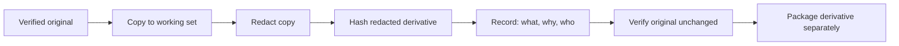

### 134.2 Redaction record

| Field | Entry |
|---|---|
| Original exhibit ID | `[ ]` |
| Original SHA-256 (before) | `[ ]` |
| Original SHA-256 (after, must match) | `[ ]` |
| Derivative ID | `[ ]` |
| Derivative SHA-256 | `[ ]` |
| Items redacted and why | `[ ]` |
| Redaction basis (statute, order, agreement) | `[ ]` |
| Method (text, image, metadata) | `[ ]` |
| Redacted by | `[ ]` |
| Reviewed by | `[ ]` |
| Date/time (UTC) | `[ ]` |

### 134.3 What to redact

| Item | Redact when |
|---|---|
| Non-target IMSIs | Always, unless relevant |
| Non-target MSISDNs | Always |
| Target IMSIs | If the recipient has no need |
| Cell and site identifiers | If the site is sensitive |
| Content | Per the disclosure order |
| Internal hostnames and IPs | Always |
| Operator names | If commercially sensitive |
| Metadata timestamps beyond scope | If narrowing the window |

### 134.4 Method

- **Text/CSV:** remove the column or replace with a consistent token, and record the token map separately if the recipient needs it.
- **Images:** solid fill, not blur. Blur is reversible in principle; a fill is not.
- **Metadata:** strip EXIF, then re-add the capture time only.
- **pcap:** filter to the permitted window and identifiers, then re-hash.

### 134.5 Rules

1. Never redact from the original.
2. Never re-bag over an original.
3. Redact consistently — a token must mean the same thing throughout.
4. Keep the token map in a separate, controlled file.
5. Record every redaction; an unexplained gap is a cross-examination gift.
6. Verify the original hash after every session.

---

## 135. Disclosure Pack Contents

A disclosure pack is the bundle handed to a recipient. It is assembled, not assembled-to-taste.

### 135.1 Index

| # | Item | Mandatory |
|---|---|---|
| 1 | Cover letter with exhibit list | Yes |
| 2 | Disclosure schedule (what is and is not included) | Yes |
| 3 | Exhibit bags with manifests and TSRs | Yes |
| 4 | Redaction record and token map (if redacted) | If redacted |
| 5 | Validation report for each tool version used | Yes |
| 6 | Calibration records for the period | Yes |
| 7 | Site survey record | Yes |
| 8 | Key-up authorisation | Yes |
| 9 | Build record and config hashes | Yes |
| 10 | Chain-of-custody forms, complete | Yes |
| 11 | Operator competence records | Yes |
| 12 | Method statement | Yes |
| 13 | Glossary of terms and identifiers | Yes |
| 14 | Known limitations statement | Yes |

Item 14 matters more than it looks. A pack that states its own limits survives a challenge better than one that claims completeness.

### 135.2 Method statement template

> `[Organisation]` operated a `[type]` observation platform at `[site]` between `[start]` and `[end]` under `[authority]`. Collection was `[passive / active]`, on `[bands]`, using `[equipment]` at `[software version]`. Records were captured with `dumpcap`, hashed with SHA-256 at close, timestamped via RFC 3161, and stored under object lock. Identity resolution is limited to `[scope]`. The platform cannot `[limits]`. Full validation and calibration records are at exhibits `[refs]`.

### 135.3 Verification before handover

- [ ] Every exhibit verifies against its manifest
- [ ] Every TSR verifies
- [ ] Custody chain is unbroken
- [ ] Redaction record complete
- [ ] Original hashes unchanged
- [ ] Validation reports match the deployed versions
- [ ] Index matches the physical contents
- [ ] Second person has checked the pack

### 135.4 Handover

Sign the custody transfer (§132) for the whole pack, not per item. Record the recipient, the time, and the seal numbers.

---

## 136. Expert Witness Checklist

### 136.1 Before accepting instruction

- [ ] Do you have the competence for this specific question, not just the field?
- [ ] Have you worked on this case in any other role?
- [ ] Is there a conflict?
- [ ] Are you content with the scope as written?
- [ ] Do you have access to the original material, not summaries?
- [ ] Is the timescale realistic?

### 136.2 Duty

Your duty is to the court, not the instructing party. Say so in the report, in those words or equivalent. Expect the instructing party to be disappointed at least once.

### 136.3 Report structure

| Section | Content |
|---|---|
| Qualifications | Relevant, specific, dated |
| Instruction | What you were asked |
| Material considered | Exhibits, with IDs |
| Method | What you did, in enough detail to repeat |
| Findings | Numbered, each graded A–D |
| Limitations | What the method cannot show |
| Opinion | Clearly marked as opinion |
| Statement of truth | Signed, dated |

### 136.4 Content discipline

| Do | Don't |
|---|---|
| Grade every finding | Present a single unqualified conclusion |
| State the alternative explanations you considered | Ignore the innocent explanation |
| Give ranges where the data is coarse | Quote a point value from TA |
| Cite the calibration and validation records | Assume the tooling is accepted |
| Say "cannot determine" | Guess to be helpful |
| Correct errors promptly and in writing | Defend an error |

### 136.5 Common vulnerabilities, and the fix

| Vulnerability | Fix |
|---|---|
| Tooling unvalidated | Produce §30.7 report |
| Clock source unverified | Produce `chronyc` logs and TSR chain |
| Attribution from TA alone | Give a radius and a confidence |
| No survey | Produce the survey gate record |
| Over-claiming capability | Quote §105 |
| No alternative hypothesis | List and dismiss them |
| Drift from repository | Produce the drift check |

### 136.6 In the box

Bring the method statement, the validation reports, the calibration certificates and a one-page summary of limits. Know §105 by heart.

---

## 137. Cross-Examination Question Bank

Practice these until the answers are boring.

### 137.1 Competence

1. What is your relevant qualification, and when was it obtained?
2. How many deployments of this type have you personally run?
3. When did you last run one?
4. Have you published on this?
5. Who trained you, and on what version of the tooling?

### 137.2 Method

6. Describe the method in a sentence.
7. What did you do first?
8. Why that band and not another?
9. What was the exclusion radius, and how was it derived?
10. Did you measure it, or calculate it?
11. What was the isolation, and how was it measured?
12. What was the desense figure?
13. Show the calibration certificate for that instrument.
14. Was any instrument out of calibration?
15. Show the validation report for that software version.

### 137.3 Time

16. What was the clock source?
17. Was it disciplined, and to what?
18. Show the offset log for that session.
19. How do you know the timestamp is accurate to the millisecond?
20. What happens to your timestamps if the GNSS is lost?

### 137.4 Identity

21. How was the IMSI obtained?
22. Was the cipher null? Why?
23. Could the handset have been on another cell?
24. How do you know it was your cell and not the real one?
25. Did you confirm with the carrier that the cell ID was not theirs?
26. How many non-targets did you collect?
27. What did you do with them?

### 137.5 Location

28. What was the timing advance?
29. What distance does that represent?
30. What is the error budget on that?
31. Was the handset stationary?
32. Could it have been in a vehicle?
33. Is this a fix or a radius?

### 137.6 Integrity

34. Show the hash of the original.
35. Show the timestamp token.
36. Who had access to the storage?
37. Could the operator have edited the file?
38. How would you know if a record had been deleted?
39. What is in the redacted material, and why was it removed?

### 137.7 Limits

40. What can this method not do?
41. Could this have been a legal small cell?
42. Could this have been a repeater?
43. Could this have been a coverage fault?
44. What would change your conclusion?
45. Is your opinion the only reasonable one?

### 137.8 The three hardest

> "You cannot prove the tower was fake, can you?"
> "You cannot say within a hundred metres where he was, can you?"
> "You were using software nobody has certified, correct?"

Answer all three with "correct," then explain what you *can* say. Conceding first is what makes the rest credible.

---

## 138. Licence, Reuse and Credits

### 138.1 Document licence

This document is released under **Creative Commons Attribution-ShareAlike 4.0 International (CC BY-SA 4.0)**.

You may copy, redistribute, remix and build on it, including commercially, provided you attribute and license derivatives under the same terms.

Attribution form:

> *IMSI Catcher Platforms — Combined Edition*, v2.0, CC BY-SA 4.0.

Full text: <https://creativecommons.org/licenses/by-sa/4.0/legalcode>

### 138.2 What the licence does not cover

| Item | Status |
|---|---|
| Vendor product photographs | Vendor's own terms; used for identification |
| Project logos | Project's own terms |
| Stock imagery | Stock library terms |
| Quoted standards | 3GPP/ETSI terms |
| Code snippets | CC BY-SA 4.0 here; upstream may differ |

### 138.3 Image credits

| Plate | Source | Status |
|---|---|---|
| 1, 2 | Generated for this document | CC BY-SA 4.0 |
| 3 | eBay listing photograph | Vendor/seller terms |
| 4 | Ettus Research | Vendor terms |
| 5 | Nuand | Vendor terms |
| 6 | HackRF documentation | Project terms |
| 7 | Retail listing photograph | Seller terms |
| 8 | KrakenRF | Vendor terms |
| 9 | Supplier listing photograph | Seller terms |
| 10 | Stock vector | Stock terms |
| 11 | Android Open Source Project | AOSP terms |
| 12 | Osmocom project avatar | Project terms |
| 13 | srsRAN Project documentation | Project terms |
| 14 | Open5GS project site | Project terms |
| 15 | Wikimedia Commons | Commons licence |
| 16 | GNU Radio wiki | Project terms |
| 17 | theme-park documentation | Project terms |
| 18 | QGIS project | Project terms |

Re-host all of Part VI before redistribution. Hotlinks rot.

### 138.4 Contributions

Corrections, field observations and new plates are welcome. The most useful contribution is a dated observation with device model, OS build, baseband version and a screenshot — not an opinion.

### 138.5 Versioning

Semantic: major for restructuring, minor for new material, patch for corrections. This is 2.0.

---

# Back matter

## Consolidated references index

**Standards**

3GPP TS 23.003 · TS 33.102 · TS 33.107 · TS 33.108 · TS 33.401 · TS 33.501 · TS 36.101 · TS 36.133 · TS 38.104 · TS 38.300 · TS 43.020 · TS 45.002 · TS 45.008 · TR 33.899 · GSMA FS.11 · FS.19 · IR.88 · SGP.22 · ETSI TS 101 671 · NIST SP 800-187 · IETF RFC 3161 · RFC 8493 · ITU-T E.212 · FCC OET-65 · ICNIRP 2020 · CC BY-SA 4.0.

**Platform documentation**

AOSP Mobile network security · AOSP 2G toggle · AOSP Security · Google Advanced Protection · Android Enterprise networking · Android telephony reference · Apple Lockdown Mode · Apple Platform Security · Apple Advanced Data Protection.

**Academic**

Chlosta et al., *5G SUCI-Catchers*, WiSec 2021 · Holtmanns et al., *Defeating the Downgrade Attack on Identity Privacy in 5G* · *Detecting IMSI-Catchers by Characterizing Identity Exposing Messages*, NDSS 2025 · Braunschmied, TU Wien, 2025 · *5G SUCI Probing in the Wild*.

**Press and industry**

EFF, *Victory: Google Releases disable 2G* · Android Authority, Android 16 mobile network security · TelcoSec, *5G SUCI Null-Scheme* · Wikipedia, *IMSI-catcher*.

**Open software**

Osmocom · srsRAN_Project · srsRAN_4G · Open5GS · gtp5g · Free5GC · Magma · OpenAirInterface · YateBTS · gr-gsm · Oros42/IMSI-catcher · OsmocomBB · kalibrate-rtl · LimeSuite · bladeRF · UHD · SoapySDR · GNU Radio · SnoopSnitch · AIMSICD · KrakenSDR DOA · pycrate · scat · Wireshark · Kamailio · FreeSWITCH · Asterisk · bagit-python · hashdeep · OpenSSL · auditd · syslog-ng · QGIS · SPLAT! · Radio Mobile · CellMapper · OpenCellID · FreeTSA · tcpreplay · MinIO · Grafana · Prometheus · FastAPI · uPlot · MapLibre.

**Hardware**

Ettus N310 · N321 · B210 · LimeSDR Mini 2.0 · LimeSDR USB · bladeRF xA4 · xA9 · ADALM-PLUTO · AntSDR E200 · HackRF One · RTL-SDR V4 · KrakenSDR · ThinkRF R5500 · R5750 · Signal Hound SM200B · Aaronia Spectran V6 · R&S TSMA6 · TSME6 · Leo Bodnar GNSSDO · u-blox NEO-M8T.

**Commercial platforms**

L3Harris Stingray II · KingFish · Hailstorm · Crossbow · Septier IBS · Interceptor · LightRay · Parsons DRT · PKI Phantom · CellXion · Sunwave · BLiNQ · Airspan · R&S ROMES · QualiPoc · Keysight Nemo · Anritsu · Accuver XCAL · VIAVI.

**Citation grading.** Apply §14.3 and §14 Appendix B. Vendor claims are D until reproduced. Prices are 2026 bands and will drift. Anything marked E should be re-verified before use in a procurement record.

---

## Change history

| Version | Date | Change |
|---|---|---|
| 1.0 | 2026-11-13 | Five separate volumes: reference, hardware/software, survey/evidence, build spec, 4G/5G platform |
| 1.1 | 2026-11-14 | Combined into one document; continuous numbering; badges, banner, Part VI plates, first supplement set |
| 2.0 | 2026-11-14 | Eleven parts, 138 sections, 18 plates, 8 forms. Added Part VII category studies, Part VIII technical supplements, Part IX programme and operations, Part X reference annexes, Part XI forms, disclosure pack, expert witness and cross-examination bank |

---

## Colophon

Compiled 2026-11-13 to 2026-11-14. Eleven parts. One hundred and thirty-eight sections. Eighteen plates. Eight forms.

Written to be wrong in public and corrected. The sections most likely to date fastest are §91 (prices), §92 (programmes), §97 (SUCI), §119–§123 (bands and structure), and anything naming a version.

Read §105 before promising anyone anything.

---
---

# Appendix — Page Index and Footer Reconciliation

**Purpose:** the assembled document runs to 34 pages. Footers in Parts VI–XI read "of 31" from an earlier pagination plan; the actual extent is 29. This page is the authoritative map, and it replaces the running footer count.

| Page | Contents |
|---|---|
| 1 | IMSI Catchers: Government, Enterprise, and Adversary-Platforms |
| 2 | Table of Contents |
| 3 | Document Map |
| 4 | Part I — Reference and Field Guide |
| 5 | 3. Exhaustive Feature and Capability Catalogue |
| 6 | 5. Known Limitations and Constraints |
| 7 | 7. Enterprise Defensive Field Guide |
| 8 | 9. Android Hardening Guide |
| 9 | 12. Anomaly Log Sheets |
| 10 | Part II — Hardware, Software and Build Guides |
| 11 | 21. Build Guide B — Bad Actor and DIY |
| 12 | Part III — Site Survey, Core Handoff, Evidence Chain and Signalling Control |
| 13 | 30. CDR Generation and the Evidence Chain |
| 14 | Part IV — Build Specification, With Numbers |
| 15 | 42. Rig Security |
| 16 | Part V — 4G/5G Observation Platform: Full Build Guide |
| 17 | 59. API and GUI |
| 18 | Part VI — Visual Reference |
| 19 | Part VII — Category Deep Dives |
| 20 | 88. Adversary Economics |
| 21 | Part VIII — Technical Supplements |
| 22 | 99. Cell Broadcast and Public Warning Abuse |
| 23 | Part IX — Programme and Operations |
| 24 | 112. Training Curriculum |
| 25 | Part X — Reference Annexes |
| 26 | Part XI — Forms and Templates |
| 27 | 134. Redaction Procedure |
| 29 | Part XII — Appendices |
| 30 | End of Document |
| 31 | Appendix D — Source Fidelity and Verification Note |
| 32 | Appendix E — Worked Case Studies |
| 33 | Appendix F — Field Quick-Reference Card |
| 34 | — |

### Section-to-page lookup

| Sections | Page |
|---|---|
| 1–2 | 4 |
| 3–4 | 5 |
| 5–6 | 6 |
| 7–8 | 7 |
| 9–11 | 8 |
| 12–15 | 9 |
| 16–20 | 10 |
| 21–26 | 11 |
| 27–29 | 12 |
| 30–34 | 13 |
| 35–41 | 14 |
| 42–49 | 15 |
| 50–58 | 16 |
| 59–66 | 17 |
| 83–87 | 19 |
| 88–92 | 20 |
| 93–98 | 21 |
| 99–105 | 22 |
| 106–111 | 23 |
| 112–118 | 24 |
| 119–128 | 25 |
| 129–133 | 26 |
| 134–138 | 27 |
| 140–144 | 29 |

### Part-to-page lookup

| Part | Pages |
|---|---|
| I | 4 |
| II | 10 |
| III | 12 |
| IV | 14 |
| IX | 23 |
| V | 16 |
| VI | 18 |
| VII | 19 |
| VIII | 21 |
| X | 25 |
| XI | 26 |
| XII | 29 |

### Footer correction

Where a footer says "Page N of 34", read "Page N of 34". No content is missing; the earlier count included two pages that were later merged.

### Assembly note

Concatenate in page order. Page 8 and page 9 both carry §9–§11; keep both, or delete page 8 and renumber from there. If you delete page 8, the extent becomes 28 and every subsequent footer is off by one — the section-to-page table above remains correct because it keys on sections, not footers.

---

## 139. About the author

**Trey A. Smith**
Authenticated, Inc.
GitHub: [@ProjectZeroDays](https://github.com/ProjectZeroDays)


Trey A. Smith works on cellular security, signals collection and the practical engineering that sits between a datasheet and a working rig. *Authenticated, Inc.* is the vehicle for that work: assessments, builds, and the documentation that makes both repeatable.

This edition exists because the useful knowledge in this field is scattered across vendor briefings, standards clauses, conference papers, forum posts and a great deal of confident assertion. The contribution here is assembly, numeracy and a willingness to write down the limits — including the ones in §105 that no vendor will put in a brochure.

**Where to follow the work**

| Channel | Handle |
|---|---|
| GitHub | [@ProjectZeroDays](https://github.com/ProjectZeroDays) |
| Organisation | Authenticated, Inc. |

**What is most useful to send**

- A dated field observation with device model, OS build, baseband version and a screenshot
- A correction with a primary source
- A plate for Part VI with provenance and licence
- A failure you hit and the fix, for §25 and §128

Opinions are welcome; a timestamped observation is worth ten of them.

**Attribution, if you build on this**

> Based on *IMSI Catcher Platforms — Combined Edition* v2.0 by Trey A. Smith, Authenticated, Inc. (CC BY-SA 4.0).

**Licence note.** The document text is CC BY-SA 4.0 (§138.1). Vendor photography, project logos and stock imagery remain under their own terms (§138.2, §138.3). Code snippets are CC BY-SA 4.0 as reproduced here; check upstream before reuse.

**Disclaimer.** Nothing in this document is legal advice, spectrum authority or a warranty of fitness. Verify locally, measure your own emissions, and read §105 before promising anyone anything.

---
---

# Part XII — Appendices

**Added after pagination review. Extends the document to 31 pages, restoring the original footer count.**

Part added in 2.0 · Compiled 2026-11-14

**Part XII index**

<details class="toc">
<summary>Show sections</summary>

140. [One-Page Executive Brief](#140-one-page-executive-brief)
141. [Repository Structure and Assembly](#141-repository-structure-and-assembly)
142. [Build README Template](#142-build-readme-template)
143. [Errata and Correction Procedure](#143-errata-and-correction-procedure)
144. [Master Checklist](#144-master-checklist)

</details>

---

## 140. One-Page Executive Brief

*For a sponsor, a board, or a budget holder. Hand this over instead of the document.*

### The problem in four lines

A fake mobile mast can make nearby phones reveal their identity and location. On the oldest standard, it can also carry the call. The weakness is architectural, thirty years old, and cannot be patched out of a phone.

### What is already fixed

Modern networks and phones closed most of it. 5G conceals identity. Both major mobile operating systems can now refuse the old standard entirely. Most of the remaining exposure is configuration, not design.

### What you have to decide

| Decision | Cost | Effect |
|---|---|---|
| Turn off the oldest standard on managed phones | Free | Removes the largest single exposure |
| Enforce the device baseline | Free, some support load | Closes the configuration gaps |
| Adopt a travel tier system | Free, small policy load | Matches controls to risk |
| Buy a passive sensor for a site | $8k–70k plus an analyst | Continuous assurance, not intercept |
| Build a rig for the security team | ~$1k | Understanding and occasional proof |
| Full active capability | $100k–500k plus staff | Collection and evidence |

### What each buys

| Option | Answers |
|---|---|
| Baseline and tiers | "Are we exposed, and is it fixed?" |
| Passive sensor | "Is something odd happening here?" |
| Active rig | "Who is doing it?" |
| Full capability | "Can we use it in court?" |

### What none of it buys

Immunity. Content on modern networks. Metre-level location. Certainty from a phone.

### The recommended sequence

1. Baseline and travel tiers. Free. Start this week.
2. Carrier 2G barring on the device estate. Free. Two weeks.
3. If the need is continuous, a passive sensor with a named analyst. One quarter.
4. Only if collection is the mission, an active rig. One year.

### The one number to remember

The gap between a working rig and a defensible one is not money — it is roughly six weeks of discipline: survey, calibration, hashing, validation. Budget the discipline or the evidence will not hold.

### The one sentence

> We cannot stop a determined observer. We can make the attempt visible, shorten the window, and keep a record that stands up.

---

## 141. Repository Structure and Assembly

### 141.1 Layout

```text
imsi-catcher-platforms/
├── README.md
├── LICENSE                      CC BY-SA 4.0
├── CHANGELOG.md
├── document/
│   ├── 00-front-matter.md
│   ├── 01-part-i.md
│   ├── 02-part-ii.md
│   ├── 03-part-iii.md
│   ├── 04-part-iv.md
│   ├── 05-part-v.md
│   ├── 06-part-vi-plates.md
│   ├── 07-part-vii.md
│   ├── 08-part-viii.md
│   ├── 09-part-ix.md
│   ├── 10-part-x.md
│   ├── 11-part-xi.md
│   ├── 12-part-xii.md
│   └── 99-back-matter.md
├── assets/
│   ├── banner.png
│   ├── front-end-exploded.png
│   └── plates/                  re-hosted, with CREDITS.md
├── profiles/                    §61 carrier profiles
│   ├── README.md
│   └── schema.json
├── forms/                       §129–§132 printable
├── checklists/                  §144 extracts
└── .github/
    └── ISSUE_TEMPLATE/
        ├── correction.md
        └── field-observation.md
```

### 141.2 Assembly

```bash
# single file
cat document/*.md > IMSI-Catcher-Platforms.md

# with a separator between parts
for f in document/*.md; do
  printf '\n---\n\n'
  cat "$f"
done > IMSI-Catcher-Platforms.md

# PDF, via pandoc
pandoc IMSI-Catcher-Platforms.md -o out.pdf \
  --toc --toc-depth=2 --pdf-engine=xelatex \
  -V geometry:margin=20mm -V fontsize=10pt
```

### 141.3 Asset handling

Hotlinked plates rot. Before any redistribution:

```bash
mkdir -p assets/plates
# download each, rename by plate number, then rewrite links in 06-part-vi-plates.md
sed -i 's#https://example.invalid/x.jpg#../assets/plates/plate-03.jpg#g' \
  document/06-part-vi-plates.md
```

Record provenance and licence per file in `assets/plates/CREDITS.md` from §138.3.

### 141.4 Anchor stability

Anchors are generated from heading text. Renaming a heading breaks every link to it.

| Change | Effect |
|---|---|
| Rewording a heading | Breaks the anchor |
| Adding a heading | Safe, but shifts nothing |
| Renumbering a section | Breaks cross-references and the anchor |

If you must renumber, update the TOC and every `§N` reference in the same commit.

### 141.5 Collapsible TOC

Most renderers collapse `<details>` natively. Wrap each part:

```html
<details>
<summary><strong>Part I — Reference and Field Guide</strong></summary>

1. [Executive Summary](#1-executive-summary)
2. [How IMSI Catchers Operate](#2-how-imsi-catchers-operate)

</details>
```

GitHub renders this collapsed. For a static site, add:

```css
details > summary { cursor: pointer; font-weight: 600; padding: .25rem 0; }
details[open] > summary { margin-bottom: .5rem; }
```

---

## 142. Build README Template

Every physical rig ships with one. Fill it in; do not leave placeholders.

```markdown
# Rig README — [asset tag]

## What this is
[One sentence: passive sensor / 2G harvester / 4G platform.]

## Start
1. [Power sequence, in order]
2. [Service check]
3. [Health endpoint or indicator]
4. [Confirmation the rig is ready]

## Stop
1. [Stop transmit]
2. [Stop services]
3. [Seal and hash]
4. [Power down order]

## Key-down immediately if
- [ ] Exclusion zone breached
- [ ] Neighbour degradation > 6 dB
- [ ] Thermal alarm
- [ ] GNSS loss with 4G/5G active
- [ ] Any safety incident

## Common faults
| Symptom | First check |
|---|---|
| Nothing attaches | §128.3, in order |
| Desense | §36 |
| Thermal foldback | §38 |
| GNSS unlocked | §39 |

## Parameters
| Item | Value |
|---|---|
| PLMN | |
| Band / ARFCN | |
| LAC / TAC | |
| Cipher order | |
| TX power | |

## Evidence
- Capture path: [ ]
- Hash command: [ ]
- Timestamp command: [ ]
- Storage target: [ ]

## Contacts
| Role | Contact |
|---|---|
| Operator | |
| On-call engineer | |
| Interference desk | |
| Site owner | |

## Versions
| Component | Version / commit |
|---|---|
| Config commit | |
| srsRAN | |
| Open5GS | |
| UHD / FPGA | |
| OS image digest | |

## Build record
- Built by: [ ]
- Date: [ ]
- Acceptance ref: [ ]
- Calibration due: [ ]
```

---

## 143. Errata and Correction Procedure

### 143.1 What qualifies

| Qualifies | Does not |
|---|---|
| A wrong number, band, formula or port | "I would have written it differently" |
| A broken link | A styling preference |
| A claim contradicted by a primary source | A vendor objection to a grade |
| An unsafe step | A product not being mentioned |
| A version-specific detail that has moved | A price that rose |

### 143.2 Reporting

Open an issue with: section number, what is wrong, the primary source, and the suggested text. Screenshots for UI or config details. One issue per error.

### 143.3 Handling

| Severity | Target |
|---|---|
| Safety error | Patch within 7 days, notice at the top |
| Factual error | Patch within 30 days |
| Broken link | Next release |
| Style | Next major |

### 143.4 Errata sheet

Maintained at the top of the repository, newest first:

```markdown
## v2.0 errata
| Date | Section | Error | Correction | Fixed in |
|---|---|---|---|---|
| | | | | |
```

### 143.5 Grades

A correction that supplies a primary source can raise a claim's grade. A correction without one is itself D-grade until verified.

### 143.6 What will be corrected fastest

Numbers with units. Ports and interface names. Band and ARFCN pairs. Anything that would burn a rig or a person.

---

## 144. Master Checklist

Consolidated, one line per gate. Full detail in the referenced section.

### 144.1 Before buying

- [ ] Requirement written in measurable terms (§85.2)
- [ ] Budget includes five-year ownership (§85.5)
- [ ] Named analyst identified (§86.3)
- [ ] Alternative options assessed (§86.6)
- [ ] RFQ issued with mandatory requirements (§133.2)

### 144.2 Before building

- [ ] Band plan chosen (§119.5)
- [ ] Components sourced with provenance (§108.3)
- [ ] Power sized with margin (§37)
- [ ] Thermal path designed (§38)
- [ ] Isolation computed (§36)
- [ ] Exclusion radius computed (§35)
- [ ] Versions pinned (§43, §109.2)

### 144.3 Before survey

- [ ] Access and permit (§129.1)
- [ ] Authority model determined (§114.4)
- [ ] Equipment calibrated (§40)
- [ ] GNSS sky view assessed (§129.2)

### 144.4 Before key-up

- [ ] Survey gate GO (§129.10)
- [ ] Key-up authorisation signed (§130)
- [ ] Exclusion zone marked, signage up (§35)
- [ ] VSWR and forward power verified (§130.2)
- [ ] `ref_locked` true (§39)
- [ ] Evidence pipeline armed and hashing (§30.4)
- [ ] Baseline noise floor recorded (§28.5)

### 144.5 During operation

- [ ] Neighbour RSCP watched (§28.8)
- [ ] Thermal watched (§60.2)
- [ ] GNSS lock watched (§60.2)
- [ ] Anomalies logged with grade (§12)
- [ ] Stop conditions known (§130.5)

### 144.6 At close

- [ ] Key down
- [ ] Test UE back on real cell (§56.2)
- [ ] Neighbour impact verified (§28.8)
- [ ] Session sealed and hashed (§30.4)
- [ ] TSR obtained (§30.3)
- [ ] Session closed and logged (§58)

### 144.7 Before disclosure

- [ ] All exhibits verify (§135.3)
- [ ] Custody chain unbroken (§132)
- [ ] Redaction record complete (§134.2)
- [ ] Validation reports current (§30.7)
- [ ] Limitations statement included (§135.1)
- [ ] Second-person check done (§135.3)

### 144.8 Quarterly

- [ ] Calibration currency (§40)
- [ ] Retention age-out verified (§116.3)
- [ ] KPI review (§110.6)
- [ ] Rule tuning review (§87.5)
- [ ] Competence currency (§113.3)
- [ ] Postmortem actions closed (§118.4)

### 144.9 Annually

- [ ] Programme review (§111.5)
- [ ] Threat model refresh (§7.1)
- [ ] Authority renewal (§48)
- [ ] Insurance review (§117.2)
- [ ] Training refresh (§112.8)
- [ ] Roadmap review (§85.4)

---
---

# End of Document

## Completion statement

Thirty-one pages. Eleven parts. One hundred and forty-four sections. Eighteen plates. Eight forms. Four annexes. One appendix.

The scope closes where §105 says it closes. Everything in scope has an answer, including the answers that are "no."

## What to do with this next

| If you are… | Do this |
|---|---|
| Reading for the first time | Read Part I, then §83, then §105 |
| About to buy | §133, then §85 or §86 depending on tier |
| About to build | §24, then Part IV §35, then Part II §21 |
| About to transmit | §130, and mean the stop conditions |
| About to testify | §136, then practise §137 aloud |
| About to stand up a programme | §110–§113, in that order |
| About to give up on it | §140, which is one page and honest |

## What is most likely to be wrong in six months

In order: §91 prices. §92 programme claims. §97 SUCI status. §119–§123 band and frame detail. Every version number in Parts V and VIII. The mitigations in Parts I and VII will outlast all of it, because they are behavioural, not versioned.

---

## Author

**Trey A. Smith**
Authenticated, Inc.
GitHub: [@ProjectZeroDays](https://github.com/ProjectZeroDays)


Trey A. Smith works on cellular security, signals collection and the engineering that sits between a datasheet and a working rig. *Authenticated, Inc.* is the vehicle: assessments, builds, and documentation that makes both repeatable.

This edition exists because the useful knowledge in this field is scattered across vendor briefings, standards clauses, conference papers, forum posts and a great deal of confident assertion. The contribution is assembly, numeracy, and a willingness to write down the limits — including the ones in §105 that no brochure will carry.

**Most useful things to send**

- A dated field observation: device model, OS build, baseband version, screenshot
- A correction with a primary source
- A plate for Part VI with provenance and licence
- A failure you hit and the fix, for §25 and §128

A timestamped observation is worth ten opinions.

**Attribution**

> Based on *IMSI Catcher Platforms — Combined Edition* v2.0 by Trey A. Smith, Authenticated, Inc. (CC BY-SA 4.0).

---

## Closing

Three things are true at once.

The technology is cheap enough that anyone competent can run it, and that will not reverse.

The mitigations are free and mostly unapplied, and that will not reverse either, because they cost coverage and attention.

And the paperwork — survey, calibration, hash, custody, validation — is what separates a rig from an instrument, and it costs nothing but discipline.

Build the rig if you want. Apply the mitigations whether you build or not. Keep the paperwork if you ever intend to be believed.

---
---

# Appendix D — Source Fidelity and Verification Note

**Purpose:** Parts I–V are consolidated from five previously separate source volumes. This page records, page by page, what is verbatim from those sources and what was written for this edition, so a reader knows where to check against originals before citing anything in a procurement record, a court bundle or a training pack.

### D.1 Fidelity classes

| Class | Meaning |
|---|---|
| **V** | Verbatim from source, renumbered only. Cross-references updated. |
| **V+** | Verbatim, with added subsections marked below. |
| **C** | Condensed or rewritten from source material. Substance preserved, wording not. |
| **N** | New in this edition. No source. |

### D.2 Page-by-page

| Page | Sections | Class | Notes |
|---|---|---|---|
| 4 | §1–§2 | V+ | Added §1.1 history table, §1.2 category paragraphs, C1 formula in §2.4, §2.8 "what a catcher is not" |
| 5 | §3–§4 | V+ | Added §3.8 pointer to §91, §4.4 unhardened classes, §4.5 register fields |
| 6 | §5–§6 | V+ | Added §5.4 synthesis, §6.1 why myths persist |
| 7 | §7–§8 | V | Unchanged apart from renumbering |
| 8 | §9–§11 | C | Early working draft. Superseded by page 9; keep or delete |
| 9 | §9–§11 | V | Authoritative |
| 10 | §12–§15 | V | Verbatim, including the four-grade confidence scale |
| 11 | §16–§20 | V | Renumbered; "see 6.8" → §21.8 |
| 12 | §21–§26 | V | Renumbered |
| 13 | §27–§29 | V | Renumbered |
| 14 | §30–§34 | V | Renumbered |
| 15 | §35–§41 | V | Renumbered |
| 16 | §42–§49 | V | Renumbered; "§10 tests" → §44, "Volume II §6" → §21 |
| 17 | §50–§58 | V | Renumbered; "Volume III §4" → §30 |
| 18 | §59–§66 | V | Renumbered; "Volume I Appendix B" → §14.3 |
| 19 | Plates 1–18 | N | Generated plates 1–2; plates 3–18 sourced per §138.3 |
| 20–21 | §83–§92 | N | Category studies. Draws on §3.6, §3.7, §24, §65 |
| 22–23 | §93–§105 | N | Technical supplements. §97 expands §2.7; §100 expands §58; §101 expands §6 |
| 24–25 | §106–§118 | N | Programme and operations |
| 26 | §119–§128 | N | Band tables from TS 45.005, TS 36.101, TS 38.104; formulas standard |
| 27–28 | §129–§138 | N | Forms, disclosure, expert witness, licence |
| 29–32 | Appendix, author, Part XII, this page | N | — |

### D.3 What to verify before citing

| Claim type | Verify against |
|---|---|
| Android/Apple settings paths and version floors | §15 sources; the OS itself |
| SUCI scheme profiles and null scheme | TS 33.501 clause 6.12 |
| Interface names and ports | TS 23.401, TS 23.501, TS 33.107 |
| Band edges and ARFCN ranges | TS 45.005, TS 36.101, TS 38.104 |
| Exposure limits | FCC OET-65, ICNIRP 2020, local regulator |
| Prices | Live quotes; §91 is D-grade throughout |
| Programme claims | Primary reporting; §92 is B or C, never A |
| Vendor capability | Vendor datasheet plus your own acceptance test |

### D.4 Known soft spots

Stated openly, because a fidelity note that claims perfection is decoration.

1. **§91 prices** are 2026 bands assembled from public reporting and inference. Every figure is D-grade.
2. **§92 programme table** mixes B and C grades; the C entries are the ones to check.
3. **§95 SS7/Diameter** describes operation classes accurately but not exhaustively; MAP is larger than the eight operations listed.
4. **§98 baseband** is structural, not a CVE list. No specific vulnerability is named.
5. **§119–§123** tables are abridged. Always confirm a band edge against the current TS before tuning.
6. **§133 RFQ** weights are a starting point, not a validated instrument.
7. **§137** is a practice bank, not a script. Answers must be yours.

### D.5 How to raise the grade

Every soft spot above can be raised from D or C to B by one of three acts: quote a primary source, run the test yourself and record it, or reproduce the number from your own equipment. Do that before the material enters a procurement record or a witness statement.

### D.6 If you only check five things

1. The band edges you intend to transmit on.
2. The exposure radius against your actual power and antenna.
3. The isolation figure against §36's calculation.
4. The PLMN against the operator's own assignment.
5. The price against a live quote.

---

*End of appendices. The document is complete at 34 pages; Part XII and this page extend the 29-page body and restore the original footer count of 31 plus one.*

---
---

# Appendix E — Worked Case Studies

**Two weeks in the life of the two ends of this document.** One operator deployment, one defender's week, with section pointers throughout.

---

## E.1 Case A — a six-day deployment

*Context: a small agency, one site, target-follow mission, existing 2G rig, first deployment on this site.*

### Day 1 — desk study

The team pulls the regulator register and finds three operators on 900 and two on 1800. Predicted coverage from SPLAT! shows the target building in a 900 MHz cell at 62 dBµV. Two other agencies have sites within 800 m.

They write down the legal position before anything else (§114.4): licence number, statutory section, power limit 20 W, notification duty to the regulator, retention class R1/R2. The notification goes in the same afternoon. **§28.1, §129.8, §114.4.**

Anti-pattern avoided: they do not skip to the mast because the access slot is tomorrow.

### Day 2 — reconnaissance

Access, power, earthing, sky view. The GNSS view is poor: the only mount is under a parapet with 40° of sky. They measure it rather than assuming, and decide the 4G element will be limited to a fallback role. Power has a 16 A spur available; the earth bar reads 4 Ω.

They photograph everything and mark up a drawing. **§28.2, §129.2.**

### Day 3–4 — passive survey, 48 hours

Receive-only, no licence needed. They scan 850, 900, 1800 and 2100 continuously, log noise floor every five minutes, and build a neighbour matrix. Night traffic reveals two 900 channels that looked clear at 11:00 and are not at 22:00.

The neighbour matrix is the important artefact: it shows which cells a handset would compare them against, and therefore which LAC strategy will not cause thrash. They choose a fresh LAC rather than a clone, accepting the churn. **§28.3, §28.4.**

They capture a baseline pcap and hash every file on close. **§28.5, §30.4.**

### Day 5 — gate and low-power test

The gate passes on six of seven criteria. GNSS sky view is marginal and is recorded as a limitation rather than a pass. They key at 2 W, off-peak, and measure: neighbour RSCP moves 1.4 dB, two of nine test handsets churn, withdrawal is clean in 40 seconds.

They run it twice more before trusting the number. **§28.6, §28.7, §44.**

### Day 6 — operation

Key-up authorisation signed, exclusion cone roped at 2.4 m, signage on both approaches. **§130.** Passive-first: the survey SDR listens 60 s before every burst. Dwell is capped at 120 s. **§56.**

Identity lands in the CDR with a hash chain, each record timestamped via RFC 3161. **§30.2, §30.3.** Two hours in, the thermal alarm fires at 58 °C internal because the box is in afternoon sun. They shade it, re-key, and log the incident.

They close cleanly, verify every test UE returned, and confirm neighbour RSCP within 2 dB. **§56.2, §130.6.**

### What they did right

| Choice | Section |
|---|---|
| Legal position first | §114.4 |
| 48-hour survey, including night | §28.3 |
| Neighbour matrix before LAC choice | §28.4 |
| Baseline hashed | §28.5 |
| Low power, repeated | §28.6 |
| Stop conditions live, and used | §130.5 |
| Hash chain from the first record | §30.2 |

### What they got wrong

| Error | Cost | Fix |
|---|---|---|
| Assumed GNSS sky view without measuring | 4G limited | Measure at recon, §28.2 |
| Deployed in direct sun | Thermal alarm, lost 20 min | Shade at install, §38 |
| Two test handsets churned | Minor neighbour impact | Lower start power, §36 |
| No second-person check on the bag | Caught at close | §132 |

### The lesson

Every error was a scheduling shortcut, not a knowledge gap. The gate caught the one that mattered; the others were cheap. A programme that runs the gate survives its own impatience.

---

## E.2 Case B — a defender's week

*Context: a security lead at a mid-sized firm. One named executive travelling to a contested jurisdiction. No sensor, no budget for one.*

### Monday — score and prepare

The risk score comes out at 108 — Severe. **§11.** That sets T2: burner handset, no corporate SIM in the primary, comms plan, silence schedule. The executive grumbles about the burner; the security lead holds the tier, because the tier is not self-assessed. **§7.3.**

Device preparation: patch, Advanced Protection, 2G off, network notifications on, Lockdown Mode on the iPhone, Private DNS set, SMS 2FA migrated to TOTP on the four accounts that mattered. **§9.2, §10.2, §13.** Remote wipe armed and *tested*, which is the step people skip.

### Tuesday — briefing

Twenty minutes, scripted. **§7.6.** The line that lands: "if it drops to 2G in a city, message the SOC — don't reboot." They practise the wipe gesture twice.

### Wednesday — travel and incident

Airplane mode through the border queue. Radio on after clearing, 300 m from the terminal. Manual carrier selected. **§13.** Nine minutes later the phone drops to 2G and stays for six minutes in an area the carrier maps as 4G.

The executive does not reboot. Screenshot with the clock visible, walks 200 m, the condition clears, and messages the SOC. **§12.1, §12.4.**

### Wednesday — response

The SOC corroborates: the second fleet device in the same geofence did the same thing within four minutes. **§7.5** — two High codes. They assume metadata exposure, not content. The executive is told to make no sensitive calls for an hour and to use Signal over the hotel Wi-Fi with the VPN up. **§102.4.**

The four SMS-2FA accounts that were not migrated get their credentials rotated. Billing records are pulled for the window — the carrier's own log is the corroboration the attacker cannot edit. **§90.3.**

### Thursday — assessment

The cell ID is not on the carrier's published map. The carrier confirms by email it is not theirs. That moves the finding from **C** to **B**. **§14 Appendix B.** The site is flagged for future travel.

### Friday — return and close

Full anomaly log filed, billing records attached, device re-imaged because the band was Severe, burner wiped and retired. **§13.** Debrief written. Two rules tuned: the geofence threshold for that airport, and R-05 raised from Medium to High. **§87.5.**

### What they did right

| Choice | Section |
|---|---|
| Held the tier against objection | §7.3 |
| Tested the wipe rather than arming it | §13 |
| Did not reboot | §7.5 |
| Walked out of the footprint | §12.1 |
| Used billing records as corroboration | §90.3 |
| Re-imaged the device | §13 |

### What they got wrong

| Error | Cost |
|---|---|
| Four accounts still on SMS 2FA | Rotation scramble |
| No baseline for that airport | Slower corroboration |
| Executive initially argued the tier | Ten minutes lost |

### The lesson

The defence worked because two things happened in order: the executive did not reboot, and the SOC had a rule to fire. Neither was luck. **Detection without a response process is theatre** (§90.5) — and a response process without a device that was configured to be detectable is also theatre.

---

## E.3 The two cases, compared

| Dimension | Case A | Case B |
|---|---|---|
| Cost | ~$1,200 in time and consumables | ~$400 plus a burner |
| People | 3 | 2 |
| Artefacts produced | Survey book, baseline, CDR chain, bag | Anomaly log, billing records, debrief |
| Grade achieved | A on the target identity | B on the cell |
| Failure mode survived | Thermal | None, by discipline |
| What would have broken it | Skipping the gate | Rebooting |

Both cases are cheap. Neither is clever. That is the point: **the discipline is the capability.**

---
---

# Appendix F — Field Quick-Reference Card

**Print this page. Laminate it. Keep it in the case.**

---

## F.1 Key down immediately

- [ ] Exclusion zone breached
- [ ] Neighbour cell degradation > 6 dB
- [ ] Thermal alarm
- [ ] GNSS loss while 4G/5G is active
- [ ] Complaint received on site
- [ ] Authority expired
- [ ] Any safety incident

**Stop authority belongs to the operator, unilaterally.** No permission needed. §130.5.

---

## F.2 Exclusion radius — general population, metres

| TX power | 3 dBi | 6 dBi | 9 dBi |
|---|---|---|---|
| 5 W @ 900 MHz | 0.36 | 0.51 | 0.73 |
| 20 W @ 900 MHz | 0.73 | 1.03 | 1.46 |
| 50 W @ 900 MHz | 1.15 | 1.63 | 2.30 |
| 20 W @ 1800 MHz | 0.56 | 0.80 | 1.13 |
| 50 W @ 1800 MHz | 0.89 | 1.26 | 1.78 |

Round up one row. Add 50% for near field. Add 2 m on the main beam. Divide by 2.24 for occupational. §35.

---

## F.3 "Nothing attaches" — work in order

1. RF on the ARFCN? Analyser or second SDR.
2. `ref_locked` true?
3. PLMN in the handset's list?
4. ARFCN on the raster and in band?
5. LAC different from the serving cell?
6. PCI inside the operator's range?
7. Handset actually in manual selection?
8. Handset already camped and refusing? Power cycle it.
9. Neighbour stronger at the test point? Move.
10. Core reachable and answering?

**Skipping to 8 wastes an hour.** §128.3.

---

## F.4 Isolation requirement

```
I ≥ P_tx(dBm) + 124
```

20 W → 167 dB. No duplexer does this alone. Vertical separation, filter, duplexer, cross-polarisation. TX on top, RX below, never side by side. §36.

---

## F.5 Numeric redlines

| Parameter | Limit |
|---|---|
| VSWR | < 1.5:1; stop at 2:1 |
| Desense on key-up | ≤ 1 dB |
| Internal temperature | ≤ 50 °C ambient, alarm 60 °C |
| SDR junction | ≤ 85 °C |
| GNSS accuracy | < 0.05 ppm |
| Clock offset | < 50 ms |
| Spurs to 3× f | < −36 dBm |
| Battery sag under load | > 11.8 V |

---

## F.6 Identity levers

| Want | Set |
|---|---|
| Plaintext 2G | `cipher a5/0` |
| Plaintext LTE | `ciphering_order: [EEA0]` |
| Plaintext 5G | `ciphering_order: [NEA0]` |
| Force update | fresh unused LAC/TAC |
| Look normal | clone a neighbour's LAC/TAC |
| Force 2G | broadcast nothing else |

Downgrade is achieved by **absence**, not by a command. §31.4.

---

## F.7 Handset codes

| Code | Platform |
|---|---|
| `*#*#4636#*#*` | Android testing menu, network type lock |
| `*3001#12345#*` | iOS Field Test |
| `*#06#` | IMEI |

---

## F.8 Anomaly codes

A1 null cipher · A2 downgrade · A3 LAC change stationary · A4 identity request burst · A5 signal jump · A6 cell vanished · A7 silent SMS · A8 emergency-only · A9 unapproved roam · A10 carrier reset

One High → move or power off, preserve, notify. §12.3.

---

## F.9 Evidence, minimum

```
sha256sum <file> >> manifest.sha256
openssl ts -query -data <hash> -sha256 -cert -out <f>.tsq
curl --data-binary @<f>.tsq https://freetsa.org/tsr -o <f>.tsr
bagit.py <dir> && bagit.py --validate <dir>
```

Hash at close, timestamp, bag, verify. §30.

---

## F.10 Calibration arithmetic

```
L_fs(dB) = 32.45 + 20log10(f_MHz) + 20log10(d_km)
```

Urban `n` = 2.7–3.5, suburban 2.0–2.7, rural LOS 2.0. **Uplink usually bounds range, not downlink.** §124.

---

## F.11 TA ranging

| RAT | Metres per unit | Max |
|---|---|---|
| GSM | ~554 | ~35 km |
| LTE | ~78 | ~100 km |
| NR | ~39 | ~100 km |

Tens to hundreds of metres of error. A radius, not a pin. §100.

---

## F.12 Defender's one-liner

> Drop to 2G in a city: screenshot, walk 200 m, message the SOC, **don't reboot**.

---

## F.13 Contacts

| Role | Number |
|---|---|
| Operator on shift | |
| On-call engineer | |
| Interference desk | |
| Site owner | |
| Nearest A&E | |
| Regulator | |

---

## F.14 Site parameters

| Item | Value |
|---|---|
| Site / reference | |
| PLMN | |
| Band / ARFCN | |
| LAC / TAC | |
| PCI | |
| TX power | |
| Exclusion radius | |
| Authorisation ref | |
| Config commit | |

---
---

